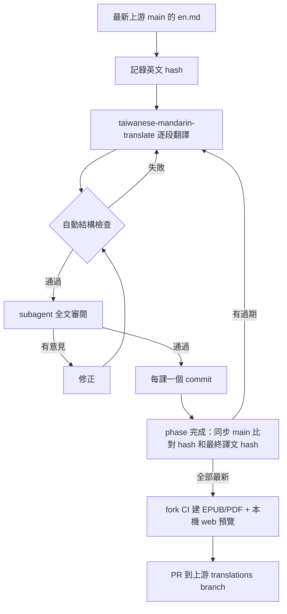
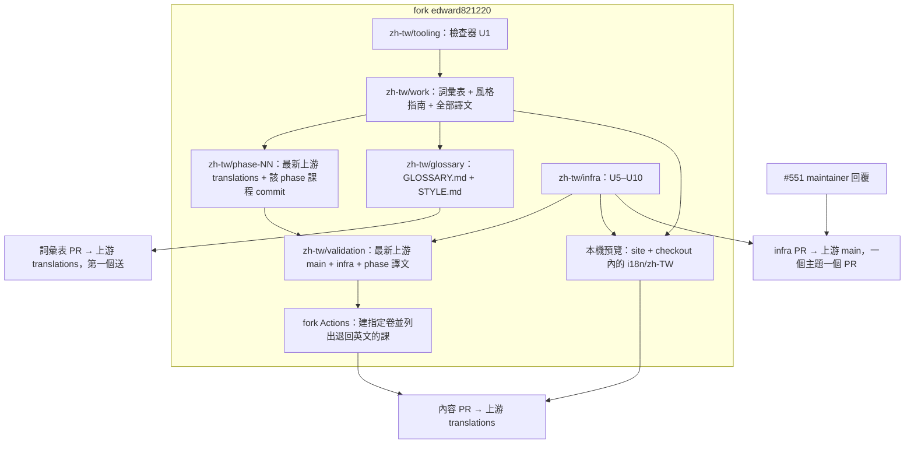

# 繁體中文（zh-TW）全書翻譯 - Plan

## Goal Capsule

- **Objective：** 臺灣讀者可以在官方網站、EPUB、PDF 讀到 AI Engineering from Scratch 全部 523 課的繁體中文版。
- **Means：** AI 依 taiwanese-mandarin-translate skill 逐課翻譯，再由 subagent 全文審閱並通過結構檢查器（KTD1、KTD2、KTD4）。譯文 PR 到上游 `translations` branch。web 與書籍的缺口另外送 infra PR 到 main 補上（KTD5–KTD8）。
- **Product authority：** 範圍、品質標準、發布順序由使用者（edward821220）決定。上游 maintainer（rohitg00）決定是否合併。這份計畫的 Product Contract 優先於 Planning Contract，Planning Contract 又優先於各 unit。
- **Execution profile：** 長時間的內容工作，加上少量工具與 infra 程式碼。內容一課一課做；工具和 infra 先在 fork branch 開發並驗證，再送上游。
- **Stop conditions：**
  - 某課審閱 2 輪仍未通過：停下這一課，交給使用者決定。
  - maintainer 在 #551 拒絕某項 infra：停止那一項 PR，回報使用者。內容 PR 和 fork 上的書籍建置照常進行。
  - 檢查器對同一類寫法反覆誤報：先修檢查器，不要為了通過檢查去改譯文。
  - 證據顯示某個 session-settled 決策行不通：停下並回報，不要自行改掉。
- **Who finishes：** AI 代理執行各 unit，負責送出 PR。使用者已授權發布，PR 不必逐一請示，但每個 PR 的說明都要依 R8 標示 AI 翻譯與 AI 審閱。
- **Open blockers：** U5–U10 送上游之前，要先等 maintainer 回覆 #551（R15）。這不影響 U1–U4 開工。

---

## Product Contract

**Product Contract preservation：** changed: R9（使用者同意段內句子可重組）、新增 R26（使用者同意譯名變更要全書回溯）、R11（補上同一章節的英文變體寫法，不改變範圍）。restructured, no scope change: R1、R2 指明來源是上游 main；R25 依上游 CI 的實際觸發範圍說明證據來源。另外依程式碼證據更正 Problem Frame 對錨點的描述；Outstanding Questions 已在 Planning Contract 內解決，因此移除。

### Summary

以最新 main 的英文為來源，逐課用 taiwanese-mandarin-translate skill 翻譯，原書格式與架構一律不動。每課都經過自動結構檢查和 subagent 全文審閱。
內容分 phase PR 到上游 `translations` branch，每課一個 commit，並記錄英文來源的 hash。另外送幾個小型 infra PR 到 main，補齊 web 切換器、繁中 EPUB/PDF、介面字串和 README。
所有東西都先在自己的 fork 用 GitHub Actions 驗證。先用 Vol 1（phase 00–02）把三個平台完整跑一遍，再擴大到其他卷。

### Problem Frame

`languages.json` 早就登記了 zh-TW，但上游沒有任何繁中內容。現有的自動翻譯用 NLLB-200，就算在簡中版，品質也很差：perceptron 被譯成「感覺器」、weights 被譯成「重量」、backpropagation 被譯成「反擴散」、Ship It 被譯成「運送它」。臺灣讀者目前沒有可以用的版本。

上游規定課程譯文不能 commit 到 main，只能 PR 到 `translations` branch。#439 就是因為這條規定被關，maintainer 也指名 #457 為範例。網站和書籍都在執行時才讀這個 branch。

就算有人交出高品質的繁中譯文，三個平台目前也接不起來：

- 網站切換器只顯示 `ci:true` 的語言。可是一開 `ci:true`，英文每次改版都會自動跑 NLLB，把人工譯文蓋掉。
- `build_book.py` 用英文標題 `## Ship It`、`## Exercises` 辨識章節。網站也用英文標題加區塊樣式、產生「學習目標」框，並用 `#the-concept`、`#build-it`、`#use-it`、`#ship-it`、`#key-terms` 決定小測驗放在哪裡。
- 網站的 `slugify` 只保留 a–z 和 0–9。中文標題的錨點會退回成 `section-N`：目錄還能跳轉，但錨點不好讀，標題一變動也就不穩定。
- `build-book.yml` 從來不建 `--lang` 翻譯版，PDF 環境也沒有 CJK 字型和 xeCJK。書籍外框寫死了 `lang: en`、`toc-title: Contents`，說明框也都是英文。
- 網站讀取譯文和介面字串的網址寫死在 `rohitg00`，fork 沒辦法預覽自己的譯文。

規模約 92 萬英文字，翻成中文大約 150 萬字以上。整個工作會持續數個月，這段期間 main 會不斷更新。

### Key Decisions

- **做上游官方版，fork 只用來驗證。** 內容走 `translations` branch PR，缺口用 infra PR 補到 main。Governs R13–R22. (session-settled: user-approved — chosen over 只在 fork 發布、只送內容不碰 infra: 讀者要在官方網站和書籍拿到繁中版，並且遵守上游貢獻規則)
- **從頭開始，不沿用 #550 的任何內容。** #550 是先前已關閉的嘗試，它的 style guide 和詞彙表也一律不用。Governs R5, R6. (session-settled: user-directed — chosen over 沿用 #550 的 52 課與 style.md: 使用者判斷該 PR 有問題)
- **一律以 taiwanese-mandarin-translate skill 翻譯，不得改變原書格式與架構。** 這是使用者直接指定的規則。Governs R4, R9–R12.
- **每課做全文審閱，由翻譯 AI 呼叫獨立的 subagent 執行。** Governs R7, R8. (session-settled: user-directed — chosen over 每課重點審、每 phase 抽樣: 要全文品質，審閱改由 AI 負責)
- **固定章節標題採「English｜中文」雙語。** 保留英文，slug 和 `startswith` 判斷就照常成立，web 與書籍都不必改程式。Governs R11. (session-settled: user-approved — chosen over 保留英文原標題、純中文標題加上游改 code: 三個平台零修改，讀者也看得到中文)
- **術語採混合式。** Governs R5. (session-settled: user-approved — chosen over 中文優先、英文優先: 貼近臺灣業界的實際用法)
- **段落一一對應，段內句子可以重組。** Governs R9. (session-settled: user-approved — chosen over 逐句對應: 依語意翻譯才自然，逐句對應容易帶翻譯腔)
- **譯名變更要回溯全書。** Governs R26. (session-settled: user-approved — chosen over 只管新翻的課: 詞彙表一致不等於整本書一致)
- **範圍包含介面字串、README、書籍外框；小測驗與互動圖表延後。** Governs R19, R21, R22. (session-settled: user-approved — chosen over 全部一起做: quiz 和 figures 都需要上游先同意新機制)
- **PR 說明如實標示 AI 翻譯與 AI 審閱。** maintainer 看不懂中文，標成人工審閱會誤導他。Governs R8.

### Requirements

**來源與同步**

- R1. 每課以撰寫當下最新上游 `rohitg00/ai-engineering-from-scratch:main` 的 `phases/<phase>/<lesson>/docs/en.md` 為唯一來源，並記錄這個檔案的 sha256，格式與上游翻譯 cache 相同。
- R2. 每個內容 PR 送出前，都要對最新上游 main 重新比對 hash。英文已經改過的課，必須在同一個 PR 內補翻並更新 hash，否則不送出。
- R3. 英文改版後，要能列出已發布但已過期的繁中課，作為後續補翻 PR 的清單。

**翻譯品質**

- R4. 每課譯文都以 taiwanese-mandarin-translate skill 產出：臺灣華語的技術文件語域、全形標點、中英文之間加半形空格，不得出現簡體字或中國用語，也不寫「進行…操作」、「通過…來」這類翻譯腔。
- R5. 術語採混合式：臺灣業界慣用英文的詞保留英文（如 token、prompt、agent）；有通行譯名的用中文，並在每課第一次出現時附上英文，例如「反向傳播（backpropagation）」。中文譯名以國家教育研究院樂詞網為參考。
- R6. zh-TW 詞彙表是術語的唯一權威。新術語要先加入詞彙表才能使用，同一個術語全書只用一種譯法。
- R7. 每課翻完後，由翻譯 AI 呼叫一個 context 獨立的 subagent，對照英文逐段做全文審閱，檢查正確性、完整性、臺灣用語和詞彙表一致性。技術事實錯誤、核心資訊遺漏／顛倒、受保護內容變動及其他 P0/P1 findings 必須修正；只有 P2 風格潤飾時可記錄為非阻擋建議，不要求再審。
- R8. 每個 PR 的說明都要如實寫明「AI 翻譯（taiwanese-mandarin-translate）＋ AI subagent 全文審閱」，並附上來源 main commit 和自動檢查結果。
- R26. 修改既有詞條的譯法時，要在同一個 PR 或緊接的修正 PR 裡，把所有已發布課程中的舊譯法一併改掉。

**格式與架構不變**

- R9. 譯文不得改變原書的格式與架構：標題層級和順序、段落、清單項目、表格的欄與列、區塊的種類和位置、圖片、連結目標，都要和英文一一對應。同一段落內的句子可以合併、拆開或調整順序，但不得增減資訊。
- R10. 以下內容逐字保留：程式碼區塊、行內程式碼、數學式、URL、檔案路徑、指令、識別碼、figure 區塊，以及 metadata header（`**Type:**` 到 `**Time:**`）。Mermaid 圖只翻節點標籤文字，語法和節點 id 不動。
- R11. 固定章節標題一律寫成「English｜中文」，英文部分照原文逐字保留，例如 `## Build It｜動手實作`。固定章節包括 Learning Objectives、The Problem、The Concept、Build It、Use It、Ship It、Exercises、Key Terms、Further Reading，以及原文中這些章節的變體寫法（`## Problem`、`## Concept`、`## Learning objectives`）。其他標題翻成中文。
- R12. 每課都要通過自動結構檢查，沒通過就不得進 PR。檢查項目：R10 列出的受保護片段逐字一致；標題數量和層級一致；段落、清單、表格的結構一致；沒有命中簡體字或中國用語清單；沒有使用詞彙表標為禁用的譯法。

**交付到上游**

- R13. 譯文提交到上游 `translations` branch，沿用既有路徑和 cache 格式：`i18n/zh-TW/phases/<phase>/<lesson>/docs/zh-TW.md`，加上 `i18n/zh-TW/.cache/<phase>.json` 裡的對應項目。這樣 CI 就算對 zh-TW 執行，也只會跳過，不會覆蓋。
- R14. 一個 phase 一個 PR，PR 內每課一個 commit。commit subject 遵守 conventional commits，長度不超過 72 字元。
- R15. 送 infra PR 之前，先在上游開 issue 和 maintainer 對齊做法（已開 #551），取得同意後才送。

**三平台完整（web）**

- R16. zh-TW 出現在網站的語言切換器，而且 NLLB 不會翻譯或覆蓋 zh-TW 的課程。
- R17. zh-TW 課程的錨點可用且不重複，「On this page」跳轉正常。小測驗位置、學習目標框、區塊樣式都和英文版一樣運作。
- R18. 網站讀取譯文的來源，要依部署所在的 repo 設定決定，讓 fork 和本機預覽都能看到自己的譯文。
- R19. zh-TW 介面字串可以發布，固定譯名用 overrides 鎖定。

**三平台完整（EPUB / PDF）**

- R20. build-book workflow 可以指定語言建置翻譯版，並自動取得 `translations` branch 上的譯文。PDF 環境要有繁中字型，Mermaid 圖的渲染也包括在內。
- R21. 繁中版書籍的外框文字全部是繁中：語言標記、書名副標、目錄標題、卷次、部標題、Continue Online 框、Ship It 替換框、圖表提示、前言頁、封面標籤。

**README**

- R22. 透過上游的 README 翻譯機制，新增人工品質的 `i18n/zh-TW/README.md`，並通過 `python3 scripts/build_readme_i18n.py --check`。

**驗證與推進順序**

- R23. 每個內容 PR 和 infra PR 送出前，都要在自己的 fork 跑 GitHub Actions，建出受影響卷的 zh-TW EPUB 和 PDF，並檢查版面：CJK 字型、換行、程式碼框、表格、圖表，以及 Ship It 和 Exercises 的替換結果。
- R24. 先用 Vol 1（phase 00–02）把 web、EPUB、PDF 三個平台完整跑一遍，修好流程和檢查器之後，才擴大到其他卷。
- R25. 每個 PR 都要通過上游與它相關的既有檢查並附上證據；上游 PR CI 跑不到的部分（送往 `translations` 的內容 PR、書籍建置的變更），以 R12、R23 的檢查結果和 fork Actions 紀錄補上。

### Key Flows

- F1. 單課翻譯
  - **Trigger：** 開始處理某一課。
  - **Steps：** 從最新上游 main 讀完整課並記下來源 hash → 先補齊該課用到的詞彙表詞條 → 依 skill 逐段翻譯 → 結構檢查 → subagent 全文審閱 → 修正並複審 → 對最後譯文再做結構檢查與審閱 → 記錄來源和譯文 hash → commit。任何來源或譯文改動都會使之前的審閱結果失效。
  - **Covered by：** R1, R4–R12, R14, R26
- F2. 送出一個 phase 的內容 PR
  - **Trigger：** 這個 phase 的每一課都完成 F1。
  - **Steps：** 同步最新上游 main 並比對 hash，過期的課回到 F1 → 在 fork 建出該卷的 EPUB/PDF 並檢查版面 → 本機預覽 web → PR 到上游 `translations`，附上來源 commit、逐課來源與譯文 hash、檢查和審閱結果、AI 標示。
  - **Covered by：** R2, R8, R13, R23, R25
- F3. 英文改版或譯名變更後回溯
  - **Trigger：** main 上某課的 `en.md` 改了，或詞彙表有既有詞條的譯法被修改。
  - **Steps：** 列出過期的課，或命中舊譯法的課 → 補翻或修正 → 依 F1 檢查與審閱 → 送修正 PR。
  - **Covered by：** R3, R26



### Acceptance Examples

- AE1. **Covers R11, R17.** **Given** 一課有 `## Ship It`，**when** 翻譯完成，**then** 標題是 `## Ship It｜交付成果`。建書時這一節會被換成 repo 連結框；網站上的 slug 是 `ship-it`，中測驗出現在 Use It 之前。
- AE2. **Covers R2, R3.** **Given** 某課翻好之後 main 又改了 `en.md`，**when** 準備送 PR，**then** hash 比對會標出這一課，補翻並更新 hash 之前 PR 不得送出。
- AE3. **Covers R10, R12.** **Given** 譯文的程式碼區塊和英文差一個字元，**when** 跑檢查，**then** 檢查失敗，這一課不得進 PR。
- AE4. **Covers R4, R7.** **Given** subagent 審閱時抓到「數據」或「通過…來」，**when** 審閱結束，**then** 改成「資料」、「透過」，複審通過後才能 commit。
- AE5. **Covers R16.** **Given** zh-TW 已經出現在切換器，**when** main 上的 `en.md` 變更觸發 translate workflow，**then** workflow 不翻譯也不改動任何 zh-TW 檔案。
- AE6. **Covers R5, R6.** **Given** 某課第一次出現 backpropagation，**when** 翻譯，**then** 第一次寫成「反向傳播（backpropagation）」，之後只寫「反向傳播」，而且譯名和詞彙表一致。
- AE7. **Covers R26.** **Given** 詞彙表把某術語的譯法從 A 改成 B，並把 A 列入禁用，**when** 對全部已發布的課跑檢查，**then** 所有用到 A 的課都被列出，修正後才算完成。

### Success Criteria

- 523 課全部在上游 `translations` branch 發布，每課的英文 hash 都和發布當時的上游 main 一致。
- 每課的結構檢查都是零失敗，subagent 審閱也都留下通過紀錄。
- fork CI 能建出 6 卷 zh-TW 的 EPUB 和 PDF；抽查頁面沒有缺字（豆腐字）、沒有被裁切，替換框也都正確。
- 官方網站切到 zh-TW 後，課程、介面字串、錨點和小測驗位置都正常。

### Scope Boundaries

- 延後：小測驗 `quiz.json`、互動圖表（`site/figures-*.js`）的翻譯。兩者都需要上游先同意新機制。
- 延後：`glossary/terms.md`、學習路徑頁等非課程頁面的內文；目錄頁與側欄上的英文課名（來自 `site/data.js`）。
- 不做：certifications 與 manuals。上游政策規定它們只出英文，不進翻譯流程。
- 不做：程式碼、程式碼註解、`outputs/` 底下的 skill 或 prompt 檔，以及 `quiz.json` 原檔。這些都維持英文。
- 不做：修改簡中（zh）或其他語言既有的譯文。
- 不做：引用或沿用 #550 的任何內容。

### Dependencies / Assumptions

- infra PR（U5–U10）需要 maintainer 同意。如果他拒絕，web 和書籍外框會卡住，但內容 PR 和 fork 上的 EPUB/PDF 不受影響。
- zh-TW 在 U5 合併之前一直不是 `ci:true`，所以 NLLB 不會碰 zh-TW。
- 上游 `translations` branch 的路徑和 cache 格式維持現狀。
- fork `edward821220/ai-engineering-from-scratch` 已經建立。它的 Actions 必須手動啟用，`translate.yml` 也必須在 fork 裡停用。
- CodeRabbit 單一 PR 上限 300 個檔案。最大的 phase 19 有 85 課，加上 cache 不會超過。

### Sources / Research

- `docs/i18n.md`、`languages.json`、`.github/workflows/translate.yml`、`.github/workflows/build-book.yml`；英文原稿以 `rohitg00/ai-engineering-from-scratch:main` 為準
- `scripts/translate_lessons.py`：`source_hash`、`cache_path`、`NLLB_INLINE`/`PROTECT` regex、cache 命中時跳過（`cache.get(rel) == h`）
- `scripts/build_book.py`：`_lesson_source`、`transform_lesson`（`## Ship It` 和 `## Exercises` 的判斷、figure 和 mermaid 提示）、`continue_box`、`how_to_use`、`assemble`（Part 標題）、`metadata`、`render`（`toc-title`、CJK 字型候選）
- `book/titlepage.tex`、`book/theme.tex`：封面和章名的英文標籤
- `site/lesson.html`：`slugify`、`ensureHeadingId`（`section-N` 退路）、`translatedUrl` 寫死 `rohitg00`、依英文標題放置小測驗
- `site/ui-i18n.js`：`TRANSLATIONS_BASE` 寫死 `rohitg00`
- `site/content-source.js`：本機預覽讀 `../`，部署時讀 `__AIFS_SOURCE`
- `site/build.js`：`langs.js` 只輸出 `source` 或 `ci` 的語言、`sourceRepository()`
- `scripts/translate_ui_strings.py`：override、已發布譯文、模型三者的優先順序
- `scripts/readme_translations.py`、`scripts/build_readme_i18n.py`
- 上游 #439（關閉理由）、#457（`translations` branch 範例和人工修正被覆蓋的風險）、#471（`"lessons": "human"` 先例）、#531（尚未合併，會改到 `scripts/readme_translations.py`）、#551（本計畫的對齊 issue）
- [Pandoc User's Guide](https://pandoc.org/MANUAL.html)：LaTeX PDF 引擎支援 `CJKmainfont`、`CJKsansfont`、`CJKmonofont`；`lang=zh-TW` 會選用中文文件類別並載入 xeCJK。
- [Ubuntu 24.04 `texlive-lang-chinese`](https://packages.ubuntu.com/noble/texlive-lang-chinese)：提供中文 XeLaTeX 巨集。
- [GitHub Docs：Manually running a workflow](https://docs.github.com/en/actions/using-workflows/manually-running-a-workflow)：`workflow_dispatch` 的 workflow 必須先存在 default branch，才能在另一個 ref 執行。
- [Ubuntu 24.04 `fonts-noto-cjk`](https://packages.ubuntu.com/noble/fonts-noto-cjk)：包含 `Noto Sans CJK TC`、`Noto Serif CJK TC`、`Noto Sans Mono CJK TC`。
- `~/.agents/skills/taiwanese-mandarin-translate/SKILL.md`

---

## Planning Contract

### Key Technical Decisions

- KTD1. **翻譯單位是整課，由當前 session 的 AI 代理執行，不呼叫 `translate_lessons.py --provider anthropic`。** 先讀完整課再逐段翻譯，才能套用 skill、詞彙表和上下文；一次性的 API 呼叫做不到。Governs R4, R5, R9.
- KTD2. **檢查器只對精確的訊號判定失敗，需要看上下文的交給審閱。** 判定失敗的項目：受保護片段、結構對齊、簡體字清單、高確定性的中國用語清單、詞彙表的禁用譯法。「首次出現有沒有附英文」、語氣，以及「配置」這類兩岸都有正當用法的詞，列入 subagent 的審閱清單。這樣誤報少，檢查器才可以當成硬性門檻。Governs R10, R12.
- KTD3. **詞彙表是一張 markdown 表，欄位為：English、譯法、保留英文、禁用、備註。** 檢查器直接解析這張表。譯名變更的做法：把舊譯法移到「禁用」欄，再對全書跑一次檢查，命中的課就是要回溯修正的課，不需要另外寫掃描工具。初版詞彙表的來源有三個：`glossary/terms.md` 的術語標題、各課 `## Key Terms` 段落、各課粗體術語，再依樂詞網和 R5 的規則定稿。Governs R6, R26.
- KTD4. **審閱用每課一個全新 context 的 subagent。** 輸入是 en.md、譯稿、`i18n/zh-TW/STYLE.md`、`i18n/zh-TW/GLOSSARY.md` 和檢查器報告；輸出是逐段問題清單和最終判定。最多 2 輪：若首輪沒有 P0/P1 blockers，P2 潤飾記錄後即可通過；有 blockers 則修正並複審，第二輪仍有 blocker 才交給使用者。每課 PR 證據表記錄來源 hash、最後譯文 hash、檢查結果、審閱結果、輪數和非阻擋 P2；來源或譯文改動會使此前 hash 證據失效。Governs R7, R8.
- KTD5. **在 registry 加一個布林欄位標記「人工審定的語言」，暫定名稱 `reviewed`，最後名稱依 maintainer 意見調整。** 標了這個欄位的語言會出現在切換器，不會進入 NLLB 課程翻譯 matrix，而且 `translate_lessons.py` 會拒絕翻譯它。介面字串 job 使用獨立的 `ui-langs` matrix，納入 `ci:true` 或 `reviewed:true` 的語言；reviewed 語言不載入模型，缺漏字串保留英文。只加一個欄位，就能擋住自動和手動觸發的課程翻譯覆蓋。Governs R16, R19.
- KTD6. **網站讀取譯文時，本機預覽優先讀 checkout 裡的 `i18n/`；遠端則用 `__AIFS_SOURCE` 的 owner/repo 加固定的 `translations` ref。** 英文內容來源的 `repoUrl` 會讀 main 或預覽 ref，不能直接拿來抓翻譯；因此 `AIFSContentSource` 提供獨立的翻譯 URL helper，同時服務 lesson markdown 和 UI 字典。checkout 內現有譯文即使較舊也優先顯示；送 PR 前的 source-hash 檢查才是新鮮度門檻。部署時 `__AIFS_SOURCE` 由 `site/build.js` 依 Vercel 提供的 repo owner/slug 產生；未部署的 fork 改用本機預覽驗證。`slugify` 不改：雙語固定標題保留英文前綴，其餘中文標題使用 `section-N` 退路，目錄仍可跳轉。Governs R17, R18.
- KTD7. **書籍外框文字改用每種語言一個字串表 `book/i18n/<lang>.json`，英文預設值留在程式碼裡，缺漏的 key 退回英文。** 非英文建置結束時列出退回英文的外框 key 和課程路徑，讓缺譯看得見，又不會在上游之後新增英文字串時讓建置失敗。英文版的組裝結果必須和現在逐位元組相同。卷名、卷副標、phase 標題也放進同一張表。封面和章名的標籤，用 `book/titlepage.tex` 既有的 `@X@` 佔位符機制替換。CJK 語言另外設定 `CJKmonofont`，讓 `\ttfamily` 的中文也有字型。Governs R21.
- KTD8. **build-book workflow 新增 `workflow_dispatch` 輸入 `lang`、`volume` 和 `translations_ref`。** 三者都只透過 env 傳進 shell；`lang` 與 `volume` 要符合 registry 和 `volumes.json`，`translations_ref` 必須通過安全 branch-ref 驗證。CJK 語言才安裝 `texlive-lang-chinese` 和 `fonts-noto-cjk`。push 和 release 時英文建置行為不變。GitHub 要求 `workflow_dispatch` 檔案先存在於 default branch；因此 U9 合併前用 `zh-tw/validation` branch，疊上最新 main、infra 改動與當前 phase 譯文，並保留只匹配此 branch 的 test-only push trigger。workflow 在該 branch 建書時使用同一 branch 作為 `translations_ref`。這個 trigger 只留在 fork 的 validation branch，不進上游 PR；正式版合併後改用 `workflow_dispatch` 驗證。Governs R20, R23.
- KTD9. **工具和 infra 先在 fork branch 開發。** 檢查器、詞彙表格式、infra 變更都先放在 fork，拿來驗證 Vol 1。#551 有回覆之後，infra 才拆成一個主題一個 PR 送上游，讓 maintainer 可以分開接受。檢查器暫時不送上游。Governs R15, R23.
- KTD10. **每課 commit subject 採 `docs(i18n): zh-TW / NN/LL`。** `NN/LL` 是唯一的 phase/lesson 編號，沿用上游翻譯 branch 的 `i18n` scope，並符合 72 字元上限和每課一個 commit 的規則。Governs R14.
- KTD11. **本機用一條 `zh-tw/work` branch 累積詞彙表、風格指南和所有譯文；每個 phase 的 PR branch 從最新上游 `translations` 切出，只帶該 phase 的課程 commit；`GLOSSARY.md` 與 `STYLE.md` 的變更走獨立 PR，且第一個先送。** 這樣多個 phase PR 可以同時開著，不會在詞彙表上互相衝突，檢查器也永遠讀得到完整詞彙表；maintainer 合併較慢時，翻譯仍能往下推進。Governs R6, R13, R14.

### High-Level Technical Design

工作用幾條 branch 隔開（KTD9、KTD11）。這張圖說明它們的相依關係和驗證路徑：



檢查器比對英文和譯文的方式如下（僅說明方向，不是實作規格）：

```text
把兩份文件各自切成區塊序列：heading(level,text) | paragraph | list_item | table(rows,cols) | fence(info,body) | blank
要求：兩邊區塊數和種類序列相同
  heading：level 相同；英文是固定章節時，譯文必須以「原英文｜」開頭
  fence：除了 mermaid，body 必須逐字相同；mermaid 去掉標籤文字後必須相同
  paragraph / list_item：受保護 span 的多重集合相同（inline code、math、URL、link target、image）
  metadata header：該行逐字相同
另外對譯文的散文部分（排除 fence 和 inline code）掃描：簡體字、中國用語、詞彙表禁用譯法
```

### Assumptions

- pandoc 3.x 搭配 babel `chinese`、`provide=*`、xeCJK，在 Ubuntu 24.04 runner 上可以建出 PDF。這條路徑從來沒有在 CI 跑過，所以 U9 要拿 Vol 1 盡早實際跑一次。
- Mermaid CLI（Chromium）只要系統裝了 `fonts-noto-cjk`，就能渲染中文標籤。
- 審閱 subagent 由 pi-subagents 執行，使用者已授權。

### Risks & Dependencies

| 風險 | 緩解方式 |
|---|---|
| maintainer 拒絕 `reviewed` 欄位，zh-TW 就上不了網站切換器 | 內容 PR 照送；書籍靠 fork 建置；回報使用者，請他決定是否改用其他方案 |
| xelatex 中文 PDF 失敗或版面有問題 | U9 先用 Vol 1 實際跑 fork CI；有問題的話在 U8、U9 修，再擴大到其他卷 |
| 數個月內英文持續變動，PR 開出後到合併前也可能再變 | 每個 PR 送出前做 R2 hash 比對；開出後才過期的課由 U11 的定期過期清單接手補翻 |
| U5 一合併就會觸發 `translate.yml` | registry 旗標、matrix 拆分和 `translate_lessons.py` 的拒絕在同一個 PR 落地，合併前由測試證明 zh-TW 不在課程 matrix（AE5）；已發布的課有 cache 項目，是第二層保護 |
| U5 合併後切換器就出現 zh-TW，尚未翻譯的課會顯示英文 | 這是上游對所有語言既有的退回行為；依 R24 先完成 Vol 1，再依卷推進 |
| 上游之後新增介面字串或書籍外框字串 | 依 KTD5、KTD7 顯示英文，不讓上游 CI 失敗；U11 每卷完成時補上缺漏的 zh-TW 字串 |
| maintainer 合併內容 PR 很慢 | KTD11 讓多個 phase PR 可以同時開著，翻譯不必等合併 |
| 上游 bot 頻繁推 `translations` | zh-TW 路徑只有我們會改，PR 不會衝突；送出前 rebase 到最新 `translations` |
| #531 會改到 `scripts/readme_translations.py` | U10 送出前 rebase 到最新 main 並解衝突 |
| 檢查器誤報拖慢進度 | 依 Stop conditions 先修檢查器；中國用語清單只收高確定性的詞（KTD2） |
| token 和時間成本很高 | 先用 3 課試翻估出每課成本，回報使用者後再擴大 |

### Sequencing

1. U1 → U2 → U3（試翻 3 課）
2. 在 fork branch 完成 U8 → U9、U5 → U6，以及 U7，用來驗證三個平台
3. 先送詞彙表 PR，再送 U4（Vol 1 的 3 個內容 PR，可以同時開著）
4. #551 有回覆後送 U5–U10 的 infra PR
5. U11 依卷推進 Vol 2–6，並處理回溯

---

## Implementation Units

| U-ID | 標題 | 主要檔案 | 相依 |
|---|---|---|---|
| U1 | 結構檢查器與 hash 工具 | `scripts/check_translation.py` | — |
| U2 | 詞彙表與風格指南 | `i18n/zh-TW/GLOSSARY.md`, `i18n/zh-TW/STYLE.md` | U1 |
| U3 | 單課流程與試翻 3 課 | `i18n/zh-TW/phases/0{0,1,2}-*/*/docs/zh-TW.md` | U1, U2 |
| U4 | Vol 1 完成並送內容 PR | `i18n/zh-TW/phases/00..02/**`, `i18n/zh-TW/.cache/*.json` | U3, U5, U6, U7, U8, U9 |
| U5 | registry `reviewed` 欄位 | `languages.json`, `site/build.js`, `scripts/translate_lessons.py`, `scripts/translate_ui_strings.py`, `.github/workflows/translate.yml` | — |
| U6 | zh-TW 介面字串 overrides | `site/ui-strings.json`, `site/ui-i18n.js`, `site/lang-picker.js` | U5 |
| U7 | 網站譯文來源 | `site/content-source.js`, `site/header.js`, `site/lesson.html`, `site/ui-i18n.js` | — |
| U8 | 書籍外框在地化 | `scripts/build_book.py`, `book/i18n/zh-TW.json`, `book/titlepage.tex`, `book/theme.tex` | — |
| U9 | build-book 翻譯版建置 | `.github/workflows/build-book.yml` | U8 |
| U10 | 繁中 README | `scripts/readme_translations.py`, `README.md`, `i18n/zh-TW/README.md` | — |
| U11 | Vol 2–6 推進與回溯 | `i18n/zh-TW/phases/03..19/**` | U4 |

### U1. 結構檢查器與 hash 工具

- **Goal：** 一支只用標準函式庫的腳本，有三種模式：逐課檢查譯文、寫入 hash cache、列出過期與缺漏的課。
- **Requirements：** R1, R2, R3, R10, R11, R12, R26；AE2, AE3, AE7
- **Dependencies：** 無
- **Files：** `scripts/check_translation.py`, `scripts/test_check_translation.py`（放在 fork branch `zh-tw/tooling`）
- **Approach：**
  1. 從 `translate_lessons` 重用 `source_hash` 和 inline regex（`INLINE_CODE`、`INLINE_MATH`、`IMAGE`、`LINK`、`BARE_URL`），確保 hash 和受保護片段規則與上游一致。cache 路徑依 `translations-root/i18n/<lang>/.cache/<phase>.json` 組成，cache key 維持 `phases/<phase>/<lesson>/docs/en.md`。
  2. 區塊對齊與比對規則依 High-Level Technical Design（KTD2）。固定章節標題清單取 R11。
  3. 詞彙表依 KTD3 的欄位解析，簡體字和高確定性的中國用語清單寫在腳本內，作為常數。
  4. 參數：`--lang`、`--source-root`（最新上游 main checkout，預設為腳本所在 repo）、`--translations-root`（譯文 branch worktree）、`--phase`、`--only`，以及 `--stale`、`--write-cache` 兩種模式。逐課輸出 source hash、translation hash、檢查結果；有任何失敗就以非零值結束。
- **Patterns to follow：** `scripts/translate_lessons.py` 的 `lesson_docs()`、`out_path()`、`source_hash()`；`scripts/test_translate_workflow.py` 的 unittest 寫法
- **Test scenarios：**
  - 結構完全對齊的譯文通過檢查。
  - Covers AE3. 程式碼區塊和英文差一個字元時失敗，報告指出是第幾個區塊。
  - 行內程式碼被改動或刪除時失敗。
  - 數學式 span 被改動時失敗。
  - 連結文字翻譯了但 target 沒變時通過；target 被改時失敗。
  - metadata header 的 `**Time:** ~60 minutes` 被翻成中文時失敗。
  - mermaid 只改節點標籤時通過；改了節點 id 或箭頭時失敗。
  - figure 區塊內容被改時失敗。
  - `## Ship It｜交付成果` 通過；`## 交付成果` 失敗；`## Learning objectives｜學習目標` 也通過。
  - 標題數量或層級不一致時失敗。
  - 同一段內兩句合併成一句時通過；段落數少一段時失敗。
  - 清單項目數或表格欄、列數不一致時失敗。
  - 散文中出現「这」時失敗；出現「數據」時失敗；同樣的字出現在行內程式碼裡則不判定。
  - Covers AE7. 詞彙表禁用欄有「詞元」時，含「詞元」的課失敗，輸出列出課程路徑和命中的禁用詞。
  - 全量詞彙表檢查可依禁用詞列出所有需回溯修正的課，不能只回報一般檢查失敗。
  - Covers AE2. `--stale` 能列出 cache hash 和目前 en.md 不同的課，也能列出缺譯文的課。
  - `--write-cache` 寫入的值等於 `translate_lessons.source_hash(en.md)`；cache 寫入 `translations-root/i18n/<lang>/.cache/<phase>.json`，key 和上游格式完全相同。
- **Verification：** 測試全數通過；從最新 main checkout 對上游現有 zh 譯文 worktree 跑一次，會回報 NLLB 改動過的結構問題，證明檢查器能抓到問題。

### U2. 詞彙表與風格指南

- **Goal：** 建立初版 zh-TW 詞彙表，以及把 skill 和本計畫規則綁在一起的風格指南兼審閱清單。
- **Requirements：** R4, R5, R6, R11, R26；AE6
- **Dependencies：** U1（詞彙表格式）
- **Files：** `i18n/zh-TW/GLOSSARY.md`, `i18n/zh-TW/STYLE.md`（在 `zh-tw/work` 維護，依 KTD11 以獨立 PR 送上游）
- **Approach：**
  1. 候選術語依 KTD3 從三個來源抽出，依出現次數排序，先定案 Vol 1 會用到的詞。
  2. `STYLE.md` 引用 taiwanese-mandarin-translate skill，不重寫 skill 的內容，只記錄本專案的差異：R5 的混合式規則、R9 的段落規則、R11 的雙語標題對照（`Learning Objectives｜學習目標`、`The Problem｜問題`、`The Concept｜核心概念`、`Build It｜動手實作`、`Use It｜實際應用`、`Ship It｜交付成果`、`Exercises｜練習`、`Key Terms｜關鍵術語`、`Further Reading｜延伸閱讀`；變體標題 `Learning objectives｜學習目標`、`Problem｜問題`、`Concept｜核心概念`），以及 KTD2 留給審閱者判斷的項目。
  3. `STYLE.md` 最後一節是審閱清單，subagent 依這份清單審閱（KTD4）。
- **Test scenarios：**
  - U1 的解析器讀得進 `GLOSSARY.md`，讀到的詞條數等於表格列數。
  - 詞彙表中「保留英文」的詞條，禁用欄要列出常見的中文誤譯（例如 token 禁用「詞元」、「令牌」）。
- **Verification：** 對試翻的 3 課跑 U1，詞彙表沒有解析錯誤，雙語標題對照也被檢查器認得。

### U3. 單課流程與試翻 3 課

- **Goal：** 用 F1 的完整流程試翻 3 課，校正詞彙表、檢查器和審閱清單，並估出每課的成本。
- **Requirements：** R1, R4–R12, R14；F1；AE1, AE4, AE6
- **Dependencies：** U1, U2
- **Files：** `i18n/zh-TW/phases/00-setup-and-tooling/01-dev-environment/docs/zh-TW.md`, `i18n/zh-TW/phases/01-math-foundations/01-linear-algebra-intuition/docs/zh-TW.md`, `i18n/zh-TW/phases/02-ml-fundamentals/01-what-is-machine-learning/docs/zh-TW.md`，以及 `i18n/zh-TW/.cache/<phase>.json`（課名以實際目錄為準）
- **Approach：**
  1. 先確認課內所有必要術語都已在詞彙表定稿，再依 KTD1 翻譯；依 KTD4 審閱，最多 2 輪。
  2. 每輪修正後重新跑檢查與審閱；無 P0/P1 blocker、且最終 checker 零失敗的版本才可提交。只有 P2 建議時不開新審閱輪，記錄後繼續。來源 en.md 或譯文任何字元改變，都要重新檢查、審閱並更新對應 hash。
  3. 每輪問題歸類為規則不清（改 `STYLE.md`）、詞彙缺漏（改 `GLOSSARY.md`）或檢查器誤報（改 U1）。
  4. 記錄每課花的時間和審閱輪數，回報給使用者。
- **Execution note：** 3 課都要通過 U1 和審閱，並在本機和 fork 驗證過三個平台之後，才能開始 U4。
- **Test expectation：** none -- 這是內容產出，品質門檻由 U1 和 subagent 審閱負責。
- **Verification：** 3 課的 U1 檢查零失敗；審閱沒有未解決的 P0/P1 blockers，P2 備註留存；使用者拿到成本估算。

### U4. Vol 1 完成並送內容 PR

- **Goal：** 翻完 phase 00–02 共 52 課，每個 phase 送一個 PR 到上游 `translations`。
- **Requirements：** R2, R8, R13, R14, R23, R24, R25；F2；AE2
- **Dependencies：** U3；fork validation branch 上的 U5、U6、U7（web 驗證）與 U8、U9（EPUB/PDF 驗證）
- **Files：** `i18n/zh-TW/phases/00-setup-and-tooling/**`, `i18n/zh-TW/phases/01-math-foundations/**`, `i18n/zh-TW/phases/02-ml-fundamentals/**`, `i18n/zh-TW/.cache/0{0,1,2}-*.json`；詞彙表與風格指南依 KTD11 另送
- **Approach：**
  1. 每課依 F1 在 `zh-tw/work` 完成，commit subject 依 KTD10；phase PR branch 依 KTD11 切出。
  2. 每個 phase 送出前：同步最新上游 main，跑 `--stale` 確認 hash 都是最新；以該 phase PR branch 作為 `translations_ref` 建立完整 foundations 卷。其他 phase 的課依既有規則回退英文，但 U8 列出的退回清單不得包含本 phase 的任何課。檢查輸出版面並在本機預覽抽查課程。
  3. PR 說明包含：來源上游 main commit、R8 的 AI 標示、每課的來源 hash、最後譯文 hash、檢查結果、審閱結果和輪數表、非阻擋 P2 備註、fork 上檢查器與 Actions 執行紀錄的連結，以及 #551 連結。只有最後一版 checker 零失敗且沒有未解決的 blocker，才能登記這列證據。
- **Test expectation：** none -- 內容 PR；門檻是 U1 和 R23 的建置驗證。
- **Verification：** 三個 PR 都已開出；每個 phase PR 的 branch 都可建出 foundations 卷，該 branch 沒有的譯文依 `build_book.py` 現有規則回退英文。00–02 的三個 PR 合併後，同步 fork 的 `translations` branch，再以該 branch 建置完整 foundations 繁中版，U8 的退回英文清單為空；本機預覽中 zh-TW 課程的小測驗位置和學習目標框都正常（AE1）。

### U5. registry `reviewed` 欄位

- **Goal：** 讓標了 `reviewed` 的語言出現在切換器，而且永遠不會被 NLLB 翻譯課程。
- **Requirements：** R16, R19；AE5
- **Dependencies：** 無（送上游前要等 #551 回覆）
- **Files：** `languages.json`, `site/build.js`, `scripts/translate_lessons.py`, `scripts/translate_ui_strings.py`, `.github/workflows/translate.yml`, `docs/i18n.md`, `scripts/test_translate_workflow.py`, `scripts/test_translate_ui_strings.py`, `site/test_build_artifacts.js`
- **Approach：** 依 KTD5 修改：
  1. `langs.js` 的篩選加上 `reviewed`。
  2. `translate.yml` 的 prepare 步驟分別輸出 `lesson-langs` 和 `ui-langs`：課程 matrix 只用 `ci:true` 且非 reviewed 的語言；ui-strings matrix 納入 `ci:true` 或 reviewed 的語言。
  3. `translate_lessons.py` 遇到 reviewed 語言時直接結束並說明原因。
  4. `translate_ui_strings.py` 處理 reviewed 語言時不載入模型，缺漏的 key 保留英文。
  5. zh-TW 加上 `"reviewed": true`。`docs/i18n.md` 補上說明。
  6. 以上全部放在同一個 PR。這個 PR 一合併就會觸發 `translate.yml`，所以 AE5 必須在合併前由測試證明。
- **Patterns to follow：** `translate.yml` 現有的 jq 篩選寫法；`test_translate_workflow.py` 現有的 registry 檢查
- **Test scenarios：**
  - Covers AE5. prepare 步驟在空白輸入下產生的課程 matrix 不含 zh-TW。
  - 手動輸入 `langs=zh-TW` 時，課程 matrix 也不含 zh-TW；`ui-langs` 仍包含 zh-TW。
  - 以 `--lang zh-TW` 執行 `translate_lessons.py` 會以非零值結束，訊息提到 reviewed，而且沒有寫任何檔案。
  - `site/build.js` 產生的 `langs.js` 包含 zh-TW，也仍然包含所有 `ci:true` 的語言。
  - 對 reviewed 語言執行 `translate_ui_strings.py` 時不呼叫翻譯函式；有 override 的 key 用 override，沒有的保留英文。
  - 非 reviewed 語言的行為完全不變（既有測試全部通過）。
- **Verification：** 列出的測試通過；本機 `node site/build.js` 後，切換器出現「繁體中文」。

### U6. zh-TW 介面字串 overrides

- **Goal：** 為 `site/ui-strings.json` 的每個 key 提供 zh-TW override。
- **Requirements：** R19
- **Dependencies：** U5
- **Files：** `site/ui-strings.json`, `site/ui-i18n.js`, `site/lang-picker.js`, `site/header.js`, `site/index.html`, `site/lesson.html`, `site/test_ui_i18n.js`, `site/test_build_artifacts.js`
- **Approach：**
  1. 依 skill、詞彙表和 `STYLE.md` 翻譯每個 key，送出前由 subagent 審閱一次（KTD4）。
  2. `ui-i18n.js` 目前以 `.lang-picker` 整塊跳過翻譯，導致切換器的「LANGUAGE」、篩選欄和清單標籤永遠是英文。改成只跳過語言原生名稱與代碼，切換器其餘控制項照常翻譯。
  3. 切換器按鈕的無障礙名稱目前是動態英文字串，不在 key 表中。改成可翻譯的固定字串加上目前語言名稱的組合，讓讀螢幕器仍能讀出目前語言。
- **Patterns to follow：** `site/ui-strings.json` 既有的 `overrides` 結構
- **Test scenarios：**
  - `node --test site/test_ui_i18n.js` 驗證 override key 都存在於 `keys`。
  - `SKIP_SELECTOR` 不再整塊跳過 `.lang-picker`，但仍跳過語言原生名稱與語言代碼。
  - 切換器的標題、篩選欄 placeholder 與 aria-label、清單 aria-label、按鈕 `aria-labelledby` 引用的固定無障礙字串，都是 `site/ui-strings.json` 裡的 key，且都有 zh-TW override；目前語言名稱仍保留原生寫法。
- **Verification：** 送出前確認 zh-TW overrides 涵蓋當下全部 key；這是一次性檢查，不寫成上游 CI 測試，以免上游之後新增字串時被 zh-TW 卡住，之後的缺漏由 U11 補上。本機預覽切到 zh-TW 後，導覽列、側欄、上一課／下一課與語言切換器都顯示繁中，讀螢幕器讀到的按鈕名稱仍包含「繁體中文」。

### U7. 網站譯文來源

- **Goal：** 本機預覽和 fork 都能讀到自己的 zh-TW 譯文與介面字串。
- **Requirements：** R17, R18
- **Dependencies：** 無
- **Files：** `site/lesson.html`, `site/content-source.js`, `site/header.js`, `site/ui-i18n.js`, `site/test_build_artifacts.js`, `site/test_ui_i18n.js`
- **Approach：** 依 KTD6：
  1. 在 `AIFSContentSource` 增加共用的翻譯 URL helper：本機先讀 `../i18n/<lang>/...`；遠端從 `__AIFS_SOURCE` 取 owner/repo，ref 固定為 `translations`。
  2. `lesson.html` 和 `ui-i18n.js` 都呼叫同一個 helper；本機 checkout 中已有譯文時優先使用，即使遠端較新。
  3. `content-source.js` 目前只有 lesson、assessment、project 等少數頁面載入，但 `header.js` 會在每一頁注入 `ui-i18n.js`；`__AIFS_SOURCE` 也只由少數頁面靜態載入的 `build-meta.js` 提供。讓 `header.js` 先確保 `build-meta.js` 已載入，再載入 `content-source.js`，最後才載入 `ui-i18n.js`，首頁、目錄等頁面的介面字串才會跟著 fork 設定走。
  4. 擴充既有 site 測試；`curriculum.yml` 已經會執行這兩個測試檔，不新增另一個測試入口。
- **Patterns to follow：** `site/content-source.js` 的 `repoUrl`、`rawRepoUrl`；`lesson.html` 的 `fetchRepositoryFile` 主要來源失敗再讀備援的寫法
- **Test scenarios：**
  - 沒有設定 `__AIFS_SOURCE` 時，譯文網址等於現在的 `rohitg00/.../translations/i18n/<lang>/...`，行為不變。
  - `__AIFS_SOURCE.owner` 是 `edward821220` 時，網址改指向該 owner 的 `translations`。
  - 不合法的 owner 值（含 `/` 或 `..`）會退回 `rohitg00`。
  - Covers R18. 本機 checkout 有 `i18n/zh-TW/...` 時，先讀 checkout；遠端有不同譯文時仍顯示 checkout 版本。
  - 在沒有自行引入 `build-meta.js` 或 `content-source.js` 的頁面（例如 `about.html`），`header.js` 依序載入兩者再載入 `ui-i18n.js`，介面字串網址同樣遵循 `__AIFS_SOURCE`。
  - 本機 checkout 缺檔時，會依 helper 的備援規則取得遠端譯文或回到英文。
  - `ui-i18n.js` 和 lesson markdown 使用相同的來源 helper，ref 固定為 `translations`。
- **Verification：** 既有 site source 和 UI i18n 測試通過；把 fork branch 的 `i18n/zh-TW` 解到 checkout 裡、在 repo 根目錄開本機伺服器，就能預覽該 checkout 的繁中內容。

### U8. 書籍外框在地化

- **Goal：** 讓 `--lang zh-TW` 建出的書，外框文字全部是繁中；英文版完全不變。
- **Requirements：** R21；AE1
- **Dependencies：** 無
- **Files：** `scripts/build_book.py`, `book/i18n/zh-TW.json`, `book/titlepage.tex`, `book/theme.tex`, `scripts/test_book_rendering.py`
- **Approach：** 依 KTD7。需要納入字串表的位置：
  1. `metadata`：`lang`、`toc-title`、副標。
  2. `render`：`-V toc-title`、`title-meta`、`CJKmonofont`。
  3. `how_to_use` 和 `series_map`。
  4. `assemble`：Part 標題、「Course phase」。
  5. `transform_lesson`：figure 和 mermaid 提示、Ship It 框、Exercises 那一行。
  6. `continue_box`。
  7. 封面和 `CHAPTER` 標籤。
  8. 卷名、卷副標、phase 標題。
  `## Ship It` 和 `## Exercises` 的判斷不用改，因為雙語標題仍然以英文開頭。
- **Patterns to follow：** `build_book.py` 既有的 `BOOK_LANG`、`_lesson_source`；`test_book_rendering.py` 既有的組裝測試
- **Test scenarios：**
  - `BOOK_LANG=en` 時，`assemble` 的輸出和修改前逐位元組相同（用固定的 fixture lesson 比對）。
  - zh-TW 的 metadata 含 `lang: zh-TW`，目錄標題為繁中。
  - Covers AE1. 一課譯文含 `## Ship It｜交付成果` 時，這一節被換成繁中的 repo 連結框。
  - 譯文含 `## Exercises｜練習` 時，下一行加上繁中的 starter code 說明。
  - 某課沒有 zh-TW 譯文時，該章退回英文原文，其他章不受影響；建置結束時列出每一卷退回英文的課程路徑。
  - 一卷所有課程都有譯文時，退回英文的清單為空。
  - `book/i18n/zh-TW.json` 少了某個 key 時，該處使用英文預設值，建置不失敗，並在輸出中列出缺漏的 key。
  - 封面 `@X@` 佔位符在 zh-TW 下換成繁中標籤，在 en 下維持原文。
- **Verification：** 測試通過；zh-TW 建置回報的缺漏外框 key 為零；fork CI 建出的 Vol 1 PDF 抽查封面、目錄、Part 頁、章末框，都是繁中。

### U9. build-book 翻譯版建置

- **Goal：** 手動觸發 build-book 時可以指定語言和譯文來源 branch，建出含中文字型的 EPUB/PDF。
- **Requirements：** R20, R23
- **Dependencies：** U8
- **Files：** `.github/workflows/build-book.yml`, `scripts/test_book_rendering.py`
- **Approach：** 依 KTD8：
  1. 新增 `workflow_dispatch` 輸入和正式版的安全驗證。
  2. 語言不是 `en` 時，fetch 指定 ref，並用 `git archive` 解出 `i18n/<lang>`。
  3. CJK 語言另外安裝 `texlive-lang-chinese` 和 `fonts-noto-cjk`。
  4. 以 `--lang` 和 `--volume` 建置。
  5. fork 的 `zh-tw/validation` branch 疊上最新 main、U8/U9 與當前 phase 譯文，保留只匹配該 branch 的 test-only `push` trigger 和測試用環境值。這條 trigger 不得帶進上游 PR。
  6. artifact 名稱帶上語言。
- **Patterns to follow：** `translate.yml` 的 prepare 驗證（jq 和 registry 比對）、只透過 env 傳值、`git archive origin/translations` 還原
- **Test scenarios：**
  - workflow 中 `lang`、`volume` 和 `translations_ref` 只以 env 進入 `run` 區塊，沒有直接內插 `${{ inputs.* }}`。
  - `lang` 不在 `languages.json`，或 `volume` 不在 `volumes.json` 時，驗證步驟失敗。
  - `translations_ref` 含空白、`..`、`;`、反斜線、以 `-` 開頭或不符合允許字元時，驗證步驟失敗。
  - push 觸發時的步驟和現在一樣：只建英文 EPUB，不安裝 CJK 套件。
  - CJK 安裝步驟只在 `lang` 為 zh、zh-TW、ja、ko 時執行。
  - pre-merge validation branch 包含 workflow 和當前譯文；push trigger 僅匹配該 branch，`translations_ref` 指向同一 branch，PR 組裝完成卷時缺譯文回退英文。
  - test-only push trigger 只存在 fork 的 validation branch；上游 PR 不含該 trigger。正式版合併到 default branch 後，改以 `workflow_dispatch` 執行。
- **Verification：** 在 fork 推送 validation branch 後，test-only push workflow 建出 foundations EPUB/PDF，log 列出的退回英文課程只來自尚未翻譯的 phase。PDF 沒有豆腐字，Mermaid 圖裡的中文也能正常顯示；送上游的 infra PR 不含 test-only trigger。

### U10. 繁中 README

- **Goal：** 產生人工品質的 `i18n/zh-TW/README.md`，並放進 README 的語言列。
- **Requirements：** R22
- **Dependencies：** 無（送上游前要 rebase，因為 #531 也改到同一個檔案）
- **Files：** `scripts/readme_translations.py`, `README.md`, `i18n/zh-TW/README.md`
- **Approach：**
  1. 在 `TRANSLATIONS` 和 `README_NOTE` 加入 `zh-TW`。翻譯範圍比照目前覆蓋最完整的語言，用 skill 和詞彙表翻譯，並由 subagent 審閱。
  2. 在 README 語言列加上「繁體中文」。
  3. 執行產生腳本。
- **Patterns to follow：** `readme_translations.py` 中 `zh`、`ja` 的條目
- **Test scenarios：**
  - `python3 scripts/build_readme_i18n.py --check` 通過。
  - `python3 scripts/test_translate_workflow.py` 通過（它會 import README 翻譯）。
- **Verification：** 在 GitHub 上看 `i18n/zh-TW/README.md`，圖片和連結都正常。

### U11. Vol 2–6 推進與回溯

- **Goal：** 依卷翻完 phase 03–19，並持續處理英文改版和譯名變更的回溯。
- **Requirements：** R2, R3, R24, R26；F2, F3；AE2, AE7
- **Dependencies：** U4
- **Files：** `i18n/zh-TW/phases/03-deep-learning-core/**` 到 `i18n/zh-TW/phases/19-capstone-projects/**`，以及對應的 `i18n/zh-TW/.cache/*.json`
- **Approach：**
  1. 依 `book/volumes.json` 的卷序推進，每個 phase 一個 PR（F2、KTD11）。
  2. 每卷開始前補齊這一卷的詞彙。
  3. 每卷完成時，對全部已發布的課跑 `--stale` 和全量檢查，有過期或命中禁用譯法的課，就送回溯 PR（F3）。
  4. 該卷所有 phase PR 合併後，同步 fork 的 `translations` branch，在 validation branch 建一次完整全繁中 EPUB/PDF；這次建置不應因缺少課程譯文而回退英文。
  5. 每卷完成時也檢查 `site/ui-strings.json` 與書籍外框字串表有沒有上游新增、卻缺 zh-TW 譯文的 key，有的話送補譯 PR。
- **Test expectation：** none -- 內容 PR；門檻同 U4。
- **Verification：** 523 課都已發布，全量檢查零失敗，`--stale` 回報為空；六卷的完整繁中 EPUB 和 PDF 均建置成功，且 U8 的退回英文清單為空。

---

## Verification Contract

上游 PR CI 的實際範圍：`curriculum.yml` 只在 PR 指向 main 時執行，而且不跑 `test_book_rendering.py`；`build-book.yml` 沒有 pull_request trigger。下表因此把 fork 上的執行紀錄列為 R25 的證據來源。

| 時機 | 指令或動作 | 適用 |
|---|---|---|
| 每課 commit 前 | `python3 scripts/check_translation.py --lang zh-TW --source-root <latest upstream main checkout> --translations-root <zh-tw/work worktree> --only phases/<phase>/<lesson>` 零失敗，subagent 沒有未解決的 P0/P1 blocker；P2 記錄為非阻擋 | U3, U4, U11 |
| 每個內容 PR 前 | `python3 scripts/check_translation.py --lang zh-TW --source-root <latest upstream main checkout> --translations-root <zh-tw/work worktree> --phase <phase>` 和 `--stale` 皆為空 | U4, U11 |
| 每個內容 PR 前 | 更新 fork 的 `zh-tw/validation` 整合 branch，推送後由 branch-limited Actions 建該卷 EPUB/PDF，並下載抽查版面 | U4, U11 |
| 每個內容 PR 前 | 本機預覽 `site/lesson.html?path=<lesson>`，切換到 zh-TW，確認小測驗位置、學習目標框、目錄 | U4 |
| 工具變更 | `python3 scripts/test_check_translation.py` | U1 |
| infra PR 前 | `python3 scripts/test_translate_workflow.py`、`python3 scripts/test_translate_ui_strings.py`、`node --test site/test_build_artifacts.js site/test_ui_i18n.js` | U5, U6, U7 |
| infra PR 前 | `python3 scripts/test_book_rendering.py`，並附上 fork validation branch 的 Actions 紀錄 | U8, U9 |
| infra PR 前 | `python3 scripts/build_readme_i18n.py --check` | U10 |
| 所有 main PR | `python3 scripts/audit_lessons.py`、`python3 scripts/audit_certifications.py`、`python3 scripts/check_readme_counts.py` | U5–U10 |

## Definition of Done

- **全域：**
  - Success Criteria 全部達成。
  - 每個上游 PR 的說明都附 R8 的標示和檢查結果。
  - fork 的 `translate.yml` 保持停用。
  - 已移除放棄方案留下的程式碼和臨時檔，`docs/plans/` 沒有被 commit 進任何 PR。
- **U1：** 測試通過；三種模式都能使用；對上游 zh 譯文跑得出有意義的報告。
- **U2：** 詞彙表涵蓋 Vol 1 用到的術語，且能被 U1 解析；`STYLE.md` 含審閱清單。
- **U3：** 3 課通過檢查和審閱；成本估算已回報使用者。
- **U4：** 3 個內容 PR 已開出，fork 建書與本機預覽驗證通過。
- **U5–U10：** #551 有回覆後，各自以獨立 PR 送出；上游 CI 全綠，U8、U9 另附 fork Actions 紀錄；被 maintainer 拒絕的項目已回報使用者。
- **U11：** 523 課發布完成，全量檢查和 `--stale` 皆為空。
