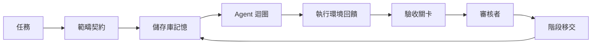

# Agent 工作台工程學：能力強的模型為何仍會失敗

> 光擁有能力強的模型還不夠。可靠的 Agent 需要一套完整的工作台（Workbench）：指引指令、狀態、範疇、即時回饋、驗收關卡、獨立審核與階段移交。拿掉這些外圍防護，即使是前沿模型，產出的成果也不適合發布。

**Type:** Learn + Build
**Languages:** Python (stdlib)
**Prerequisites:** Phase 14 · 01 (Agent Loop), Phase 14 · 26 (Failure Modes)
**Time:** ~45 minutes

## Learning Objectives｜學習目標

- 將模型本身的推理能力，與工程執行的可靠性區分開來。
- 說出決定 Agent 能否交付的七大工作台表面（Surfaces）。
- 在一個小型程式碼庫任務上，比較純 Prompt 執行與工作台引導的執行。
- 產出失效模式報告，將每個缺漏的表面對應到它造成的症狀。

## The Problem｜問題

你把一個前沿模型放進真實的儲存庫，要求它新增輸入驗證。它打開了四個檔案、寫出看似合理的程式碼、宣告成功，然後停止。你執行測試，有兩個失敗。另有第三個檔案被修改，而它與輸入驗證無關。沒有任何紀錄顯示 Agent 做了什麼假設、先嘗試了什麼，或還剩下什麼工作。

模型並非不懂 Python，而是搞錯了工作本身。它不知道什麼才算完成、可以寫哪些檔案、哪些測試具權威性，以及下一個工作階段該如何接手。

這不是模型的 bug，而是**工作台的 bug**。Agent 周圍的表面缺少了能把一次性（one-shot）生成轉變為可靠、可接續工程的部分。

## The Concept｜核心概念

工作台是在任務執行期間包裹模型的運作環境。它有七個表面：

| 工作台表面 | 承載的核心資訊 | 缺漏時引發的典型失效 |
|---|---|---|
| 指引指令（Instructions） | 啟動規則、嚴禁執行的紅線、完工定義（Definition of Done） | Agent 只能盲猜何謂「可發布」 |
| 狀態（State） | 當前任務、被修改檔案、阻礙卡點、下一步行動 | 每個工作階段皆從零重新摸索 |
| 範疇（Scope） | 允許存取的檔案、禁止修改的檔案、驗收合格標準 | 編輯滲入無關程式碼 |
| 回饋（Feedback） | 捕獲進迴圈的實際指令輸出 | Agent 在 400 報錯下自稱成功 |
| 驗證（Verification） | 單元測試、程式碼檢查 Linter、冒煙測試、範疇檢查 | 「看起來沒問題」的程式碼進入 main |
| 審查（Review） | 由不同角色進行的第二輪獨立審查 | 建置者自己批改自己的作業 |
| 移交（Handoff） | 修改了什麼、為何修改、尚餘哪些工作未完成 | 下一個工作階段被迫重新探索一切 |

工作台獨立於模型本身。你可以替換底層模型並保留這些表面；但若拿掉這些表面，就無法維持系統的可靠性。



這個控制迴圈接回儲存庫中的狀態檔案，而非聊天歷史。聊天紀錄是暫態的；儲存庫才是 System of Record。

### 工作台 vs Prompt 工程

Prompt 工程告訴模型「這一回合你要什麼」。工作台則規範模型「跨回合、跨工作階段該如何推進工程」。多數看似 Agent 失敗的案例，本質上都是披著 Prompt 工程外衣的工作台缺失。

### 工作台 vs 框架

框架為你提供了執行環境（如 LangGraph、AutoGen、Agents SDK）。而工作台則是在該執行環境內部，賦予 Agent 一個條理分明的作業場所。兩者皆不可或缺。本專題模組聚焦於後者。

### 從原語推理，而非依循廠商分類

目前有大量關於「harness（執行框架）工程學（Harness Engineering）」的討論，包括 Addy Osmani、OpenAI、Anthropic、LangChain、Martin Fowler、MongoDB、HumanLayer、Augment Code、Thoughtworks、walkinglabs awesome 清單，以及 Medium 與 Hacker News 上持續不斷的文章。各方對 harness 的邊界、範疇與術語各有主張。我們不必選邊站。這七大表面屬於外層的使用者體驗（UX）；在每個工作台的底層，支撐它的始終是任何高可靠後端系統都必須依賴的分散式系統基礎原語。

先暫時拿掉「Agent」這個標籤：一次 Agent 執行，本質上是跨越時間、行程與機器的運算。要讓它可靠，需要的正是任何正式環境系統都需要的原語。

| 分散式系統原語 | 核心本質 | 在 Agent 系統中承載的角色 |
|---|---|---|
| 函式（Function） | 強型別處理常式。純函式為佳。擁有輸入與輸出。 | 工具呼叫、規則檢查、驗證步驟、模型呼叫 |
| 工作者（Worker） | 擁有一個或多個函式與生命週期的長效行程 | 建置者、審核者、驗證者、MCP 伺服器 |
| 觸發器（Trigger） | 呼叫特定函式的事件來源 | 迴圈 Tick 定時器、HTTP 請求、佇列訊息、Cron、檔案變更、掛鉤 |
| 執行環境（Runtime） | 決定何者在何處執行、擁有何種超時與資源配額的邊界 | Claude Code 行程、LangGraph 執行環境、工作者容器 |
| 呼叫協定（HTTP / RPC） | 呼叫端與工作者之間的連線協定 | 工具呼叫協定、MCP 請求、模型 API |
| 佇列（Queue） | 觸發器與工作者之間的持久化緩衝區；背壓、重試、冪等性 | 任務看板、回饋日誌、審核收件匣 |
| 工作階段持久化（Session persistence） | 跨越系統崩潰、重啟與模型切換依然倖存的持久化狀態 | `agent_state.json`、檢查點、KV 儲存、儲存庫檔案本身 |
| 授權原則（Authorization policy） | 規範誰獲准以何種權限範疇呼叫何種函式 | 允許／禁止檔案清單、審批授權邊界、MCP 能力清單 |

將七大工作台表面一一精確映射至這些基礎原語：

- **Instructions**——策略 + 函式中繼資料。規則即檢查函式。路由（router，`AGENTS.md`）即綁定於執行環境啟動時的策略。
- **State**——工作階段持久化。執行環境在每一步讀取的鍵值儲存。不論形式是檔案、KV 還是資料庫，關鍵在於持久化語義，而非底層儲存後端。
- **Scope**——任務層級的授權策略。允許／禁止的檔案 Glob 路徑即存取控制清單（ACL）；必備的審批即權限格網。
- **Feedback**——寫入佇列的呼叫日誌。每次 Shell 命令都是一筆可持久化、可重播的紀錄。
- **Verification**——確定性函式。依輸入產出確定性結果；在任務關閉時觸發；失敗時關閉（Fail closed）。
- **Review**——獨立的 Worker 行程。對建置產物擁有唯讀授權，對審核報告擁有唯寫授權。
- **Handoff**——由工作階段結束觸發器所發布的持久化記錄；供下一次工作階段的啟動觸發器讀取。

Agent 迴圈本質上就是一個 Worker 行程：消費事件（使用者訊息、工具結果、定時器 Tick）、呼叫函式（模型推論、工具執行）、寫入持久化記錄（狀態、回饋），並發射觸發事件（驗收、審核、移交）。沒有神祕之處；其結構與非同步任務處理器（job processor）相同。

### 業界流行名詞與基礎原語對照表

流行社群與廠商名詞皆能還原為這八大原語：

| 廠商或社群流行名詞 | 實際工程本質 |
|---|---|
| Ralph Loop（Claude Code、Codex、agentic_harness 一書）——在 Agent 試圖過早結束時，將原始意圖重新注入全新視窗 | 一個觸發器將任務重新排入佇列並給予乾淨脈絡；工作階段持久化攜帶目標向前推進 |
| 規劃／執行／驗證（PEV 三段式） | 三個獨立工作者，各自承擔單一角色，透過狀態與佇列在各階段間通訊 |
| 控制平面與運算平面分離（Harness-compute separation，OpenAI Agents SDK，2026 年 4 月） | 重新包裝分散式系統中的控制平面（Control-plane）與資料平面（Data-plane）。早於 Agent 這個標籤數十年。 |
| Open Agent Passport（OAP，2026 年 3 月）——在執行前對工具呼叫進行宣告式策略簽名審計 | 由動作前置 Worker 所強制執行的授權策略，附帶具備數位簽名的審計佇列 |
| 指引與感測器（Guides and Sensors；Birgitta Böckeler／Thoughtworks）——前饋規則 + 回饋可觀測性 | 授權策略 + 確定性驗證函式 + 可觀測性追蹤鏈 |
| 漸進式脈絡壓縮，5 階段（Claude Code 逆向工程，2026 年 4 月） | 一個狀態管理 Worker，如同 Cron 定時巡檢工作階段持久化儲存以維持預算 |
| 掛鉤／中介軟體（Hooks / middleware；LangChain、Claude Code）——攔截模型與工具呼叫 | 包裹於執行環境呼叫路徑周圍的觸發器與函式組合 |
| 採漸進式揭露的 Markdown 技能（Skills as Markdown with progressive disclosure；Anthropic、Flue） | 一個函式註冊表，其函式中繼資料僅在需要時即時動態載入脈絡中 |
| 沙盒隔離 Agent（Codex / Sandcastle / Vercel Sandbox） | 運算平面：一個具備隔離檔案系統、網路與生命週期的執行環境 |
| MCP 伺服器 | 透過穩定 RPC 對外暴露函式的工作者，以能力清單作為授權憑證 |

這張表中的每一項，都是 Agent 社群把分散式系統中早已有名的原語，換成一個新名稱。這些標籤適合行銷，但不適合作為工程用語。

### 實際證據怎麼說

「harness 架構重於模型本身」這一論斷，如今已有確鑿的業界量化數字支持。值得了解，因為這些數字也是反駁「只要等更聰明的模型」的唯一誠實論據：

- **Terminal Bench 2.0**：同一模型，只調整外圍的 harness 架構，一款寫程式的 agent 便從 30 名之外躍升至第 5 名（LangChain，*Anatomy of an Agent Harness*）。
- **Vercel**：刪除了其 agent 80% 的工具，任務成功率從 80% 升至 100%（MongoDB 案例研究）。
- **Harvey**：法律專業 agent 只靠 harness 工程的最佳化，準確率就翻了一倍以上（MongoDB 案例研究）。
- **88% 的企業級 AI Agent 專案無法進入正式環境**：失敗集中在執行環境，而非推理能力（preprints.org，*Harness Engineering for Language Agents*，2026 年 3 月）。
- **2025 年跨框架基準研究**：三款熱門開源框架回報約 50% 的任務完成率；在長脈絡條件下，WebAgent 從 40-50% 崩跌至 10% 以下，元兇大多是死迴圈與目標遺忘（2026 年初的諸多文章廣泛報導）。

核心結論不是「harness 永遠勝過模型」。模型隨時間確實會吸收部分 harness 技巧。真正的重點在於：**目前承擔關鍵負荷的工程都在模型周邊，而非模型內部；而承擔這份負荷的，正是任何高可靠正式環境系統一直需要的經典分散式原語。**

### 廠商文章止步之處

這一部分不必客氣。

- LangChain 的 *Anatomy of an Agent Harness* 列出十一個元件：prompts、工具、hooks、沙盒、編排、記憶體、skills、子 agent，以及一個執行「呆板迴圈」的執行環境。它沒有提到佇列、作為部署單位的工作者、觸發器語義、獨立處理的工作階段持久化，或授權策略。它把 harness 當成可設定的物件，而不是需要部署的工程系統。
- Addy Osmani 的 *Agent Harness Engineering* 提出 `Agent = Model + Harness` 公式與棘輪模式，但並未說明 harness 由哪些基礎架構組成。讀起來更像立場宣示，而非可實作的規格。
- Anthropic 與 OpenAI 在工作台表面上走得最深，但仍停留在各自的執行環境內。2026 年 4 月 Agents SDK 的「控制與運算分離」（harness-compute separation）公告，是廠商首次明確支持控制平面與資料平面的切分——但這本就是分散式原語的概念，並非新發明。
- agentic_harness 一書將 harness 視為純設定物件（Jaymin West 的 *Agentic Engineering* 第 6 章），其最有力的論點是「harness 是 Agentic 系統中的首要安全邊界」——這不過是把授權策略換個說法重述。
- Hacker News 上的討論也一再回到同一結論。2026 年 4 月的熱門討論 *The agent harness belongs outside the sandbox* 主張 harness 應當「更像一個獨立於一切之外的 Hypervisor，依據脈絡與使用者決定存取權限」。這同樣是在重申：授權策略應作為獨立平面。

你不必反對上述任何一篇，也能察覺其中的缺口：它們是在對一套早已存在的系統做使用者體驗（UX）層面的重新包裝。而我們是在建構這套系統。系統建構正確時，七大工作台表面會自然從分散式原語中浮現；建構錯誤時，再怎麼潤飾 `AGENTS.md`，也補不回缺少的佇列緩衝。

因此，當你在其他地方聽到「harness 工程學」時，請把它還原為經典原語。Prompts 與規則就是策略與函式；鷹架就是執行環境；護欄就是授權與驗證；Hooks 就是觸發器；記憶體就是工作階段持久化；Ralph Loop 就是重新排隊；子 agent 就是工作者；沙盒就是運算平面。術語日新月異；工程本質歷久彌新。工作台是面向 Agent 的作業表面；而 harness——在經歷無數廠商重新包裝後依然成立的部分——就是函式、工作者、觸發器、執行環境、佇列、持久化與授權策略，正確地串接在一起。

```figure
wb-seven-surfaces
```

## Build It｜動手實作

`code/main.py` 將同一個小型程式碼庫任務執行兩次：第一次只用純 Prompt；第二次則接入七大工作台表面。模型與任務都相同。腳本會統計失敗的執行缺漏了哪些表面，並產出失效模式報告。

該儲存庫任務刻意保持小巧：為單一檔案的 FastAPI 風格處理常式新增輸入驗證，並撰寫一個通過的測試。

執行實驗：

```
python3 code/main.py
```

輸出包含：兩次執行的對照日誌、摘要純 Prompt 執行的 `failure_modes.json` 報告，以及工作台執行的一行判定。

該 Agent 是一個極簡的規則式替身（stub）；本課的重點在於**工作台表面**，而非模型本身。在後續課程中，你會把每個表面實作成真實、可重複使用的工程產物。

## Use It｜實際應用

在真實世界中，已有三個地方存在工作台表面，即使沒人這樣稱呼它們：

- **Claude Code、Codex、Cursor**：`AGENTS.md` 與 `CLAUDE.md` 即指引指令表面；斜線指令即範疇契約；Hooks 即驗證關卡。
- **LangGraph、OpenAI Agents SDK**：檢查點與工作階段儲存即狀態表面；移交即階段移交表面。
- **真實儲存庫的 CI 管線**：測試、Lint 與型別檢查即驗證關卡；PR 範本即階段移交；CODEOWNERS 即獨立審核。

工作台工程學的本質，是把這些表面明確化、標準化並可重複使用，而非讓每個團隊各自重新發現它們。

## Ship It｜交付成果

`outputs/skill-workbench-audit.md` 是一項可移植的審查技能。它會掃描現有的程式碼儲存庫，逐一檢查七大工作台表面，並標註哪些缺漏、哪些殘缺、哪些健康。放在任何 Agent 專案旁，它會告訴你先修什麼。

## Exercises｜練習

1. 挑選一個你目前執行 Agent 的真實專案。為七大表面分別打分：0 分（缺失）、1 分（殘缺）、2 分（健全）。你目前最脆弱的表面為何？
2. 擴充 `main.py`，讓純 Prompt 執行也產出一次假的「成功」宣告。驗證驗收關卡是否能攔下它。
3. 為你自己的產品新增第八個表面。說明它為何不會被併入既有的七個之一。
4. 改用另一個會幻覺出多餘檔案寫入的模擬 Agent 重新執行腳本。哪個表面最先攔住它？
5. 將 Phase 14 · 26 中五種業界反覆出現的失效模式，對應到七大表面。每個表面主要負責吸收哪種失效模式？

## Key Terms｜關鍵術語

| 術語 | 常見俗稱 | 實際工程意義 |
|---|---|---|
| 工作台（Workbench） | 「專案配置」 | 圍繞模型、使工程執行可靠的一組系統表面 |
| 工作台表面（Surface） | 「設定檔或腳本」 | Agent 每一回合都會讀取或寫入的具名、機器可讀介面 |
| 記錄系統（System of record） | 「任務筆記」 | 聊天紀錄消失時，Agent 視為依據的檔案 |
| 完工定義（Definition of done） | 「驗收標準」 | 一份客觀、以檔案為依據、Agent 無法偽造的檢查清單 |
| 工作台稽核（Workbench audit） | 「儲存庫就緒檢查」 | 工作開始前，檢查七大表面並標出缺漏的掃描 |

## Further Reading｜延伸閱讀

請把以下文獻當作資料點，而非權威。每一篇都只是局部的分類。在決定是否採用之前，先把每個概念還原為基礎原語（函式、工作者、觸發器、執行環境、HTTP/RPC、佇列、持久化、授權策略）。

各大廠商視角：

- [Addy Osmani, Agent Harness Engineering](https://addyosmani.com/blog/agent-harness-engineering/) ——`Agent = Model + Harness` 核心公式與棘輪演進模式；對基礎設施著墨不多
- [LangChain, The Anatomy of an Agent Harness](https://blog.langchain.com/the-anatomy-of-an-agent-harness/) ——列舉十一個元件：prompts、工具、hooks、編排、沙盒、記憶體、skills、子 agent、執行環境；未涵蓋佇列、部署架構與授權
- [OpenAI, Harness engineering: leveraging Codex in an agent-first world](https://openai.com/index/harness-engineering/) ——Codex 團隊圍繞其專屬執行環境的外圍表面實踐
- [OpenAI, Unrolling the Codex agent loop](https://openai.com/index/unrolling-the-codex-agent-loop/) ——將 Agent 迴圈還原為函式呼叫上的 `while` 迴圈
- [Anthropic, Effective harnesses for long-running agents](https://www.anthropic.com/engineering/effective-harnesses-for-long-running-agents) ——特定執行環境內長路徑任務的工作台表面
- [Anthropic, Harness design for long-running application development](https://www.anthropic.com/engineering/harness-design-long-running-apps) ——長路徑應用程式開發的設計筆記
- [LangChain Deep Agents harness capabilities](https://docs.langchain.com/oss/python/deepagents/harness) ——執行環境設定表面

具實用細節的實務文章：

- [Martin Fowler / Birgitta Böckeler, Harness engineering for coding agent users](https://martinfowler.com/articles/harness-engineering.html) ——Guides（前饋規則）+ Sensors（回饋感測）；最清晰的控制論視角
- [HumanLayer, Skill Issue: Harness Engineering for Coding Agents](https://www.humanlayer.dev/blog/skill-issue-harness-engineering-for-coding-agents) ——「這不是模型能力問題，這是系統設定問題」
- [MongoDB, The Agent Harness: Why the LLM Is the Smallest Part of Your Agent System](https://www.mongodb.com/company/blog/technical/agent-harness-why-llm-is-smallest-part-of-your-agent-system) ——實測紀錄：Vercel 80% 到 100%、Harvey 準確率翻倍、Terminal Bench 從前 30 進入前 5
- [Augment Code, Harness Engineering for AI Coding Agents](https://www.augmentcode.com/guides/harness-engineering-ai-coding-agents) ——以約束為先的逐步導覽
- [Sequoia podcast, Harrison Chase on Context Engineering Long-Horizon Agents](https://sequoiacap.com/podcast/context-engineering-our-way-to-long-horizon-agents-langchains-harrison-chase/) ——執行環境的議題優先於模型議題

書籍、學術論文與開源參考實作：

- [Jaymin West, Agentic Engineering — Chapter 6: Harnesses](https://www.jayminwest.com/agentic-engineering-book/6-harnesses) ——整本書的論述，將 harness 視為首要安全邊界
- [preprints.org, Harness Engineering for Language Agents (March 2026)](https://www.preprints.org/manuscript/202603.1756) ——學術框架：控制、能動性與執行環境
- [walkinglabs/awesome-harness-engineering](https://github.com/walkinglabs/awesome-harness-engineering) ——涵蓋脈絡、評測、可觀測性與編排的精選閱讀清單
- [ai-boost/awesome-harness-engineering](https://github.com/ai-boost/awesome-harness-engineering) ——另一份精選清單（工具、Evals、記憶體、MCP、權限）
- [HKUDS/OpenHarness](https://github.com/HKUDS/OpenHarness) ——內建個人 agent 的開源 harness

值得閱讀的 Hacker News 討論（重點在分歧，而非共識）：

- [HN: Effective harnesses for long-running agents](https://news.ycombinator.com/item?id=46081704)
- [HN: Improving 15 LLMs at Coding in One Afternoon. Only the Harness Changed](https://news.ycombinator.com/item?id=46988596)
- [HN: The agent harness belongs outside the sandbox](https://news.ycombinator.com/item?id=47990675) ——主張授權應作為獨立平面

本課程體系內部的相互參照：

- Phase 14 · 23——OpenTelemetry GenAI 語意約定：感測器（Sensors）文獻所指向的可觀測性層
- Phase 14 · 26——失效模式總覽：七大工作台表面所專門負責吸收防禦的故障類別
- Phase 14 · 27——Prompt 注入防禦：位於授權策略原語處的關鍵安全防線
- Phase 14 · 29——生產級執行環境（佇列、事件、排程）：本課所述各項原語在部署中的落腳點
