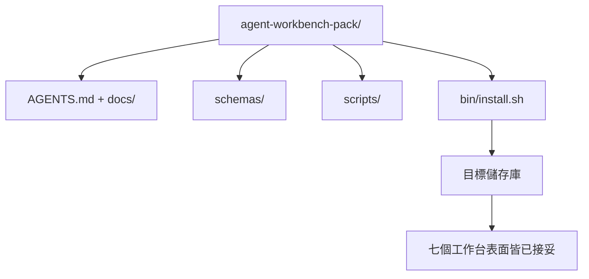

# 總結專題：交付可重複利用的 Agent 工作台整合包

> 本微專題（Mini-track）以一套可直接加入任何程式碼儲存庫（repository）的通用整合包作為終點。十一課所介紹的工作台表面，皆精簡至一個僅需 `cp -r` 就能複製的目錄，讓 agent 隔天早上便能穩定工作。本總結專題是本課程的成果。

**Type:** Build
**Languages:** Python (stdlib)
**Prerequisites:** Phases 14 · 31 to 14 · 41
**Time:** ~75 minutes

## Learning Objectives｜學習目標

- 將七個工作台表面打包至單一可直接使用的目錄。
- 鎖定結構描述（schema）、腳本與範本，讓新儲存庫取得已知良好的基準線。
- 打造單一安裝腳本，以冪等方式將整合包部署至目標儲存庫中。
- 清晰決策哪些內容應當納入整合包、哪些內容堅決排除，並為每項邊界決策提出論證。


## The Problem｜問題

散落於 Google 文件、過往聊天紀錄與三段半生不熟的腳本中的工作台，每季都會重建。解決之道是具備版本控制的整合包：包含工作台表面、結構描述、腳本與單一指令安裝程式的儲存庫或目錄。

本課結束時，你將交付 `outputs/agent-workbench-pack/`，以及能將它安裝到任何目標儲存庫的 `bin/install.sh`。

## The Concept｜核心概念



### 整合包目錄結構

```
outputs/agent-workbench-pack/
├── AGENTS.md
├── docs/
│   ├── agent-rules.md
│   ├── reliability-policy.md
│   ├── handoff-protocol.md
│   └── reviewer-rubric.md
├── schemas/
│   ├── agent_state.schema.json
│   ├── task_board.schema.json
│   └── scope_contract.schema.json
├── scripts/
│   ├── init_agent.py
│   ├── run_with_feedback.py
│   ├── verify_agent.py
│   └── generate_handoff.py
├── bin/
│   └── install.sh
└── README.md
```

### 哪些納入，哪些排除

納入整合包：

- 工作台表面的結構描述：它們是系統契約。
- 上述四支腳本：它們就是執行環境。
- 四份文件：它們定義規則與評分標準。

堅決排除在整合包之外：

- 專案特化任務：任務專屬於目標儲存庫的任務看板，絕不屬於通用整合包。
- 特定廠商的 SDK 呼叫：整合包完全維持框架無關性（Framework-agnostic）。
- 新人入職長篇大論：整合包與團隊既有的入職文件並存，而非將其吞併。

### 安裝工具

輕量的 `bin/install.sh`（或 `bin/install.py`）：

1. 在未傳入 `--force` 時，堅決拒絕覆寫既有的整合包；
2. 將整合包完整複製至目標儲存庫；
3. 若存在 `.github/workflows/`，自動配置 CI 自動化管線；
4. 印出下一步行動指引：填寫任務看板、設定驗收測試指令、執行初始化腳本。

### 版本控管

整合包攜帶 `VERSION` 檔案。結構描述變更及需要資料遷移的腳本變更，都要升級主版本號（Major）；只有文件變更時則升級修訂號（Patch）。目標儲存庫的 `agent_state.json` 記錄它是基於哪個整合包版本完成初始化的。

```figure
wb-pack-install
```

## Build It｜動手實作

`code/main.py` 將整合包組裝至本課同級目錄下的 `outputs/agent-workbench-pack/`，納入本微專題先前各課建構的結構描述、腳本與文件。

執行實驗：

```
python3 code/main.py
```

腳本會複製並鎖定各項表面、寫入 README、在終端印出整合包目錄樹，並以狀態碼 0 退出。重複執行具備完全的冪等性。

## 真實世界中的生產級模式

一套整合包唯有在歷經 Fork 改造、版本更新與不友善的上游環境時依然屹立不倒，才具備真正的實戰價值。四大實戰模式支撐了這項工程承諾：

**`VERSION` 是硬性契約，而非行銷宣傳**：主版本號升級強制要求狀態遷移；次版本號升級強制要求重跑檢查器；修訂號升級僅限文件修訂。安裝程式在每次安裝時會將 `.workbench-version` 寫入目標儲存庫；若目標檔案的鎖定版本與整合包的 `VERSION` 不符，`lint_pack.py` 堅決拒絕發布。這正是 `npm`、`Cargo` 與 `pyproject.toml` 能歷經十年浪潮依然穩固的根本原因；Agent 系統的規則毫無例外。

**跨工具分發的單一真實來源**：Nx 推出的 `nx ai-setup` 能透過單一配置，自動產出 `AGENTS.md`、`CLAUDE.md`、`.cursor/rules/`、`.github/copilot-instructions.md` 以及 MCP 伺服器。本整合包亦貫徹相同哲學：安裝程式建立標準符號連結（`ln -s AGENTS.md CLAUDE.md`），使單一權威來源能無縫輻射至所有 AI 撰寫程式碼工具。為支援某個特定工具而私自 Fork 分裂整合包是嚴重的反模式。

**在存在非平凡狀態時拒絕執行的 `uninstall.sh` 卸載工具**：卸載整合包絕不允許刪除使用者的 `agent_state.json`、`task_board.json` 或 `outputs/` 目錄。卸載程式僅移除結構描述、腳本、文件與 `AGENTS.md`（支援 `--keep-agents-md` 保留選項），且若狀態檔案存在任何未 commit 的改動時堅決拒絕執行。狀態屬於使用者；整合包絕不僭越擁有它。

**以 SkillKit 技能發布分發**：整合包作為 SkillKit 技能對外發布：一條 `skillkit install agent-workbench-pack` 可透過單一來源，將整合包部署到 32 種 AI agent。整合包儲存庫是唯一的事實來源；而 SkillKit 是高效的分發途徑。廠商鎖定問題隨之消退，而七大核心工作台表面始終如一。

## Use It｜實際應用

整合包的三種主流落地方式：

- **直接複製目錄至儲存庫**：`cp -r outputs/agent-workbench-pack /path/to/repo`。
- **作為公開的 GitHub Template 儲存庫**：Fork 並客製化，透過 `VERSION` 嚴格約束漂移。
- **作為 SkillKit 技能**：無縫接入你的 Agent 產品，一條指令全自動鋪設。

整合包是標準配方；每次安裝皆是一份完美的實裝。

## Ship It｜交付成果

`outputs/skill-workbench-pack.md` 能為特定專案量身產出調校後的整合包：規則依團隊歷史調整、範疇 Globs 符合目標儲存庫、審核維度擴充垂直領域的專屬評分項。

## Exercises｜練習

1. 思考哪份選填的第五份文件最具備資格被正式收錄進標準整合包中。提出論證。
2. 將 Bash 安裝腳本改寫為具備 `--dry-run` 預演旗標的 Python 實作。深入對比兩者的人體工學差異。
3. 撰寫 `bin/uninstall.sh` 安全卸載腳本：當狀態檔案包含實質歷史記錄時堅決拒絕執行。何謂「非平凡實質歷史」的判定邊界？
4. 撰寫 `lint_pack.py`：當整合包內的檔案與 `VERSION` 不符時強制報錯。將其整合進整合包自身儲存庫的 CI 中。
5. 撰寫一份將團隊「原本土法煉鋼自建之工作台」平滑遷移至本標準整合包的實戰操作手冊。如何規劃步驟以最小化停機維護時間？


## Key Terms｜關鍵術語

| 術語 | 常見俗稱 | 實際工程意義 |
|---|---|---|
| Workbench pack | 「工作台整合包」 | 納入版本控制、包含全部七個工作台表面的目錄 |
| Installer | 「一鍵部署腳本」 | 以冪等方式將整合包部署至目標儲存庫的 `bin/install.sh` 腳本 |
| Pack version | 「VERSION 檔案」 | 規範升級契約的檔案：結構描述或腳本變更升主版、僅文件變更升補丁版 |
| Drop-in pack | 「複製即可開工」 | 第一天就能不經逐儲存庫客製化直接使用的通用整合包 |
| Forkable template | 「GitHub 專案範本」 | 支援直接點選「Use this template」快速建立衍生專案的公開範本庫 |

## Further Reading｜延伸閱讀

- Phases 14 · 31 to 14 · 41——本整合包所完整收斂的所有底層工作台表面
- [SkillKit](https://github.com/rohitg00/skillkit) ——跨 32 種 AI Agent 一鍵安裝本技能的跨平台工具
- [Nx Blog, Teach Your AI Agent How to Work in a Monorepo](https://nx.dev/blog/nx-ai-agent-skills) ——跨六大工具的單一來源生成器
- [agents.md — the open spec](https://agents.md/) ——你的整合包路由器所必須實作的開放規範
- [HKUDS/OpenHarness](https://github.com/HKUDS/OpenHarness) ——同等整合包架構的開源參考實作
- [Augment Code, A good AGENTS.md is a model upgrade](https://www.augmentcode.com/blog/how-to-write-good-agents-dot-md-files) ——整合包指引文件品質標準
- [Anthropic, Effective harnesses for long-running agents](https://www.anthropic.com/engineering/effective-harnesses-for-long-running-agents)
- [Anthropic, Harness design for long-running application development](https://www.anthropic.com/engineering/harness-design-long-running-apps)
- Phase 14 · 30——直接消費本整合包驗收關卡的評測驅動開發體系
- Phase 14 · 41——本整合包所帶來顯著提升的對照基準評測實戰
