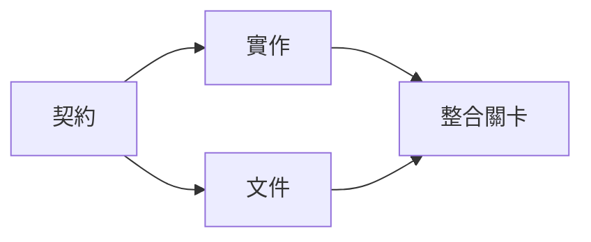

# 打造基於證據的執行計畫

> 一份計畫絕非換個漂亮格式的待辦清單（To-Do List）。它是一張相依性有向圖——其中每處變更都有其依據，每個終端節點都有證明。

**Type:** Learn + Build
**Languages:** Python (stdlib)
**Prerequisites:** Phase 14 lesson 43
**Time:** ~65 minutes

## Learning Objectives｜學習目標

- 將任務框架轉化為附有證據與證明的工作事項（Work Items）。
- 將執行順序建模為相依關係，而非散文式的先後順序。
- 在動手修改前，及早偵測缺漏的事實、未知的相依關係與循環相依。
- 區分可並行的步驟與必須等待的步驟。

## 為何 agent 的計畫會失敗

薄弱的計畫往往只是用未來式重述使用者的請求：

1. 更新 API；
2. 新增測試；
3. 更新文件。

這份清單沒有說明在程式碼中究竟發現了什麼、為何修改這些檔案是正確的、哪個契約應當最先演進，或者哪些步驟可以並行。agent 即使遵循清單中的每一步，仍可能造成返工。

一份完善的計畫，會為每項工作事項做出五項承諾：

| 承諾 | 用途 |
|---|---|
| Identifier（識別碼） | 用於相依性引用與交接的穩定標籤 |
| Change（變更） | 最小的系統行為或契約變更 |
| Evidence（證據） | 支撐該項變更的儲存庫事實 |
| Dependencies（前置相依） | 在這項工作事項開始前，必須已確立為真的前置工作 |
| Proof（完工證明） | 能證明該工作事項完成的精確驗證方式 |

## 契約設計先於具體實作

當多個表面相依於相同的行為時，應先定義該行為。測試、實作、文件與整合便能共享同一份契約，而不必各自發明四個版本。



相依性圖清晰暴露了安全的並行機會：契約確定後，實作與文件即可同時進行。整合關卡須等待兩者完成。

## 證據推動計畫動態演進

儲存庫證據不是裝飾。它應當能改變工作：

- 既有的輔助函式讓原計畫中的新抽象層變得不必要；
- 相容性測試會迫使加入一個遷移步驟；
- 部署限制會把結構描述變更移到另一項任務中；
- 公開的回應型別會改變實作與文件的先後順序。

若證據無法改變計畫，它大概就不是支持該決定的證據。

## 為隨時中斷而設計

寫程式 agent 的工作階段會意外結束。可接續的計畫，其中的工作事項需足夠小，讓另一個工作階段能判定：

- 哪項工作已完成；
- 哪項證明已執行；
- 哪些產物已變更；
- 哪些相依項現在已解除阻擋；
- 下一項最安全的工作事項是什麼。

不要只把狀態記錄在聊天視窗裡的勾選框中。請把計畫持久化存放在工作旁。

## 計畫驗證

在執行前，若出現以下情況，就拒絕該計畫：

- 出現重複的任務識別碼；
- 某項工作事項沒有證據；
- 某項工作事項沒有證明；
- 相依項指向未知的工作事項；
- 相依性圖中包含循環；
- 在相關的不確定性解決之前，就發生了第一個不可逆的動作。

前五項檢查是機械式的；最後一項需要判斷，應明確指出。

## Build It｜動手實作

`code/main.py` 建模工作事項、驗證各項出處憑證，以拓撲排序計算並行的「執行波次（Execution Waves）」，並將結果寫入 `outputs/evidence-plan.json`。

執行指令：

```bash
python3 code/main.py
python3 -m unittest discover code/tests -v
```

範例程式產出了三個執行波次：第一波次確立契約；第二波次同時並行實作與文件更新；第三波次由整合關卡執行。

## 協同寫程式 agent 實踐

在允許 agent 修改檔案前，要求它先產出執行計畫。請從以下三點審查該計畫：

1. 每個路徑與行為主張，都有儲存庫出處憑證；
2. 每項工作事項，都有一個清楚的完成證明；
3. 相依性圖會把高成本或不可逆的工作延後，直到其所依賴的不確定性解決。

核准的應該是計畫，而非「會小心一點」這類含糊的承諾。

## Exercises｜練習

1. 新增一項需要人類明確核准的遷移工作事項。
2. 製造一個循環相依，並說明其背後隱藏的產品分歧。
3. 拆分一項具有兩條證明指令的工作事項。
4. 新增一項可在第二波次執行、且不碰觸任一既有 branch 的工作事項。
5. 將計畫輸出為 Markdown，同時保持 JSON 作為事實來源。

## Further Reading｜延伸閱讀

- [Nuseibeh and Easterbrook, Requirements Engineering: A Roadmap](https://www.cs.toronto.edu/~sme/papers/2000/ICSE2000.pdf) ——說明目標、規格、共識與演進之間迭代關係的論文
- [Barry Boehm, A Spiral Model of Software Development and Enhancement](https://dl.acm.org/doi/10.1145/12944.12948) ——依風險化解而非固定線性順序安排開發的螺旋模型論文

## 留存產物

保留 `outputs/evidence-plan.json`。它會成為下一課的委派契約。
