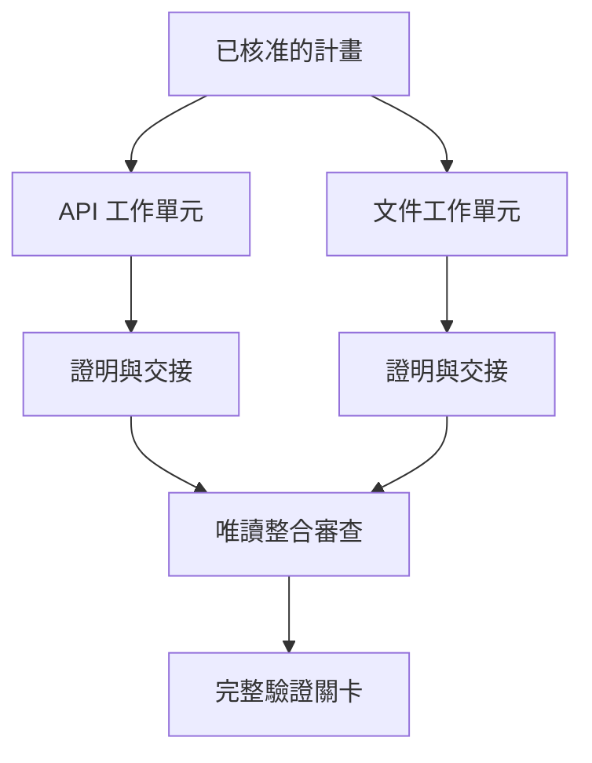

# 透過隔離與合併契約委派 Agent 任務

> 平行的 agent 唯有在工作確實獨立時，才能節省掛鐘時間。否則，它們只會把一個清晰的任務變成協調問題，而且失敗得更快。

**Type:** Learn + Build
**Languages:** Python (stdlib)
**Prerequisites:** Phase 14 lessons 39 and 44
**Time:** ~70 minutes

## Learning Objectives｜學習目標

- 判斷委派是否有真正的獨立性作為依據。
- 為每個 worker 指派專屬的檔案所有權與明確的證明。
- 依據相依關係計算出安全的執行波次（Execution Waves）。
- 設計合併契約（Merge Contract），安全地整合 agent 的工作成果。

## 並行性驗證（The Parallelism Test）

不要因為有更多 agent 可用就委派。當以下至少一項成立時，才應委派：

- 兩項獨立調查可各自回答不同的未知問題；
- 兩項實作各自擁有互不重疊的檔案與契約；
- 審核者可在不修改產物的情況下檢視已完成的產物；
- 一項耗時的外部檢查，可在本機工作持續進行時執行。

當 agent 需要相同的檔案、相同的未決決策，或相同的可變環境時，應**依序執行**。

## 工作單元就是一份契約（A Work Unit Is a Contract）

每個委派的工作單元都需要：

| 欄位 | 意義 |
|---|---|
| 目標 | 一個可觀察的結果 |
| 負責人 | 一位負責的 worker |
| 路徑 | 專屬的檔案寫入範圍 |
| 相依項目 | 開始前必須完成的單元 |
| 證明 | 交回給整合者的精確證據 |
| 移交 | 修改的檔案、做出的決策與剩餘風險 |

「負責後端」不是工作單元；「在 `app/accounts.py` 中實作重複檢查，並以專注的帳號測試證明」才是。

## 隔離有三層（Isolation Has Three Layers）

1. **檔案系統隔離（Filesystem isolation）**：獨立的 Git Worktrees 或沙盒可防止意外的共享編輯。
2. **所有權隔離（Ownership isolation）**：透過契約防止兩個 worker 有意地修改相同的路徑。
3. **狀態隔離（State isolation）**：獨立的日誌與輸出可防止一個 worker 覆寫另一個 worker 的證據。

檔案系統隔離無法解決所有權問題。兩個乾淨的 worktree 仍可能產出互相衝突的設計。合併契約必須在工作開始前，先解決共享介面。



## 整合者不重寫工作（The Integrator Does Not Rebuild the Work）

整合者（Integrator）的職責是：

1. 確認每個交接都符合其指派的範圍；
2. 閱讀證明的輸出，而不只是 worker 的摘要；
3. 依相依順序合併變更；
4. 執行跨單元的全域完整驗收關卡；
5. 拒絕任何隱性的範圍擴大；
6. 將衝突記錄為新的決策，而非靜默修改。

若整合需要重寫 worker 成果的大部分，代表原本的拆解有誤。

## 人類與 agent 的角色邊界（Human and Agent Roles）

委派並不會取代人類的判斷。人類仍負責會改變對外公開行為、系統風險、權限或帶來不可逆成本的決策。agent 可以負責範圍明確的調查、功能實作、測試驗證與審查。

這正是**標定自主權（Calibrated autonomy）**的精髓：在證據充分、回滾能力強的領域，系統給予 agent 行動的自由；在後果嚴重的關鍵處，系統則要求設立人工檢查點。

## Build It｜動手實作

實驗會檢查路徑重疊、驗證相依關係、計算安全的執行波次，並寫出 `outputs/delegation-plan.json`。

執行指令：

```bash
python3 code/main.py
python3 -m unittest discover code/tests -v
```

把文件工作單元改為也擁有 `app/` 目錄。計畫應被阻擋，因為該父目錄與 API 工作單元的路徑重疊。

## Exercises｜練習

1. 將一項真實變更拆解為兩個獨立的工作單元與一個整合者。
2. 找出一個看似獨立的平行切分方案，並指出雙方共享的決策。
3. 新增一個唯讀的研究 worker，其輸出是一份事實表。
4. 新增一個合併關卡，將最終修改的檔案集合與所有單元的契約進行比對。
5. 為 worker 定義取消規則：當其相依項變為無效時，該 worker 應如何取消。

## Further Reading｜延伸閱讀

- [Reid Smith, The Contract Net Protocol](https://doi.org/10.1109/TC.1980.1675516) ——早期對分散式任務分配與結果回報做正式處理的契約網協定論文
- [Eric Horvitz, Principles of Mixed-Initiative User Interfaces](https://dl.acm.org/doi/10.1145/302979.303030) ——關於何時自動化應採取行動、何時應把控制權交還給人的混合主動介面原則

## 留存產物（What You Keep）

保留 `outputs/delegation-plan.json`。它記錄為何這次切分是安全的、誰擁有各個路徑，以及整合必須接收哪些證明。
