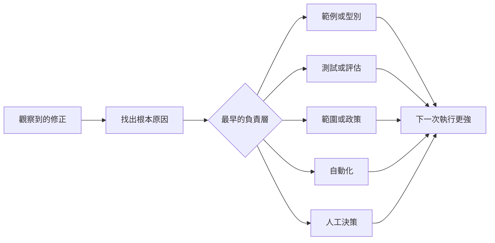

# 將每次 agent 修正轉化為系統改進

> 只存在於聊天中的修正，只能修好單次執行。升格為測試、邊界、範例或工具的修正，則會改善之後的每一次執行。

**Type:** Learn + Build
**Languages:** Python (stdlib)
**Prerequisites:** Phase 14 lessons 37 to 41
**Time:** ~65 minutes

## Learning Objectives｜學習目標

- 將 agent 的修正轉化為持久的控制措施。
- 將每項控制放在能最早防止問題重現的層級。
- 以穩定的指紋，對重複出現的經驗教訓去重。
- 退役不再防護真實風險的控制項。

## 修正即證據

當你對 agent 說「不要修改那個檔案」時，你便得知範圍邊界並非可執行的。當你說「這個輸出格式錯了」時，你便得知缺少範例或測試。當環境設定再次失敗時，你便得知環境知識應該放進自動化流程中。

請把每一次修正，視為對工作系統的觀察，而不是 prompt 寫得不夠好的問題。

## 升格至最早有效的防護層

依下列順序處理：

| 重複出現的失敗 | 持久的落點 |
|---|---|
| 錯誤結果或回歸 | 測試或評估 |
| 超出範圍或不安全的動作 | 範圍或權限政策 |
| 重複出現的設定或指令錯誤 | 自動化或工具 |
| 重複出現的輸出格式錯誤 | 標準範例搭配校驗器 |
| 模糊的本機慣例 | 附情境檢查的指引 |
| 產品分歧 | 人工決策紀錄 |

越早的控制越便宜。能阻止無效狀態的型別，比日後才抓到它的審查意見更有效；聚焦的測試，也比要求 agent 記住的一段文字更有效。



## 棘輪演進記錄

記錄以下要素：

- 表面症狀（Symptom）；
- 根本原因（Root cause）；
- 後果（Consequence）；
- 歷史重現次數（Recurrence count）；
- 採納的控制措施（Chosen control）；
- 該控制措施的驗證手段（Verification）；
- 責任人（Owner）；
- 預定審查或退役日期（Retirement date）。

不要把每個一次性的偏好都升格。唯有重現次數或後果足以支持永久的複雜度時，才將修正升格為永久控制項。

## 區分表面症狀與根本原因

「agent 修改了 README」只是表面症狀。可能的根本原因包括：

- 任務允許了儲存庫根目錄；
- 文件被隱含地視為安全；
- 計畫把實作與文件綁在一起；
- 兩個 worker 的檔案所有權重疊。

每個根本原因各自屬於不同的控制層。只重複表面症狀的規則，在下一個略有不同的案例中就會失效。

## 控制也會老化

過時的控制可能彼此衝突、使上下文膨脹，並編碼一個已不存在的系統。每條升格的規則都需要退役檢查。出現以下情況時，就刪除或重寫它：

- 底層架構已改變；
- 更強的可執行控制已取代了它；
- 在有意義的時間範圍內，該失敗沒有再次出現；
- 該控制造成的摩擦大於它所防範的風險。

目標不是最長的指引檔，而是能保留來之不易之判斷的最小系統。

## Build It｜動手實作

實驗會分類修正、將其升格為對應的控制項、以指紋對重複項去重，並寫入 `outputs/feedback-ratchet.json`。

執行指令：

```bash
python3 code/main.py
python3 -m unittest discover code/tests -v
```

新增兩條措辭不同、但根本原因相同的修正。改進正規化，直到它們合併為單一控制項，同時不會把無關的失敗也合併在一起。

## Exercises｜練習

1. 從你最近的寫程式工作階段中挑出五次修正，並分類其實際負責的層級。
2. 把一條散文形式的規則替換為可執行的測試。
3. 加入後果權重，使嚴重的首次發生可立即升格。
4. 在實驗輸出中加入責任人與退役日期。
5. 審視儲存庫中一條既有的 agent 指引，只有在證明存在更強的控制可取代它之後，才刪除它。

## Further Reading｜延伸閱讀

- [Basili, Caldiera, and Rombach, The Goal Question Metric Approach](https://www.cs.toronto.edu/~sme/CSC444F/handouts/GQM-paper.pdf) ——將目標轉化為問題與可操作度量的 GQM 方法論論文
- [Shinn et al., Reflexion](https://arxiv.org/abs/2303.11366) ——利用回饋追蹤改進後續決策、無需修改模型權重的論文
- [Madaan et al., Self-Refine](https://arxiv.org/abs/2303.17651) ——在任務迴圈內部進行迭代式回饋與修正的論文

## 留存產物

保留 `outputs/feedback-ratchet.json`。它是 Agent 輔助工程路線的持久終點，也是未來工作台變更的輸入。
