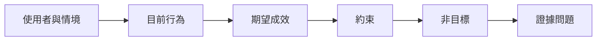

# 在挑選產出前先界定成效

> 快速實作會提高選錯問題的代價。先塑造成效（Outcome），讓速度朝向正確的方向。

**Type:** Learn + Build
**Languages:** Python (stdlib)
**Prerequisites:** None
**Time:** ~60 minutes

## Learning Objectives｜學習目標

- 在不指定解法的前提下，撰寫成效框架（Outcome Frame）。
- 辨識使用者、情境、目前行為與期望的改變。
- 明確寫出約束與非目標（Non-goals）。
- 在解法外洩（Solution Leakage）變成範圍之前，及早偵測。

## 產出不等於成效

「打造一個事故排查助手」只是在命名一項**產出（Output）**。它沒有說明誰需要它、什麼會變得更好，或什麼必須維持安全。

而**成效框架（Outcome Frame）**會這樣寫：

> 當正式環境出現告警時，值班工程師能在兩分鐘內辨識故障服務，並決定安全的下一步行動，而診斷過程維持唯讀且可稽核。

這句話可以由軟體、一份應變手冊、一次資料修復，或一次較小的介面變更來達成。它讓團隊聚焦於結果，而非某人最先想到的產物。

## 六部式框架

| 組成維度 | 核心檢核問題 |
|---|---|
| User（使用者） | 誰直接經歷這個問題？ |
| Situation（情境） | 問題在何時、何處發生？ |
| Current behavior（當前現狀） | 今天實際發生什麼，包括變通做法？ |
| Desired outcome（期望成效） | 哪種可觀察的狀態應該改善？ |
| Constraints（硬性約束） | 哪些安全、政策、成本或相容性限制是固定的？ |
| Non-goals（非目標） | 哪些看似誘人的相鄰工作被排除？ |



## 找出解法外洩

當成效描述包含尚未由證據支持的產品形態、介面、模型選擇、框架或架構時，就會發生「解法外洩」：

- 「使用者每週收到一份 AI 摘要」——外洩了摘要的形式與頻率。
- 「使用者在核准前理解帳號變更」——陳述了結果。
- 「部署一套向量資料庫」——外洩了底層基礎設施。
- 「審查時可取得相關的政策證據」——陳述了一項能力。

約束可以在相容性確實固定技術時提及該技術，並記錄它為何固定。

## 約束守護成效

約束不是實作細節，而是真實世界目標的一部分：

- 診斷期間不得寫入正式環境；
- 回應時間須落在事故處理的時間預算內；
- 既有的稽核事件仍是權威依據；
- 不引入新的執行環境相依性；
- 無障礙行為維持不變。

若一項建置是靠違反約束才達到成效，就不算達到成效。

## 非目標劃定邊界

非目標能防止有用的切片變成平台。好的非目標必須夠具體，才能拒絕無關的工作：

- 不做自動修復；
- 不打造全新告警路由系統；
- 不取代事故指揮官；
- 本切片不含歷史分析。

## Build It｜動手實作

實驗會驗證 `OutcomeFrame`，並寫出 `outputs/outcome-frame.json`。

```bash
python3 code/main.py
python3 -m unittest discover code/tests -v
```

將期望成效替換為「使用事故排查助手」。校驗器應標記出該提議的產出已外洩到成效描述中。

## Exercises｜練習

1. 將待辦清單（Backlog）中的一項功能需求，改寫為成效框架。
2. 新增一條會改變仍可行解法的約束。
3. 新增兩項非目標，讓第一個切片保持小巧。
4. 找出最早能推翻期望成效的觀測。
5. 寫出三種不同的產出，都能達成同一成效。

## Further Reading｜延伸閱讀

- [Nuseibeh and Easterbrook, Requirements Engineering: A Roadmap](https://www.cs.toronto.edu/~sme/papers/2000/ICSE2000.pdf) ——將真實世界目標視為軟體工作錨點的需求工程論文
- [Dardenne, van Lamsweerde, and Fickas, Goal-Directed Requirements Acquisition](https://doi.org/10.1016/0167-6423(93)90021-G) ——將高層目標精煉為約束與操作需求的目標導向需求擷取方法

## 留存產物

保留 `outputs/outcome-frame.json`。下一課會將它對照人們實際執行的工作流程加以檢驗。
