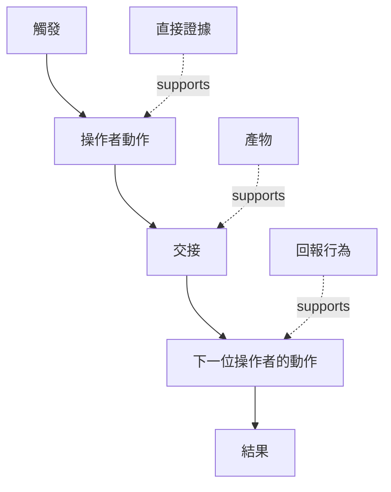

# 發掘人們實際執行的工作流程

> 需求不會坐在會議室裡等人收集。它們散落於各種行動、權宜做法、紀錄與分歧之中。

**Type:** Learn + Build
**Languages:** Python (stdlib)
**Prerequisites:** Phase 14 lesson 47
**Time:** ~70 minutes

## Learning Objectives｜學習目標

- 將目前的工作流程建模為有序的動作，並附上證據。
- 區分直接觀察與回報或推論的行為。
- 找出摩擦、交接點、權限與隱性狀態。
- 讓不確定的主張保持可見，而不是把它們變成需求。

## 從現有系統出發

不要一開始就問大家想要什麼功能。先重建現在實際發生的事。

為每個步驟記錄：

| 欄位 | 範例 |
|---|---|
| Actor（操作者） | 值班工程師 |
| Trigger（觸發事件） | 正式環境出現告警 |
| Action（具體動作） | 開啟告警，隨後搜尋多個儀表板 |
| Input（輸入資料） | 告警內容與部署紀錄 |
| Output（產出產物） | 候選的故障服務與其負責人 |
| Friction（摩擦阻力） | 在三個工具之間切換上下文 |
| Authority（權限） | 事故指揮官批准寫入操作 |
| Evidence（證據） | 螢幕錄影、事故紀錄、既有應變手冊 |

工作流程比螢幕上看到的大。它包括等待、複製貼上、私下的溝通途徑、審批、錯誤復原，以及人們已不再注意的步驟。

## 證據具備強弱階梯

採用簡單的證據階梯：

1. **直接行為（Direct behavior）**：觀察、追蹤、錄影或系統事件。
2. **產物（Artifact）**：工單、應變手冊、日誌、表單或已完成的輸出。
3. **回報行為（Reported behavior）**：當事人描述他們做了什麼。
4. **推論（Inference）**：團隊推論實際流程可能如何進行。

這四種都可能有用。只有前兩種能直接證明目前的行為。其餘的請標註出來，以免信心在不知不覺間被放大。



## 重點探尋四大核心要素

- **摩擦（Friction）**：重複的努力、延誤、重新輸入或復原。
- **隱性狀態（Hidden state）**：存於記憶、聊天或個人筆記中的事實。
- **權限（Authority）**：獲准做出重大變更的人或系統。
- **例外（Exceptions）**：正常流程不再正常的情況。

AI 功能常在交接與例外處失敗，因為設計時只塑造了順利的路徑。

## 不要用「平均化」抹掉分歧

兩位使用者可能因為正當理由而採用不同的工作流程。在你弄清楚這些變體代表什麼之前，請保留它們：

- 不同的職責角色；
- 不同的風險等級；
- 舊流程與現行流程；
- 專業程度的差異；
- 或真實的政策分歧。

被平均化的流程，可能沒有描述任何一個人。

## Build It｜動手實作

實驗會為每個工作流程步驟儲存證據、驗證順序與信心，計算直接證據比例，並寫入 `outputs/workflow-evidence.json`。

```bash
python3 code/main.py
python3 -m unittest discover code/tests -v
```

新增一條部署紀錄缺失時的例外路徑。保持主流程順序不變，並記錄 branch 從何處開始。

## Exercises｜練習

1. 在不訪談任何人的情況下，僅依據日誌還原一條工作流程。
2. 訪談一位使用者，並標記所有仍缺乏直接證據的主張。
3. 新增一個權限邊界與一個故障復原步驟。
4. 將兩種工作流程變體分別建模，不要合併。
5. 找出一項提議功能：它移除了一個可見步驟，卻沒有處理隱性工作。

## Further Reading｜延伸閱讀

- [Nuseibeh and Easterbrook, Requirements Engineering: A Roadmap](https://www.cs.toronto.edu/~sme/papers/2000/ICSE2000.pdf) ——特別是其將需求擷取（elicitation）視為詮釋、建模與驗證，而非單純收集的論述
- [Gotel and Finkelstein, An Analysis of the Requirements Traceability Problem](https://doi.org/10.1109/ICRE.1994.292398) ——探討保留需求與其來源之間關係之困難的論文

## 留存產物

保留 `outputs/workflow-evidence.json`。它會在下一課轉化為假設地圖，把觀察到的摩擦與不確定性放在其中。
