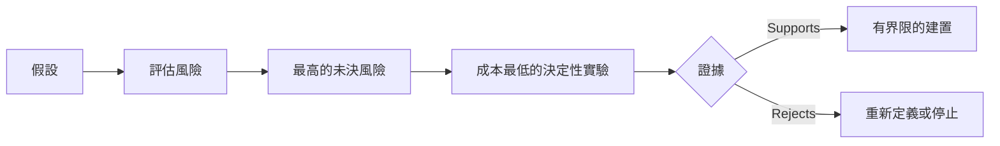

# 繪製假設地圖並優先化解最高風險

> 產品路線圖（Roadmap）往往把不確定性藏在各項功能裡。假設地圖（Assumption Map）則揭露這些功能值得存在之前，必須為真的前提。

**Type:** Learn + Build
**Languages:** Python (stdlib)
**Prerequisites:** Phase 14 lesson 48
**Time:** ~65 minutes

## Learning Objectives｜學習目標

- 將提議的工作轉化為明確的假設。
- 分別評分衝擊度（Impact）、不確定性（Uncertainty）與不可逆性（Irreversibility）。
- 依風險而非熱情選擇下一個實驗。
- 以證據與決策取代經檢驗的假設。

## 每次建置都包含賭注

一個事故工具可能依賴以下所有前提皆為真：

- 告警上下文包含足夠資訊，能辨識出服務；
- 工程師會信任一條自己沒有推導出來的建議；
- 期望的回應時間在營運上確實重要；
- 所需資料可在不授予不安全權限的情況下存取；
- 此工作流程發生得夠頻繁，足以支持維護。

這些不是實作任務，而是建置要具備價值、可用、可行與安全所需的條件。

## 五大假設分類

| 假設類別 | 回答的問題 |
|---|---|
| Value（價值） | 成效是否足夠重要？ |
| Usability（易用性） | 使用者能否理解並採取行動？ |
| Feasibility（可行性） | 系統能否用現有資料與限制產出成果？ |
| Viability（營運可行性） | 組織能否持續承擔成本、負責與營運？ |
| Safety（安全性） | 它失敗時能否不造成無法接受的後果？ |

將假設撰寫為具備**可證偽性（Falsifiable）**的精確陳述。「該功能有用」無法測試；而「十位值班工程師中有八位，能借助這個唯讀結果更快找出正確的服務」可以測試。

## 風險絕非單一扁平數字

實驗使用三個維度，每個從 1 到 5：

- **衝擊度（Impact）**：若假設為假，會造成多大損害。
- **不確定性（Uncertainty）**：目前證據的薄弱程度。
- **不可逆性（Irreversibility）**：投入之後才學習所需的代價。

範例評分公式將衝擊度與不確定性相乘，隨後疊加不可逆性。這個公式並非通用；其目的在於讓團隊說明，為何某個未知項要先於另一個解決。



## 設計實驗，而非確認儀式

有用的測試應具備：

- 一個可能為假的主張；
- 一個族群或貼近真實的樣本；
- 可觀察的結果；
- 在結果出來之前就決定的門檻；
- 對通過、失敗與模糊證據各自的下一步決策。

避免只證明團隊能把點子做出來的測試。

## 可逆性改變順序

後果重大且不可逆的選擇，需要更早的證據。唯讀重播，可以先於正式環境整合；暫時的轉接器可先於資料遷移；經人工核准的建議，可先於自動執行。

建置的形態應順應不確定性的形態。

## Build It｜動手實作

實驗會排序假設、區分已測試與未決的主張、選出目前最高的未決風險，並寫入 `outputs/assumption-map.json`。

```bash
python3 code/main.py
python3 -m unittest discover code/tests -v
```

修改最高風險假設的證據，觀察下一個實驗如何改變。

## Exercises｜練習

1. 為你想建置的一項功能寫下五條假設。
2. 補上功能清單中遺漏的一條安全假設。
3. 定義一個會讓你停止建置的門檻。
4. 把一個大型實驗換成更便宜、同樣具決定性的測試。
5. 比較風險排序與路線圖優先順序，並說明兩者的不一致。

## Further Reading｜延伸閱讀

- [Barry Boehm, A Spiral Model of Software Development and Enhancement](https://dl.acm.org/doi/10.1145/12944.12948) ——在更深投入之前先化解不確定性的風險導向開發循環
- [Dardenne, van Lamsweerde, and Fickas, Goal-Directed Requirements Acquisition](https://doi.org/10.1016/0167-6423(93)90021-G) ——在精煉目標的同時浮現障礙與約束的論文

## 留存產物

保留 `outputs/assumption-map.json`。下一課會用它來選出能產生決定性證據的最小切片。
