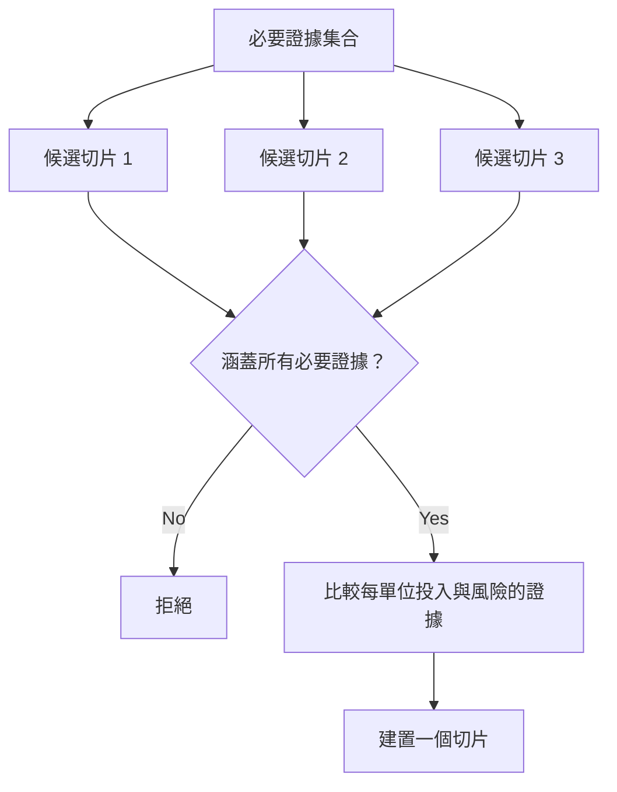

# 挑選能改變決策的最小切片

> 小只有在能證明重要的事情時才有用。一個無法改變下一個決策的微小建置，只是不完整。

**Type:** Learn + Build
**Languages:** Python (stdlib)
**Prerequisites:** Phase 14 lesson 49
**Time:** ~65 minutes

## Learning Objectives｜學習目標

- 依據切片所能驗證的假設，定義垂直切片（Slice）。
- 平衡成效價值、不確定性消除、投入精力與後果。
- 優先選擇可逆的證據，而非過早對正式環境做出承諾。
- 拒絕省略工作流程中風險部分的切片。

## 垂直切片意味著端到端的證據

一個有用的切片，必須涵蓋觀察成效所需的最小真實工作流程。它在使用者、資料、時長與能力上可以狹窄，但不應透過移除你需要測試的不確定性來變得狹窄。

實用對照：

- 對十起真實事故進行唯讀重播，可測試服務辨識與操作者的信任；
- 以合成資料做出的精緻儀表板，或許能測試理解度，但無法測試資料可行性；
- 直接在正式環境部署自動修復器，會一次測試所有東西，後果無法接受。

## 先定義必要證據集合

將風險最高的未決假設轉為「必要證據集合（Required Proof Set）」。候選切片只有涵蓋該集合，才有資格。

接著，比較合格的候選切片，依據：

| 評估維度 | 優劣方向 |
|---|---|
| Outcome value（成效價值） | 越高越好 |
| Uncertainty reduced（降低的不確定性） | 越多越好 |
| Effort（投入精力） | 越少越好 |
| Consequence（後果） | 越低越好 |
| Reversibility（可逆性） | 越高越好 |

實驗的評分刻意保持簡單。資格閘門比算術更重要。



## 常見的偽「最小化」陷阱

- **只做 UI 的最小化**：移除了資料與營運面的不確定性。
- **只做基礎設施的最小化**：證明技術可能性，卻沒有使用者價值。
- **只做理想路徑的最小化**：省略了造成多數風險的例外。
- **只做 demo 的最小化**：產出一份有說服力的產物，卻沒有可重複的量測。
- **過早平台化的最小化**：在一個工作流程證明其價值之前，就建置可重用的機制。

## 加入停止規則

在實作前，寫下切片失敗時會發生什麼：

- 放棄該成效目標；
- 改變目標使用者或情境；
- 測試不同的機制；
- 收集更好的證據；
- 進一步縮小權限。

若每種結果都導向「繼續建置」，這個切片就不是實驗。

## Build It｜動手實作

實驗依必要證據集合篩選候選切片、為合格切片評分，並寫入 `outputs/slice-decision.json`。

```bash
python3 code/main.py
python3 -m unittest discover code/tests -v
```

新增一個較便宜、只能證明一項必要假設的候選切片。即使它的分數很高，它仍應保持不合格。

## Exercises｜練習

1. 針對同一成效，在不同後果等級下設計三個切片。
2. 在評分之前，先寫下必要證據集合。
3. 移除一項能力，同時保留具決定性的證據。
4. 為失敗的試點（Pilot）加入停止規則。
5. 找出一個應在切片之後才開始的可重用平台元件。

## Further Reading｜延伸閱讀

- [Barry Boehm, A Spiral Model of Software Development and Enhancement](https://dl.acm.org/doi/10.1145/12944.12948) ——讓每個開發循環對應其必須化解之風險的螺旋模型論文
- [Lenarduzzi and Taibi, MVP Explained: A Systematic Mapping Study on the Definitions of Minimal Viable Product](https://arxiv.org/abs/1609.07592) ——探討軟體產品實務中「minimum」與「viable」語意模糊性的研究

## 留存產物

保留 `outputs/slice-decision.json`。它記錄為何這個切片是能改變決策的最小切片。
