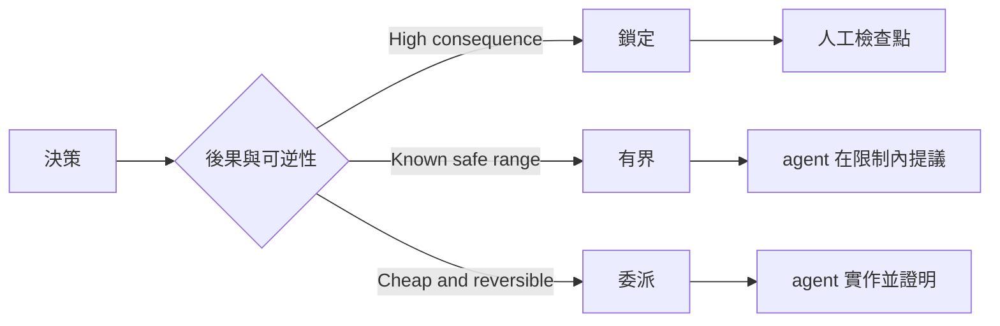

# 撰寫保留判斷力的規格

> 一份實用的規格說明書（Specification）會固定不變量與驗收證據，同時讓可逆的實作選擇保持開放。它是決策邊界，而不是劇本。

**Type:** Learn + Build
**Languages:** Python (stdlib)
**Prerequisites:** Phase 14 lesson 50
**Time:** ~75 minutes

## Learning Objectives｜學習目標

- 分開成效（Outcome）、不變量（Invariants）、範例（Examples）、非目標（Non-goals）與證明（Proof）。
- 將決策標示為鎖定（Locked）、有界（Bounded）或委派（Delegated）。
- 在選擇成本低且可逆的地方，保留 agent 的判斷。
- 在後果或公開行為會改變之處，要求人工檢查點。

## 兩種糟糕的極端

規格不足（Underspecified）的任務，要求 agent 猜測系統。過度規格（Overspecified）的任務，則要求它照抄一份可能早已錯誤的設計。

實用的中間路線，是**可執行的契約（Executable Contract）**：

| 契約表面 | 用途 |
|---|---|
| Outcome（成效） | 可觀察的結果 |
| Invariants（不變量） | 必須永遠為真的條件 |
| Examples（範例） | 揭示意圖的具體案例 |
| Non-goals（非目標） | 刻意排除的相鄰行為 |
| Decision policy（決策策略） | 明確宣告哪些決策屬於鎖定、有界或委派 |
| Proof（驗收證明） | 完成前必須提供的證據 |

## 三大決策模式

- **鎖定（Locked）**：agent **不得自行選擇**。適用於公開相容性、權限、安全性、不可逆成本或產品承諾。
- **有界（Bounded）**：agent 可在明確的限制內選擇。適用於搜尋預算、重試次數、允許的依賴，或已知的介面家族。
- **委派（Delegated）**：agent 負責該選擇，並須說明理由。適用於本機的程式結構、命名、可逆的重構與內部實作細節。



## 透過具體範例規範行為

範例傳達意圖，比形容詞更精簡。「有幫助」、「穩健」與「可上線」無法被執行。一小組正常、邊界、失敗與禁止的範例，能讓建置者與驗證者都有具體的依據。

範例不能取代不變量。單一通過的案例，無法證明一條通用的安全規則。

## 證明必須符合主張

- 單元測試證明的是單一函式的局部契約。
- wire 測試證明序列化與傳輸行為。
- 瀏覽器流程證明一條介面路徑。
- 重播集證明代表性案例上的行為。
- 稽核日誌能證明權限邊界仍然成立。

不要把低層級的證明當成高層級主張的證明。

## 刻意保留未知

規格可以寫明：「實作可以選擇任何能在時間預算內回傳的唯讀來源。」這不是含糊，而是一項有邊界、有證明的**刻意委派決策**。

規格應在證據改變時演進。保留鎖定與有界決策背後的理由，讓之後的團隊不必考古，就能修訂它們。

## Build It｜動手實作

實驗會驗證契約的每個表面、檢查決策模式，並寫入 `outputs/executable-specification.json`。

```bash
python3 code/main.py
python3 -m unittest discover code/tests -v
```

把正式環境寫入的決策從 locked 改為 delegated。說明為何結構描述（schema）接受該值，但產品風險不接受。

## Exercises｜練習

1. 將待辦清單中的一張工單轉為六個規格表面。
2. 用一條不變量與兩個範例，取代三條實作指令。
3. 為每個決策加上標記，並說明每項鎖定或有界選擇的理由。
4. 為每條不變量加入一筆證明憑證。
5. 移除一條沒有證據或風險理由的約束。

## Further Reading｜延伸閱讀

- [Nuseibeh and Easterbrook, Requirements Engineering: A Roadmap](https://www.cs.toronto.edu/~sme/papers/2000/ICSE2000.pdf) ——說明目標、精確規格、驗證、共識與演進之間關係的論文
- [Zave and Jackson, Four Dark Corners of Requirements Engineering](https://doi.org/10.1145/237432.237434) ——區分環境假設、需求與規格的論文
- [Gotel and Finkelstein, An Analysis of the Requirements Traceability Problem](https://doi.org/10.1109/ICRE.1994.292398) ——探討保留需求存在理由與其來源的論文

## 留存產物

保留 `outputs/executable-specification.json`。它會成為 coding agent 與人類審核者共同遵循的契約。
