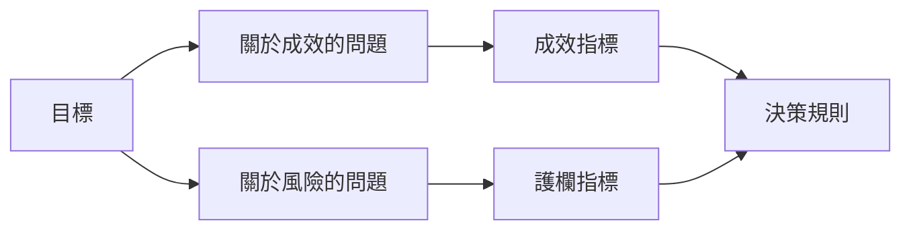

# 在看到結果前預先設計成功指標（success metrics）

> 量測應該回答決策，而不是裝飾儀表板。先從目標出發，推導出問題，再挑選能回答這些問題的最小指標集合。

**Type:** Learn + Build
**Languages:** Python (stdlib)
**Prerequisites:** Phase 14 lessons 47 and 51
**Time:** ~70 minutes

## Learning Objectives｜學習目標

- 從成效目標推導出問題與對應的量測指標。
- 在觀察任何結果之前，預先定義門檻、時間視窗、資料來源與目標方向。
- 將成效指標與護欄指標及對衡指標（Counter-metrics）成對搭配。
- 讓評估證據對應建置必須支持的決策。

## 目標、問題、指標

始於目標：

> 縮短找出受影響服務的時間，同時不增加不安全的操作。

推導關鍵問題：

- 系統多快能找出正確的服務？
- 找出的服務有多常是正確的？
- 診斷是否維持唯讀？
- 這個工作流程是否會增加告警被解除，或增加操作者的負擔？

接著將這些問題具體化為指標。



## 指標需要契約

每項指標都需要：

| 欄位 | 範例 |
|---|---|
| Name（名稱） | `median_identification_seconds` |
| Direction（方向） | at most（不大於） |
| Threshold（門檻） | 120 |
| Window（時間視窗） | 十次事故回放 |
| Source（資料來源） | 回放事件紀錄 |
| Population（目標群體） | 參與試點的值班工程師 |
| Kind（指標型別） | outcome（成效）或 guardrail（護欄） |

沒有來源與時間窗，數字就無法重現。沒有門檻，它就無法驅動決策。

## 成效指標、護欄指標與對衡指標

- **成效指標（Outcome metric）**：期望的狀態是否改善？
- **護欄（Guardrail）**：某項固定約束是否仍然成立？
- **對衡指標（Counter-metric）**：局部改善是否把成本或傷害轉移到其他地方？

對事故流程而言，速度並不足夠。正確性、正式環境寫入、操作者負擔與遺漏的告警，能防止「快但不安全」的結果。

## 離線證據與線上證據

離線回放有助於重現性與邊界覆蓋。有界限的試點（Pilot）有助於觀察真實行為、信任與工作流程的影響。兩者不能互相取代。

使用能回答當前決策、成本最低的證據。不要只因為實作已完成，就讓真實使用者接觸系統。

## 在量測前先確立決策路徑

在看到結果**之前**，先寫下通過、失敗與模糊的路徑。否則，團隊就會移動門檻來保護建置。

範例：

- 通過（Pass）：服務辨識正確率至少 0.9，且耗時中位數不超過 120 秒；
- 失敗（Fail）：任何正式環境寫入，或正確率低於 0.75；
- 模糊（Ambiguous）：改善幅度小、變異大，需要更大的回放集。

## Build It｜動手實作

實驗會驗證量測計畫、評估採含等號比較的門檻、記錄缺失值，並寫入 `outputs/measurement-report.json`。

```bash
python3 code/main.py
python3 -m unittest discover code/tests -v
```

移除護欄指標，觀察為什麼即使成效指標仍在，計畫也會失效。

## Exercises｜練習

1. 從一個成效目標推導出三個問題。
2. 新增一項對衡指標，捕捉轉嫁給其他角色的成本。
3. 為每項指標定義來源、群體與時間窗。
4. 在產生數值之前，寫下通過、失敗與模糊的決策。
5. 找出一項容易收集、卻無法改變決策的指標，並將其移除。

## Further Reading｜延伸閱讀

- [Basili, Software Modeling and Measurement: The Goal/Question/Metric Paradigm](https://drum.lib.umd.edu/items/8119803a-362b-42ec-b6ce-2311713e7236) ——從明確目標推導可操作度量的 GQM 典範論文
- [Basili, Caldiera, and Rombach, The Goal Question Metric Approach](https://www.cs.toronto.edu/~sme/CSC444F/handouts/GQM-paper.pdf) ——說明如何把此方法應用為回饋與持續改進系統

## 留存產物

保留 `outputs/measurement-report.json`。它定義原型、試點或正式上線階段的證據閘門。
