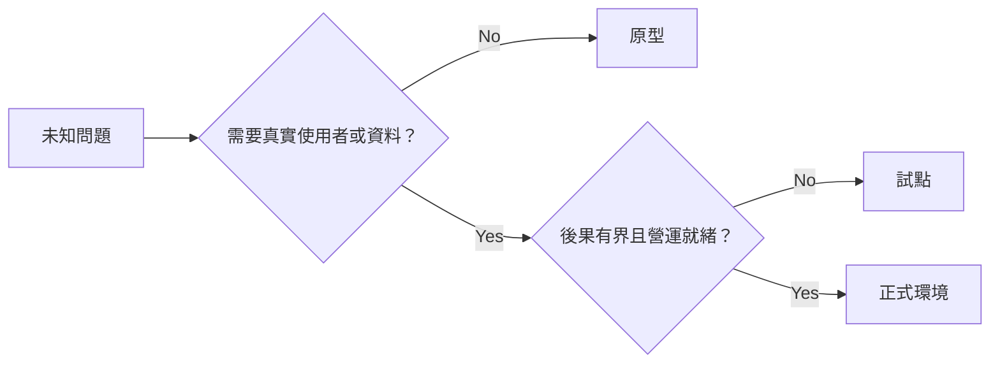

# 深思熟慮地抉擇原型（prototype）、試點或正式環境上線

> 這三者是不同的學習環境，而不是精緻程度的等級。請選擇能以最少不必要後果回答當前未知問題的階段。

**Type:** Learn + Build
**Languages:** Python (stdlib)
**Prerequisites:** Phase 14 lessons 50 to 52
**Time:** ~70 minutes

## Learning Objectives｜學習目標

- 依據未知、受眾、資料、後果與就緒度，選擇建置階段。
- 定義階段專屬的控制措施與退出標準（Exit Criteria）。
- 防止原型（Prototype）悄悄變成正式環境系統。
- 在證據與營運證明合理之前，延後授予真正的權限。

## 三個不同的問題

| 階段 | 主要問題 |
|---|---|
| Prototype（原型） | 這個機制能否產出所需證據？ |
| Pilot（試點） | 它能否在有限的真實受眾與真實條件下安全運作？ |
| Production（正式環境） | 我們能否在承諾的可靠度與風險水準下，持續負責它？ |

原型可以在技術上完整，但仍然是可丟棄的。試點可以使用正式環境資料，同時在受眾與權限上受限。正式環境始於組織接受持續的責任。

## 原型階段

當未知問題不需要真實使用者或真實資料時，使用原型。它應保持：

- 可丟棄；
- 隔離；
- 行為範圍狹窄；
- 明確說明它要學習的問題；
- 不作出錯誤的營運保證。

在機制取得進入下一階段的資格前，不要先做架構最佳化。

## 試點階段

當未知問題需要真實行為、貼近真實的資料或真實工作流程，但後果或就緒度尚不適合廣泛發布時，使用試點。

試點需要：

- 指定的受眾；
- 由人擔任的負責人；
- 有界的時長與權限；
- 稽核與回滾；
- 成效與護欄的門檻；
- 擴大、修訂或停止的退出標準。

## 正式環境階段

正式環境需要的不只是部署：

- 服務水準目標（SLO）；
- 值班與事故責任歸屬；
- 資安與隱私審查；
- 成本與容量控制；
- 回滾與復原；
- 持續監控；
- 退役路徑。



## 階段漂移

原型程式碼在取得使用者、資料或權限，卻沒有取得責任歸屬時，就會變得危險。請在設定、存取控制、遙測與文件中標示原型與試點的邊界。單純的警示橫幅並不足夠。

階段應能從系統本身觀察到。

## Build It｜動手實作

實驗依決策脈絡選出階段、回傳必要的控制，並寫入 `outputs/stage-decisions.json`。

```bash
python3 code/main.py
python3 -m unittest discover code/tests -v
```

把試點範例改為低後果且營運就緒。說明還需要哪些額外證據，才能支持進入正式環境。

## Exercises｜練習

1. 依學習階段而非部署狀態，分類你目前三個專案。
2. 撰寫包含停止決策的試點退出標準。
3. 新增一項技術控制，防止原型觸及正式環境資料。
4. 找出哪一項維運責任，使這項建置成為正式環境。
5. 為有界的試點設計回滾憑證。

## Further Reading｜延伸閱讀

- [Barry Boehm, A Spiral Model of Software Development and Enhancement](https://dl.acm.org/doi/10.1145/12944.12948) ——讓每次迭代的投入對應已化解風險的螺旋模型論文
- [Fagerholm et al., Building Blocks for Continuous Experimentation](https://doi.org/10.1145/2601248.2601276) ——說明持續進行實驗所需的組織與技術條件

## 留存產物

保留 `outputs/stage-decisions.json`。它記錄各階段為何合理，以及進入下一階段前必須存在哪些控制。
