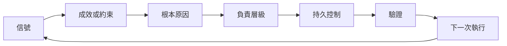

# 打造具備責任歸屬與退役機制的回饋棘輪（Feedback Ratchet）

> 交付會關閉一個建置迴圈，並開啟學習迴圈。證據必須改變系統，否則它只會變成沒人負責的遙測資料。

**Type:** Learn + Build
**Languages:** Python (stdlib)
**Prerequisites:** Phase 14 lessons 46 and 53
**Time:** ~75 minutes

## Learning Objectives｜學習目標

- 將事故、評估、使用者行為與修正轉化為有負責人的行動。
- 將每個回饋信號路由到上下文、評估、政策、執行環境或待辦清單。
- 依嚴重性與頻率排定重複問題的優先順序。
- 為每項控制設定退役條件。
- 以證據、權衡與負責的人，清楚溝通交付決策。

## 回饋本身即是基礎設施（Feedback Is Infrastructure）

一個團隊可能收集了追蹤、Evals 結果、客服工單與事故日誌，卻沒有從中學到任何東西。缺少的機制是**升格（Promotion）**：從觀察到具有負責人與證明的持久變更，所定義的路徑。

演進閉環：

1. 觀察到具體的信號；
2. 將它與成效、約束或假設關聯；
3. 找出擁有該原因的最早系統層級；
4. 建立一項有界限的變更；
5. 驗證重現的機率確實降低；
6. 審查該控制是否應保留。

## 路由到負責的層級（Route to the Owning Layer）

| 信號 | 目的地 |
|---|---|
| 偽陽性、回歸、錯誤結果 | 評估或測試 |
| 缺少上下文、重複工作、過時事實 | 上下文來源或檢索路由 |
| 不安全的動作或權限缺口 | 政策或權限邊界 |
| 逾時、重試風暴、依賴不可用 | 執行環境控制 |
| 新的產品需求或未解的取捨 | 整理過的待辦項目 |

在最早有效的層級修復根本原因。若測試或權限可以讓故障不可能發生，就不要再加一段 prompt 文字。



## 責任歸屬是控制的一部分（Ownership Is Part of the Control）

每個棘輪行動都需要：

- 一位負責人（Owner）；
- 依後果與重現頻率排定的優先順序；
- 要修改的產物；
- 證明變更有效的驗證；
- 審查或到期的時間窗；
- 退役條件。

沒有負責人的改進，只是格式比較好看的觀察。

## 退役過時的控制（Retire Stale Controls）

回饋系統會累積政策。這些政策可能互相矛盾，也可能變得昂貴。以下情況時，檢視控制：

- 架構或工作流程改變；
- 較低層的不變量取代了較高層的指引；
- 受保護的故障在選定的時間窗內未再出現；
- 該控制阻擋正當工作的次數，多於它防止傷害的次數。

退役同樣需要證據。不要因為控制「感覺很舊」就刪除它。

## 連結產品建置與 coding agent 的回饋（Connect Build and Coding-Agent Feedback）

同一套棘輪服務兩條軌道：

- 產品證據會改變成效框架、假設、切片或量測計畫。
- coding agent 的修正會改變測試、上下文、範圍、自動化或交接。
- 事故可能同時改變產品邊界與 agent 工作台。

這就是為什麼「塑造建置」不是在寫程式之前結束的階段。它會延續到每一次被接受的變更。

## Build It｜動手實作

實驗會分類信號、建立有負責人的棘輪行動、排定優先順序，並寫入 `outputs/feedback-backlog.json`。

```bash
python3 code/main.py
python3 -m unittest discover code/tests -v
```

新增一個執行環境逾時信號，確認它路由到執行環境，而非一般待辦清單。

## 實戰實驗：遭遇挫折後承擔決策（Practice Lab: Own a Decision After a Setback）

從你的職涯代表專案中挑選一個真實的工作流程，讓它經過一次決策、一次小型驗證實驗與一次審查。將證據記錄於 [職涯交付範本](https://github.com/rohitg00/ai-engineering-from-scratch/blob/main/phases/14-agent-engineering/54-build-the-feedback-ratchet/outputs/career-delivery-evidence.md) 中。

Python 實驗只會生成範例待辦行動。它不會觀察使用者、衡量介入效果，也無法證明你的職涯準備度。完成該實驗，只是本練習的準備。

### 1. 確立事實真相

記錄使用者、任務、當前工作流程，以及你期望改善的實質成效。附帶一份經授權的真實觀測紀錄、一份經脫敏的客服工單，或一條可重現的任務執行 Trace。嚴格區分你親眼觀察到的客觀事實、他人向你口頭陳述的主張，以及團隊內部的主觀推論。

揪出一次真實的挫折：一項被證偽的假設、一份無法被一線採納的產物、一次非預期的高昂成本，或是一次拖延的階段移交。清晰解釋究竟是哪項最新證據顛覆了你先前的理解。面對挫折需要的是及時的應對與果斷的決策，而非圍繞失敗編造粉飾太平的成功敘事。

若你暫時無法與真實使用者協同，與同行進行一場標註清晰的模擬演練，或在明確的假設情境下推進。嚴格將模擬觀測與真實使用者證據分開標註。切勿捏造訪談、審批、採納率或業務衝擊結論。

### 2. 在你的權限範圍內推進行動

列舉當前所有未知決策，挑選能以最小可逆代價解答最具影響力問題的行動。清晰界定哪些事項在你的授權範圍內可自主裁決、哪些事項受到既有協議約束，而哪些事項在實質執行前強制要求取得授權。

例如，在等待存取客戶資料的正式批准期間，你可以在本地準備經脫敏的離線回放資料庫。發揮主觀能動性意味著積極推進已獲授權的工作，並將受阻的未決決策清晰向上呈報。它絕不代表可以擅自僭越你的存取權限或審批邊界。

### 3. 對比多種方案並向決策人匯報

為那些無需關心過多底層技術細節的決策人員，撰寫一份簡明扼要的決策簡報。必須包含：

- 使用者真實痛點，以及促使計畫發生變更的客觀證據；
- 至少兩種可行方案，在合情合理的場景下必須包含更廉價的人工替代方案或完全不做（No-build）選項；
- 針對品質、互動體驗、投入精力、維運成本與潛在風險的深度權衡取捨；
- 你的具體建議、尚存的不確定性，以及當下迫切需要的決策項；
- 具體的決策責任人、受波及的關係人，以及必須做出決定的截止日期。

邀請一位同行扮演受波及的利益關係人，對其中一項權衡取捨發起嚴厲挑戰。如實記錄對方的反對意見，以及該意見究竟如何實質改變（或未改變）你的最終建議。將角色扮演的回饋明確標註為模擬；它絕無法替代實際利害關係人的同意。

### 4. 執行有界限的驗證實驗

依據當前急需解答的核心問題，理性挑選原型（Prototype）、試點（Pilot）或正式環境（Production）階段。在收集結果之前，預先定義目標受眾、資料範圍、授權限度、存續時間、回滾方案，以及決定繼續、修改或終止的明確門檻。

完整走過從使用者的起始起點到任務完工的全流程互動體驗。務必包含輸出錯誤或資料缺失的異常邊界案例。實地觀察使用者能否及時察覺故障、動手糾偏，並在無需你暗中提示協助的前提下順利復原。

將人類工程師的審查與修正時間計入整個工作流程。一個回應速度更快的模型，仍可能讓完整任務耗時更長，或更難取得信任。

### 5. 綜合對比業務成效與經濟效益

使用完全相同的指標定義、受試樣本群體、採集方法與可比的觀測時間視窗，忠實記錄基準線（Baseline）與後續成效。將樣本數量、排除項目與證據鏈結緊鄰數字客觀呈現。若測試條件發生改變，坦誠說明為何該對比存在局限性。

評估體系必須同時包含一項使用者實質成效、一項品質或安全護欄指標，以及人類審核所投入的總精力。即使未達預期，亦如實記錄真實結果。小規模或模擬樣本僅能支撐受限的認知學習主張，絕無法直接宣告已達成可證明的商業價值。

結合模型呼叫成本、失敗重試、輔助服務與人工審查時間，估算每個成功完成任務的成本（Cost per task）。明確說明人工時薪的假設基準，並將實測用量與主觀預估清晰分離。將該成本與純人工替代方案或專案背後的預期價值假設進行深度對照。

使用現有的 [FinOps for LLMs 課程](https://aiengineeringfromscratch.com/lesson?path=phases/17-infrastructure-and-production/27-finops-llms) 深入了解成本歸因與單位經濟效益。更換模型僅是眾多可能對策中的一種；進一步收斂業務流程或刻意保留特定人工環節，往往是更明智的產品決策。

### 6. 完成全流程閉環

依據預先宣告的成功標準，明確提出繼續推進（Continue）、修改方案（Change）或果斷終止（Stop）的具體建議。若當前客觀證據不足以得出結論，明確指出缺失的關鍵觀測是什麼，以及下一步的最小有界測試為何。忠實記錄負責該項決策之責任人的正式回覆；若尚未拍板，如實標註為暫緩未決。

為交付流程本身挑選一項可執行的具體改進措施：更清晰的任務框架、更提前的使用者演練、更完善的審核檢查清單、更精煉的 Agent 階段移交，或是更嚴格的評測測試案例。為該項改進明確指派單一責任人與預定審查日期。

在後續的審查會議上，依據實證資料決定是保留、修訂還是退役該項改進措施。忠實記錄做出該決定的客觀依據。一項只會製造更多工作負擔、卻完全無法防範目標故障的全新檢查清單，根本沒有資格在系統中獲得永久居留權。

## 交付產物

將 [career-delivery-evidence.md](https://github.com/rohitg00/ai-engineering-from-scratch/blob/main/phases/14-agent-engineering/54-build-the-feedback-ratchet/outputs/career-delivery-evidence.md) 複製至你自己的專案中，並完整附上各項客觀證據鏈結。保留儲存庫既有的範本作為可復用資產。將決策簡報、互動演練紀錄、度量對照表以及具備責任人追蹤的後續行動，納入你的職涯代表作品集之中。

## 成果驗證

邀請同行依據以下人工驗收標準手冊共同審查。在每一列中標註 **met**（已達成）、**needs work**（需返工）或 **not observed**（未觀測到），並提供證據指標或指明具體缺失的觀測依據。填滿的表單欄位絕不能證明工程判斷的健全性。

| 檢核項目 | 能證明達成該項的客觀依據 |
|---|---|
| 工作流程真實接地 | 具備可追溯的真實觀測證據支撐問題；口頭主張、推論與模擬演練皆被清晰標註 |
| 恪守權限邊界 | 可逆的下一步行動明確無誤，任何受限操作都等待有權決策的實際負責人拍板 |
| 權衡取捨充分溝通 | 記錄了合情合理的替代方案、利益關係人的質疑挑戰、自身建議以及顯式的決策請求 |
| 互動經過測試 | 演練涵蓋成功、失敗、復原與人工審查所需的精力 |
| 業務成效嚴格對照 | 基準線與後續評估的定義嚴格對齊；樣本容量、安全護欄、維運成本與對照局限性清晰可見 |
| 坦誠擔當挫折責任 | 客觀證據實質改變了「繼續／修改／終止」的決策，並轉化為具備責任人負責的下一步行動 |
| 交付流程實質進化 | 針對工作流程本身的改進具備明確責任人、審查日期，以及依託客觀證據的保留／修訂／退役決策 |

未曾實地觀測到真實使用者行為，始終是一項必須被承認的客觀盲區。在作品集宣告中完整保留該邊界，並明確指出日後消弭該盲區所需的下一步關鍵觀測。

## Exercises｜練習

1. 將一次線上真實事故與一則真實使用者投訴，分別轉化為具備明確責任人的棘輪行動。
2. 指出能最先阻止這兩起問題重現的最早生效系統防護層。
3. 為實驗輸出的待辦條目，追加具體的驗收檢驗指令或客觀觀測信號。
4. 為一條安全策略規則定義明確的退役淘汰條件。
5. 將一項已獲接納的人工糾偏，逆向追溯並注入下一個任務框架的邊界定義中。

## Further Reading｜延伸閱讀

- [Basili, Caldiera, and Rombach, The Goal Question Metric Approach](https://www.cs.toronto.edu/~sme/CSC444F/handouts/GQM-paper.pdf) ——透過目標導向度量推動組織級學習的經典 GQM 論文
- [Fagerholm et al., Building Blocks for Continuous Experimentation](https://doi.org/10.1145/2601248.2601276) ——將客觀證據與持續產品開發無縫連接的技術與組織閉環
- [Nuseibeh and Easterbrook, Requirements Engineering: A Roadmap](https://www.cs.toronto.edu/~sme/papers/2000/ICSE2000.pdf) ——將軟體需求視為貫穿整個生命週期動態演進的權威需求工程論文

## 留存產物（What You Keep）

妥善保留 `outputs/feedback-backlog.json` 作為路由範例，並保留你親手填寫的職涯交付證據檔案作為你個人工程判斷的里程碑記錄。兩者共同為「產品判斷力與交付路線（Product Judgment and Delivery path）」畫上圓滿句號，並為下一個業務成效框架提供源源不絕的演進動力。
