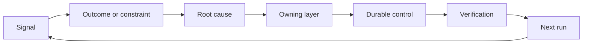

# 打造具備責任歸屬與退役機制的回饋棘輪

> 交付會關閉一個建置迴圈，並開啟學習迴圈。證據必須改變系統，否則它只會變成沒人負責的遙測資料。

**Type:** Learn + Build
**Languages:** Python (stdlib)
**Prerequisites:** Phase 14 lessons 46 and 53
**Time:** ~75 minutes

## Learning Objectives｜學習目標

- 將事故、評估、使用者行為與修正轉化為有負責人的行動。
- 將每個回饋信號路由到上下文、評估、政策、執行環境（runtime）或待辦清單。
- 依嚴重性與頻率排定重複問題的優先順序。
- 為每項控制設定退役條件。

## 回饋本身即是基礎設施

一個團隊可能收集了追蹤資料（traces）、評估結果、客服工單與事故日誌，卻沒有從中學到任何東西。缺少的機制是**升格（Promotion）**：從觀察到具有負責人與證明的持久變更，所定義的路徑。

演進閉環：

1. 觀察到具體的信號；
2. 將它與成效、約束或假設關聯；
3. 找出擁有該原因的最早系統層級；
4. 建立一項有界限的變更；
5. 驗證重現的機率確實降低；
6. 審查該控制是否應保留。

## 路由到負責的層級

| 信號 | 目的地 |
|---|---|
| 偽陽性、回歸、錯誤結果 | 評估或測試 |
| 缺少上下文、重複工作、過時事實 | 上下文來源或檢索路由 |
| 不安全的動作或權限缺口 | 政策或權限邊界 |
| 逾時、重試風暴、依賴不可用 | 執行環境控制 |
| 新的產品需求或未解的取捨 | 整理過的待辦項目 |

在最早有效的層級修復根本原因。若測試或權限可以讓故障不可能發生，就不要再加一段 prompt 文字。



## 責任歸屬是控制的一部分

每個棘輪行動都需要：

- 一位負責人（Owner）；
- 依後果與重現頻率排定的優先順序；
- 要修改的產物；
- 證明變更有效的驗證；
- 審查或到期的時間窗；
- 退役條件。

沒有負責人的改進，只是格式比較好看的觀察。

## 退役過時的控制

回饋系統會累積政策。這些政策可能互相矛盾，也可能變得昂貴。以下情況時，檢視控制：

- 架構或工作流程改變；
- 較低層的不變量取代了較高層的指引；
- 受保護的故障在選定的時間窗內未再出現；
- 該控制阻擋正當工作的次數，多於它防止傷害的次數。

退役同樣需要證據。不要因為控制「感覺很舊」就刪除它。

## 連結產品建置與 coding agent 的回饋

同一套棘輪服務兩條軌道：

- 產品證據會改變成效框架、假設、切片或量測計畫。
- coding agent 的修正會改變測試、上下文、範圍、自動化或交接。
- 事故可能同時改變產品邊界與 agent 工作台。

這就是為什麼「塑造建置」不是在寫程式之前結束的階段。它會延續到每一次被接受的變更。

## Build It｜動手實作

實驗會分類信號、建立有負責人的棘輪行動、排定優先順序，並寫入 `outputs/feedback-backlog.json`。

```bash
python3 code/main.py
python3 -m unittest discover code/tests -v
```

新增一個執行環境逾時信號，確認它路由到執行環境，而非一般待辦清單。

## Exercises｜練習

1. 將一次真實事故與一則真實使用者投訴，分別轉化為具備明確責任人的棘輪行動。
2. 指出能最先阻止這兩起問題重現的最早生效系統防護層。
3. 為實驗輸出的待辦條目，追加具體的驗收檢驗指令或客觀觀測信號。
4. 為一條安全策略規則定義明確的退役淘汰條件。
5. 將一項已獲接納的人工糾偏，逆向追溯並注入下一個任務框架的邊界定義中。

## Further Reading｜延伸閱讀

- [Basili, Caldiera, and Rombach, The Goal Question Metric Approach](https://www.cs.toronto.edu/~sme/CSC444F/handouts/GQM-paper.pdf) ——透過目標導向度量推動組織級學習的經典 GQM 論文
- [Fagerholm et al., Building Blocks for Continuous Experimentation](https://doi.org/10.1145/2601248.2601276) ——將客觀證據與持續產品開發無縫連接的技術與組織閉環
- [Nuseibeh and Easterbrook, Requirements Engineering: A Roadmap](https://www.cs.toronto.edu/~sme/papers/2000/ICSE2000.pdf) ——將軟體需求視為貫穿整個生命週期動態演進的權威需求工程論文

## 留存產物

妥善保留 `outputs/feedback-backlog.json`。它是「產品判斷力與交付路線（Product Judgment and Delivery path）」的收尾產物，也是下一個業務成效框架的輸入。
