# 通訊協定（Communication Protocols）

> 無法使用相同語言對話的 Agent 稱不上是一個團隊。它們只是一群對著虛空吶喊的陌生人。

**Type:** Build
**Languages:** TypeScript
**Prerequisites:** Phase 14 (Agent Engineering), Lesson 16.01 (Why Multi-Agent)
**Time:** ~120 minutes

## Learning Objectives｜學習目標

- 實作 MCP 工具發現與呼叫機制，讓 agent 能夠呼叫由外部伺服器所暴露的各項工具
- 建構符合 A2A 規格的 Agent Card 與任務端點，讓 agent 之間能夠透過 HTTP 相互委派任務
- 橫向比較 MCP（工具存取）、A2A（Agent 間協同）、ACP（企業級稽核）與 ANP（去中心化信任），並清楚說明哪種協定專門解決哪一類問題
- 在單一整合系統中貫通多種協定：讓 agent 透過 MCP 發現工具，並透過 A2A 委派各項任務

## The Problem｜問題

你將系統拆解為多個 agent。一個研究員、一個工程師、一個審查員。它們各自在專屬職責上表現卓越。然而現在，你必須讓它們能夠彼此真正展開對話。

你的第一次嘗試顯而易見：四處傳遞純字串。研究員回傳一大段文字，工程師各憑本事自行解析。這在初期尚可勉強運作，直到工程師誤判了研究摘要、或者兩個 agent 在互相等待中陷入死結，抑或你需要由不同團隊打造的 agent 共同協作時。剎那間，「只傳純字串」的作法徹底瓦解。

這正是通訊協定所要解決的核心難題。若缺乏一套關於 agent 如何交換資訊的共享契約，多 agent 系統將會極度脆弱、毫無可稽核性，且絕對無法擴展至超越你自己親手編寫的少數幾個 agent 之外。

AI 生態系對此給出了四種標準協定作為回應，各自攻克該難題的特定切片：

- **MCP** 專注於工具存取
- **A2A** 專注於 Agent 之間的協同合作
- **ACP** 專注於企業級的可稽核性
- **ANP** 專注於去中心化身分與信任

本課將深入探討這四大體系。你將親自研讀來自各項規格的真實傳輸格式，動手建構切實可行的實作程式碼，並將這四大協定完整貫通至單一整合系統中。

## The Concept｜核心概念

### 協定全景架構

將這四種協定想像為不同的架構層級，各自回答一個截然不同的核心問題：
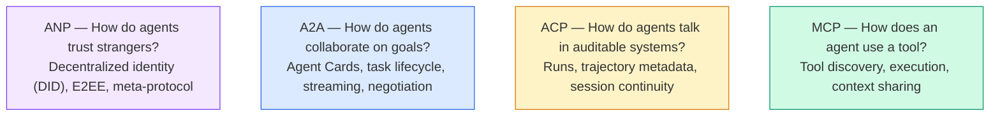
它們並非彼此競爭的替代品。它們在不同的抽象層次上解決不同的具體難題。

### MCP（複習回顧）

MCP 已在 Phase 13 中進行過深度剖析。在此快速回顧：MCP 標準化了 LLM 連線至外部工具與資料來源的通訊方式。它是一套**用戶端-伺服器**協定，其中 agent（用戶端）負責發現並呼叫由伺服器所暴露的各項工具。
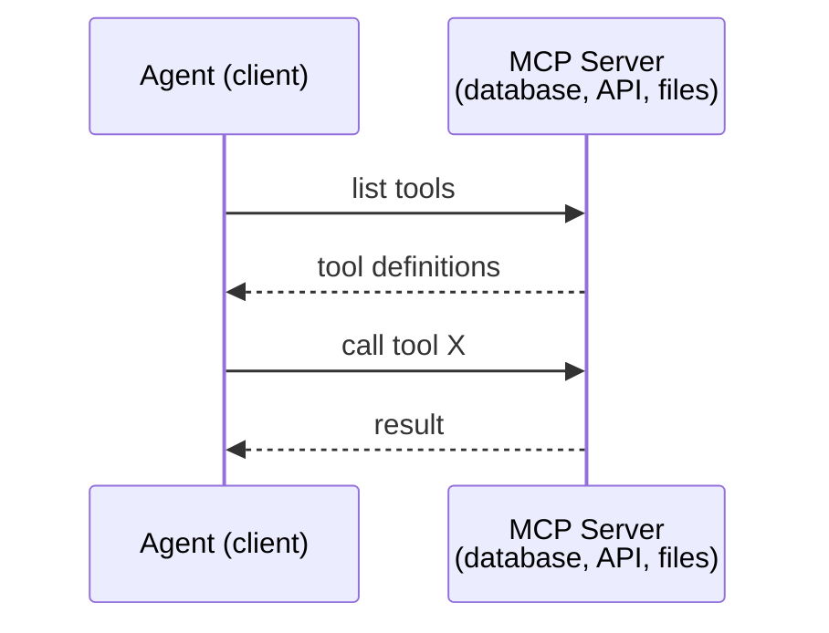
MCP 本質上是 **Agent 到工具（agent-to-tool）** 的通訊。它無法協助 agent 之間展開彼此對話。

### A2A（Agent2Agent 協定）

**發起方：** Google（現已移交至 Linux 基金會託管為 `lf.a2a.v1`）
**規格版本：** 1.0.1
**核心難題：** 自主 agent 之間該如何相互協同、協商並委派任務？

A2A 是一套專門用於 **Agent 點對點協同合作（peer-to-peer agent collaboration）** 的通訊協定。如果說 MCP 連接的是 agent 與工具，那麼 A2A 連接的則是 agent 與另一個 agent。每個 agent 皆會在眾所皆知的特定 URL 上發布其專屬的 **Agent Card**，其他 agent 則能透過該卡片進行服務發現、能力協商，並向其委派具體任務。

#### A2A 的運作機制
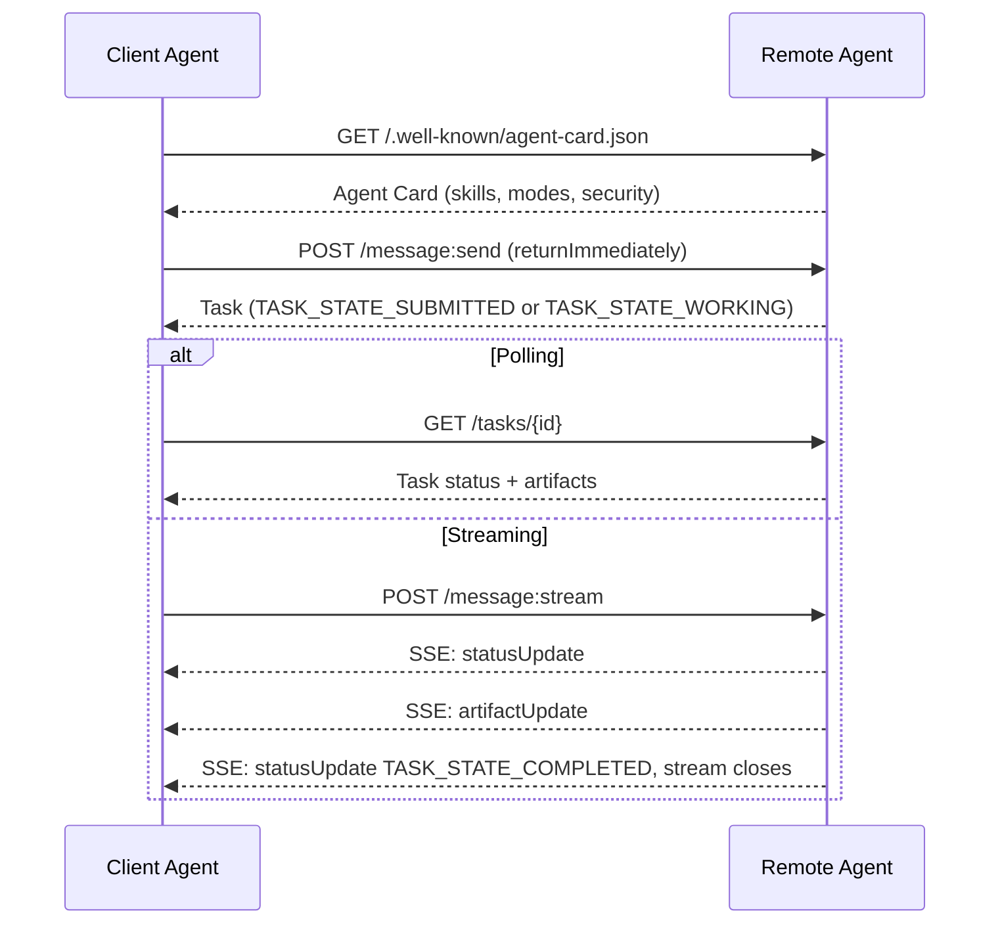
#### 真實的 Agent Card

以下展示真實正式環境中的 A2A Agent Card 的具體樣貌。透過 `GET /.well-known/agent-card.json` 取得：
```json
{
  "name": "Research Agent",
  "description": "Searches documentation and summarizes findings",
  "version": "1.0.0",
  "supportedInterfaces": [
    {
      "url": "https://research-agent.example.com/a2a/v1",
      "protocolBinding": "JSONRPC",
      "protocolVersion": "1.0"
    },
    {
      "url": "https://research-agent.example.com/a2a/rest",
      "protocolBinding": "HTTP+JSON",
      "protocolVersion": "1.0"
    }
  ],
  "provider": {
    "organization": "Your Company",
    "url": "https://example.com"
  },
  "capabilities": {
    "streaming": true,
    "pushNotifications": false
  },
  "defaultInputModes": ["text/plain", "application/json"],
  "defaultOutputModes": ["text/plain", "application/json"],
  "skills": [
    {
      "id": "web-research",
      "name": "Web Research",
      "description": "Searches the web and synthesizes findings",
      "tags": ["research", "search", "summarization"],
      "examples": ["Research the latest changes in React 19"]
    },
    {
      "id": "doc-analysis",
      "name": "Documentation Analysis",
      "description": "Reads and analyzes technical documentation",
      "tags": ["docs", "analysis"],
      "inputModes": ["text/plain", "application/pdf"],
      "outputModes": ["application/json"]
    }
  ],
  "securitySchemes": {
    "bearer": {
      "httpAuthSecurityScheme": {
        "scheme": "Bearer",
        "bearerFormat": "JWT"
      }
    }
  },
  "securityRequirements": [{ "schemes": { "bearer": { "list": [] } } }]
}
```
值得特別關注的關鍵細節：
- **Skills（技能）** 代表 agent 能夠執行的具體工作。每一項技能皆包含 ID、標籤（tags）以及支援的輸入／輸出 MIME 類型。用戶端 agent 正是依據這些中繼資料，來研判該遠端 agent 是否有能力處理自身的請求。
- **supportedInterfaces** 列出了多種協定綁定途徑。單一 agent 能夠同時支援 JSON-RPC、REST 與 gRPC 介面。
- **安全性（Security）** 深度整合於卡片結構中：`securitySchemes` 定義了各項認證方案，而 `securityRequirements` 則指明了具體的適用規則。用戶端在發起任何實質請求之前，便能明確獲知所需的安全憑證。

#### 任務生命週期（Task Lifecycle）

任務（Task）是 A2A 中的核心工作單元。它們會依循明確定義的狀態機流轉（下圖中省略了線路上每個狀態皆具備的 `TASK_STATE_` 前綴）：
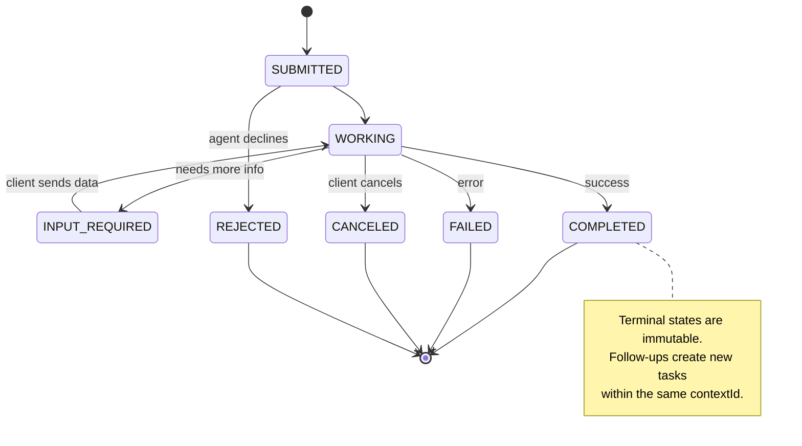
全部 8 種狀態（規格中額外定義了作為哨兵值的 `UNSPECIFIED`，此處予以省略）：

| State | Terminal? | Meaning |
|---|---|---|
| `TASK_STATE_SUBMITTED` | No | Acknowledged, not yet processing |
| `TASK_STATE_WORKING` | No | Actively being processed |
| `TASK_STATE_INPUT_REQUIRED` | No | Agent needs more info from client |
| `TASK_STATE_AUTH_REQUIRED` | No | Authentication needed |
| `TASK_STATE_COMPLETED` | Yes | Finished successfully |
| `TASK_STATE_FAILED` | Yes | Finished with error |
| `TASK_STATE_CANCELED` | Yes | Canceled before completion |
| `TASK_STATE_REJECTED` | Yes | Agent declined the task |

一旦任務邁入終端終止狀態（terminal state），該狀態即具備不可變性。後續嚴禁追加任何新訊息。後續追蹤事項必須在同一個 `contextId` 內建立全新任務。

#### 線路傳輸格式（Wire Format）

A2A 採用 JSON-RPC 2.0 協定。以下展示真實環境中的訊息交換過程：

**用戶端發送訊息：**
```json
{
  "jsonrpc": "2.0",
  "id": 1,
  "method": "SendMessage",
  "params": {
    "message": {
      "messageId": "msg-001",
      "role": "ROLE_USER",
      "parts": [{ "text": "Research React 19 compiler features" }]
    },
    "configuration": {
      "acceptedOutputModes": ["text/plain", "application/json"],
      "historyLength": 10
    }
  }
}
```
**Agent 回覆任務狀態：**
```json
{
  "jsonrpc": "2.0",
  "id": 1,
  "result": {
    "task": {
      "id": "task-abc-123",
      "contextId": "ctx-xyz-789",
      "status": {
        "state": "TASK_STATE_COMPLETED",
        "timestamp": "2026-03-27T10:30:00Z"
      },
      "artifacts": [
        {
          "artifactId": "art-001",
          "name": "research-results",
          "parts": [{
            "data": {
              "findings": [
                "React 19 compiler auto-memoizes components",
                "No more manual useMemo/useCallback needed",
                "Compiler runs at build time, not runtime"
              ]
            },
            "mediaType": "application/json"
          }]
        }
      ]
    }
  }
}
```
**透過 SSE 進行串流傳輸：**
```text
POST /message:stream HTTP/1.1
Content-Type: application/a2a+json
A2A-Version: 1.0

data: {"task":{"id":"task-123","contextId":"ctx-123","status":{"state":"TASK_STATE_WORKING"}}}

data: {"statusUpdate":{"taskId":"task-123","contextId":"ctx-123","status":{"state":"TASK_STATE_WORKING","message":{"messageId":"msg-002","role":"ROLE_AGENT","parts":[{"text":"Searching documentation..."}]}}}}

data: {"artifactUpdate":{"taskId":"task-123","contextId":"ctx-123","artifact":{"artifactId":"art-1","parts":[{"text":"partial findings..."}]},"append":true,"lastChunk":false}}

data: {"statusUpdate":{"taskId":"task-123","contextId":"ctx-123","status":{"state":"TASK_STATE_COMPLETED"}}}
```
### ACP（Agent 通訊協定）

**發起方：** IBM / BeeAI
**規格版本：** 0.2.0（OpenAPI 3.1.1）
**當前狀態：** 正式併入 Linux 基金會旗下的 A2A 計畫
**核心難題：** Agent 該如何在具備完整可稽核性、會話連續性與軌跡追蹤的前提下展開通訊？

ACP 是一套專為**企業級環境**量身打造的通訊協定。不同於許多二手摘要的錯誤宣稱，ACP **並未**採用 JSON-LD。它是一套透過 OpenAPI 規格所定義的標準 REST/JSON API。其最具特色的核心亮點在於 **TrajectoryMetadata**：agent 回傳的每一項回應皆可攜帶一份詳盡的日誌，完整記錄產出該結果所經歷的所有推理步驟與工具呼叫。
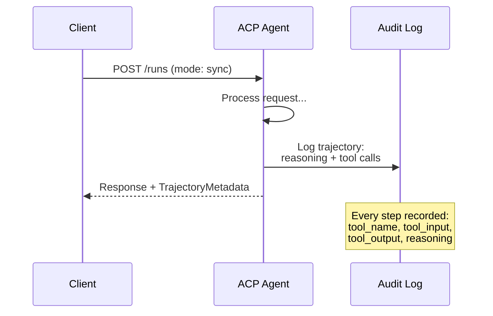
#### ACP 中的 Agent 發現機制

ACP 定義了四種探索發現途徑：
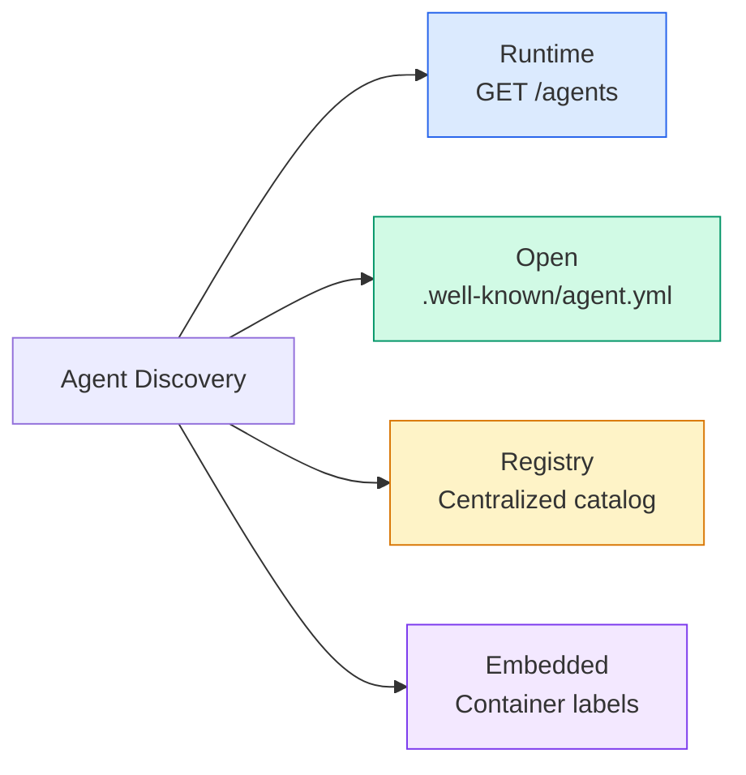
其 **AgentManifest** 比 A2A 的 Agent Card 更為精簡：
```json
{
  "name": "summarizer",
  "description": "Summarizes documents with source citations",
  "input_content_types": ["text/plain", "application/pdf"],
  "output_content_types": ["text/plain", "application/json"],
  "metadata": {
    "tags": ["summarization", "RAG"],
    "framework": "BeeAI",
    "capabilities": [
      {
        "name": "Document Summarization",
        "description": "Condenses long documents into key points"
      }
    ],
    "recommended_models": ["llama3.3:70b-instruct-fp16"],
    "license": "Apache-2.0",
    "programming_language": "Python"
  }
}
```
#### Run 執行生命週期

ACP 採用「Run（執行次）」而非「Task」。一個 Run 代表一次 agent 的執行過程，並具備三種運作模式：

| Mode | Behavior |
|---|---|
| `sync` | Blocking. Response contains the complete result. |
| `async` | Returns 202 immediately. Poll `GET /runs/{id}` for status. |
| `stream` | SSE stream. Events fire as the agent works. |
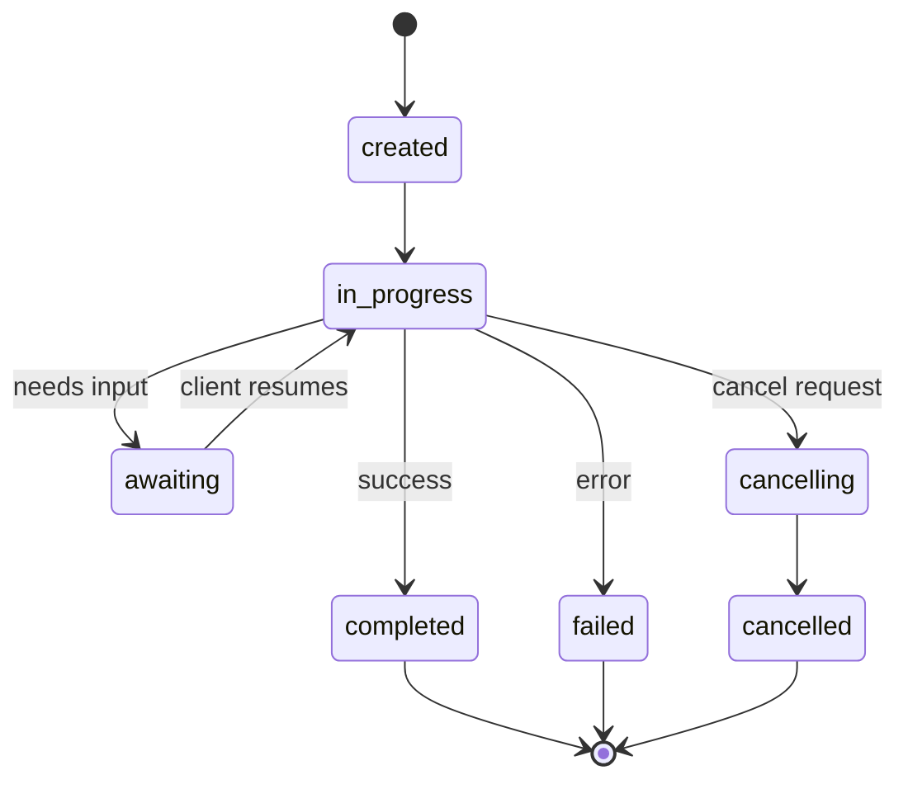
#### TrajectoryMetadata（稽核軌跡）

這是 ACP 最具決定性的核心競爭力。每一則訊息片段皆可包含詳細的中繼資料，精確交代 agent 究竟執行了何種操作：
```json
{
  "role": "agent/researcher",
  "parts": [
    {
      "content_type": "text/plain",
      "content": "The weather in San Francisco is 72F and sunny.",
      "metadata": {
        "kind": "trajectory",
        "message": "I need to check the weather for this location",
        "tool_name": "weather_api",
        "tool_input": { "location": "San Francisco, CA" },
        "tool_output": { "temperature": 72, "condition": "sunny" }
      }
    }
  ]
}
```
對於受嚴格法規監管的產業而言，這項特性價值連城。每一個答案都附帶了可被驗證的完整推理鏈條：呼叫了哪些工具、傳入了哪些參數、獲得了何種回傳資料。告別黑箱。

ACP 亦原生支援用於標註資料來源出處的 **CitationMetadata**：
```json
{
  "kind": "citation",
  "start_index": 0,
  "end_index": 47,
  "url": "https://weather.gov/sf",
  "title": "NWS San Francisco Forecast"
}
```
### ANP（Agent 網路協定）

**發起方：** 開源社群（由 GaoWei Chang 發起）
**儲存庫：** [github.com/agent-network-protocol/AgentNetworkProtocol](https://github.com/agent-network-protocol/AgentNetworkProtocol)
**核心難題：** 來自不同組織架構的跨機構 Agent，在缺乏中央權威機構的前提下該如何建立互信？

ANP 是一套專注於**去中心化身分（Decentralized Identity）**的通訊協定。它藉由 W3C 去中心化識別碼（DID）與端對端加密（E2EE）來建立無條件的信任底座。不同於 A2A 需要透過已知特定端點來發現 agent，ANP 允許各 agent 以密碼學方式向外界證明自身身分。

ANP 包含三個清晰的架構層次：
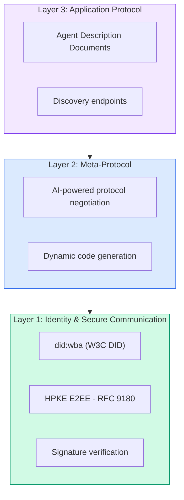
#### DID 文件（真實結構）

ANP 採用名為 `did:wba`（Web-Based Agent）的自定義 DID 方法。DID 字串 `did:wba:example.com:user:alice` 會自動解析至 `https://example.com/user/alice/did.json`：
```json
{
  "@context": [
    "https://www.w3.org/ns/did/v1",
    "https://w3id.org/security/suites/jws-2020/v1",
    "https://w3id.org/security/suites/secp256k1-2019/v1"
  ],
  "id": "did:wba:example.com:user:alice",
  "verificationMethod": [
    {
      "id": "did:wba:example.com:user:alice#key-1",
      "type": "EcdsaSecp256k1VerificationKey2019",
      "controller": "did:wba:example.com:user:alice",
      "publicKeyJwk": {
        "crv": "secp256k1",
        "x": "NtngWpJUr-rlNNbs0u-Aa8e16OwSJu6UiFf0Rdo1oJ4",
        "y": "qN1jKupJlFsPFc1UkWinqljv4YE0mq_Ickwnjgasvmo",
        "kty": "EC"
      }
    },
    {
      "id": "did:wba:example.com:user:alice#key-x25519-1",
      "type": "X25519KeyAgreementKey2019",
      "controller": "did:wba:example.com:user:alice",
      "publicKeyMultibase": "z9hFgmPVfmBZwRvFEyniQDBkz9LmV7gDEqytWyGZLmDXE"
    }
  ],
  "authentication": [
    "did:wba:example.com:user:alice#key-1"
  ],
  "keyAgreement": [
    "did:wba:example.com:user:alice#key-x25519-1"
  ],
  "humanAuthorization": [
    "did:wba:example.com:user:alice#key-1"
  ],
  "service": [
    {
      "id": "did:wba:example.com:user:alice#agent-description",
      "type": "AgentDescription",
      "serviceEndpoint": "https://example.com/agents/alice/ad.json"
    }
  ]
}
```
值得特別注意的關鍵亮點：
- 強制實施**金鑰分離（Key separation）**。簽章金鑰（secp256k1）與加密金鑰（X25519）各自獨立，職責分明。
- **`humanAuthorization`** 是 ANP 獨步業界的特色機制。被列入此處的金鑰在被使用前，強制要求取得人類的顯式授權確認（生物識別、密碼或硬體安全模組 HSM）。資金轉帳等高風險操作皆必須強制行經此路徑。
- **`keyAgreement`** 金鑰專門用於 HPKE 端對端加密（RFC 9180）。
- **service** 區塊則直接反向連結至 Agent 描述文件。

#### ANP 的信任建立機制

ANP **並未**依賴繁複的信任網路（web-of-trust）或聲譽背書圖譜。其信任關係是雙邊且在每一次互動中即時驗證的：
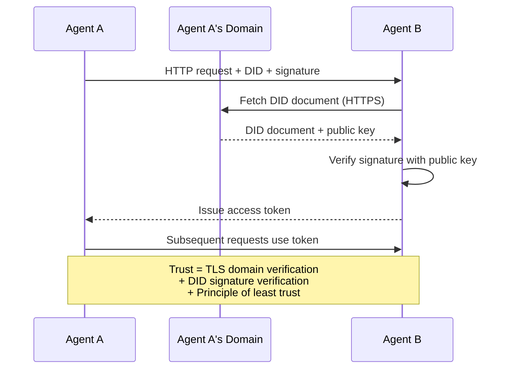
其信任源自於三大嚴謹支柱：
1. **網域名稱層級的 TLS 憑證** 驗證了 DID 文件的託管主機真偽
2. **DID 密碼學數位簽章** 嚴密驗證了 agent 本身的身分真實性
3. **最小信任原則** 確保僅授予完成當下任務所需的最低權限

系統不存在基於 Gossip 協定的信任傳播或 PageRank 聲譽演算法。你直接藉由其 DID 對每個 agent 進行點對點驗證。

#### 元協定動態協商（Meta-Protocol Negotiation）

這是 ANP 最具突破性的原創特性。當兩個來自完全不同技術生態的陌生 agent 狹路相逢時，它們不需要任何預先約定好的資料格式。它們能夠直接使用自然語言展開動態協商：
```json
{
  "action": "protocolNegotiation",
  "sequenceId": 0,
  "candidateProtocols": "I can communicate using:\n1. JSON-RPC with hotel booking schema\n2. REST with OpenAPI 3.1 spec\n3. Natural language over HTTP",
  "modificationSummary": "Initial proposal",
  "status": "negotiating"
}
```

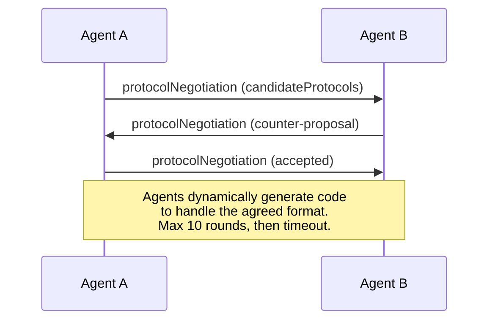
兩個 agent 進行來回交涉（最多 10 輪），直到雙方針對通訊格式達成一致共識，隨後在各自端點動態生成處理該格式的執行程式碼。協商狀態包含：`negotiating`、`rejected`、`accepted`、`timeout`。

這意味著兩個先前從未謀面的陌生 agent，能夠在無需任何人預先編寫共享 Schema 的前提下，自主探索出彼此皆能理解的通訊途徑。

### 橫向綜合對比（修正版）

| | MCP | A2A | ACP | ANP |
|---|---|---|---|---|
| **Created by** | Anthropic | Google / Linux Foundation | IBM / BeeAI | Community |
| **Spec format** | JSON-RPC | JSON-RPC / REST / gRPC | OpenAPI 3.1 (REST) | JSON-RPC |
| **Primary use** | Agent to Tool | Agent to Agent | Agent to Agent | Agent to Agent |
| **Discovery** | Tool listing | `/.well-known/agent-card.json` | `GET /agents`, `/.well-known/agent.yml` | `/.well-known/agent-descriptions`, DID service endpoints |
| **Identity** | Implicit (local) | Security schemes (OAuth, mTLS) | Server-level | W3C DID (`did:wba`) with E2EE |
| **Audit trail** | N/A | Basic (task history) | TrajectoryMetadata (tool calls, reasoning) | Not formally specified |
| **State machine** | N/A | 9 task states | 7 run states | N/A |
| **Streaming** | N/A | SSE | SSE | Transport-agnostic |
| **Unique feature** | Tool schemas | Agent Cards + Skills | Trajectory audit trail | Meta-protocol negotiation |
| **Best for** | Tools & data | Dynamic collaboration | Regulated industries | Cross-org trust |
| **Status** | Stable | Stable (v1.0) | Merging into A2A | Active development |

### 各協定如何協同運作

這些協定絕非互斥。在真實的企業級系統中，通常會複合搭配使用：
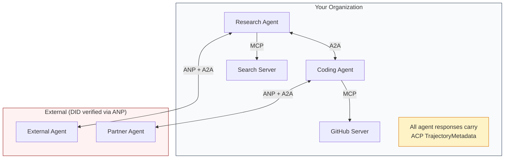
- **MCP** 負責將每個 agent 深度連接至其各自所需的工具鏈
- **A2A** 負責承載組織內部與跨機構 agent 之間的動態協同與任務委派
- **ACP** 將所有生成的回應妥善封裝於軌跡中繼資料中，以滿足嚴格的稽核合規
- **ANP** 針對你無法直接掌控的外部跨機構 agent 提供強有力的密碼學身分驗證
```figure
swarm-message-bus
```
## Build It｜動手實作

### 步驟一：核心訊息型別定義

任何多 agent 系統的起點皆始於訊息格式。我們定義了精準映射至工業級真實協定標準的型別：
```typescript
import crypto from "node:crypto";

type MessageRole = "ROLE_USER" | "ROLE_AGENT";

type MessagePart =
  | { text: string }
  | { data: unknown; mediaType: string }
  | { url: string; filename: string; mediaType: string };

type TrajectoryEntry = {
  reasoning: string;
  toolName?: string;
  toolInput?: unknown;
  toolOutput?: unknown;
  timestamp: number;
};

type AgentMessage = {
  id: string;
  role: MessageRole;
  parts: MessagePart[];
  trajectory?: TrajectoryEntry[];
  replyTo?: string;
  timestamp: number;
};

function createMessage(
  role: MessageRole,
  parts: MessagePart[],
  replyTo?: string
): AgentMessage {
  return {
    id: crypto.randomUUID(),
    role,
    parts,
    replyTo,
    timestamp: Date.now(),
  };
}

function textMessage(role: MessageRole, text: string): AgentMessage {
  return createMessage(role, [{ text }]);
}
```
值得特別留意：`MessagePart` 是多模態的（文字、結構化資料、二進位檔案），完全對齊真實的 A2A 與 ACP 規範。如同 A2A 1.0 的設計，具體存在的欄位（`text`、`data` 或 `url`）直接宣告了該片段的型別本質；無需額外的 `kind` 標籤。`TrajectoryEntry` 則用於記錄完整的推理鏈條，精準契合 ACP 的 TrajectoryMetadata。

### 步驟二：A2A Agent Card 與註冊表

建構符合真實 A2A 規範的 Agent 發現機制：
```typescript
type Skill = {
  id: string;
  name: string;
  description: string;
  tags: string[];
  inputModes: string[];
  outputModes: string[];
};

type AgentInterface = {
  url: string;
  protocolBinding: string;
  protocolVersion: string;
};

type AgentCard = {
  name: string;
  description: string;
  version: string;
  supportedInterfaces: AgentInterface[];
  capabilities: {
    streaming: boolean;
    pushNotifications: boolean;
  };
  defaultInputModes: string[];
  defaultOutputModes: string[];
  skills: Skill[];
};

class AgentRegistry {
  private cards: Map<string, AgentCard> = new Map();

  register(card: AgentCard) {
    this.cards.set(card.name, card);
  }

  discoverBySkillTag(tag: string): AgentCard[] {
    return [...this.cards.values()].filter((card) =>
      card.skills.some((skill) => skill.tags.includes(tag))
    );
  }

  discoverByInputMode(mimeType: string): AgentCard[] {
    return [...this.cards.values()].filter(
      (card) =>
        card.defaultInputModes.includes(mimeType) ||
        card.skills.some((skill) => skill.inputModes.includes(mimeType))
    );
  }

  resolve(name: string): AgentCard | undefined {
    return this.cards.get(name);
  }

  listAll(): AgentCard[] {
    return [...this.cards.values()];
  }
}
```
這套架構遠比單純的「名稱對應能力」雜湊表更為豐富。你可以依據技能標籤、輸入 MIME 類型或 agent 名稱進行全方位動態探索，與真實 A2A 規格提供的能力完全一致。

### 步驟三：A2A 任務生命週期

建構完整的任務狀態機：
```typescript
type TaskState =
  | "TASK_STATE_SUBMITTED"
  | "TASK_STATE_WORKING"
  | "TASK_STATE_INPUT_REQUIRED"
  | "TASK_STATE_AUTH_REQUIRED"
  | "TASK_STATE_COMPLETED"
  | "TASK_STATE_FAILED"
  | "TASK_STATE_CANCELED"
  | "TASK_STATE_REJECTED";

const TERMINAL_STATES: TaskState[] = [
  "TASK_STATE_COMPLETED",
  "TASK_STATE_FAILED",
  "TASK_STATE_CANCELED",
  "TASK_STATE_REJECTED",
];

type TaskStatus = {
  state: TaskState;
  message?: AgentMessage;
  timestamp: number;
};

type Artifact = {
  id: string;
  name: string;
  parts: MessagePart[];
};

type Task = {
  id: string;
  contextId: string;
  status: TaskStatus;
  artifacts: Artifact[];
  history: AgentMessage[];
};

type TaskEvent =
  | { statusUpdate: { taskId: string; status: TaskStatus } }
  | {
      artifactUpdate: {
        taskId: string;
        artifact: Artifact;
        append: boolean;
        lastChunk: boolean;
      };
    };

type TaskHandler = (
  task: Task,
  message: AgentMessage
) => AsyncGenerator<TaskEvent>;

class TaskManager {
  private tasks: Map<string, Task> = new Map();
  private handlers: Map<string, TaskHandler> = new Map();
  private listeners: Map<string, ((event: TaskEvent) => void)[]> = new Map();

  registerHandler(agentName: string, handler: TaskHandler) {
    this.handlers.set(agentName, handler);
  }

  subscribe(taskId: string, listener: (event: TaskEvent) => void) {
    const existing = this.listeners.get(taskId) ?? [];
    existing.push(listener);
    this.listeners.set(taskId, existing);
  }

  async sendMessage(
    agentName: string,
    message: AgentMessage,
    contextId?: string
  ): Promise<Task> {
    const handler = this.handlers.get(agentName);
    if (!handler) {
      const task = this.createTask(contextId);
      task.status = {
        state: "TASK_STATE_REJECTED",
        timestamp: Date.now(),
        message: textMessage("ROLE_AGENT", `No handler for ${agentName}`),
      };
      return task;
    }

    const task = this.createTask(contextId);
    task.history.push(message);
    task.status = { state: "TASK_STATE_SUBMITTED", timestamp: Date.now() };

    this.processTask(task, handler, message).catch((err) => {
      task.status = {
        state: "TASK_STATE_FAILED",
        timestamp: Date.now(),
        message: textMessage("ROLE_AGENT", String(err)),
      };
    });
    return task;
  }

  getTask(taskId: string): Task | undefined {
    return this.tasks.get(taskId);
  }

  cancelTask(taskId: string): boolean {
    const task = this.tasks.get(taskId);
    if (!task || TERMINAL_STATES.includes(task.status.state)) return false;
    task.status = { state: "TASK_STATE_CANCELED", timestamp: Date.now() };
    this.emit(taskId, {
      statusUpdate: { taskId, status: task.status },
    });
    return true;
  }

  private createTask(contextId?: string): Task {
    const task: Task = {
      id: crypto.randomUUID(),
      contextId: contextId ?? crypto.randomUUID(),
      status: { state: "TASK_STATE_SUBMITTED", timestamp: Date.now() },
      artifacts: [],
      history: [],
    };
    this.tasks.set(task.id, task);
    return task;
  }

  private async processTask(
    task: Task,
    handler: TaskHandler,
    message: AgentMessage
  ) {
    task.status = { state: "TASK_STATE_WORKING", timestamp: Date.now() };
    this.emit(task.id, {
      statusUpdate: { taskId: task.id, status: task.status },
    });

    try {
      for await (const event of handler(task, message)) {
        if (TERMINAL_STATES.includes(task.status.state)) break;

        if ("statusUpdate" in event) {
          task.status = event.statusUpdate.status;
        }
        if ("artifactUpdate" in event) {
          const update = event.artifactUpdate;
          const existing = task.artifacts.find(
            (a) => a.id === update.artifact.id
          );
          if (existing && update.append) {
            existing.parts.push(...update.artifact.parts);
          } else {
            task.artifacts.push(update.artifact);
          }
        }
        this.emit(task.id, event);
      }
    } catch (err) {
      task.status = {
        state: "TASK_STATE_FAILED",
        timestamp: Date.now(),
        message: textMessage("ROLE_AGENT", String(err)),
      };
      this.emit(task.id, {
        statusUpdate: { taskId: task.id, status: task.status },
      });
    }
  }

  private emit(taskId: string, event: TaskEvent) {
    for (const listener of this.listeners.get(taskId) ?? []) {
      listener(event);
    }
  }
}
```
這完整實現了真實的 A2A 任務生命週期：`TASK_STATE_SUBMITTED`、`TASK_STATE_WORKING`、`TASK_STATE_INPUT_REQUIRED`，隨後邁入終端終止狀態。處理常式採用非同步生成器（async generator），逐步產出 `statusUpdate` 與 `artifactUpdate` 事件，這正是 SSE 串流在底層所承載的相同事件封裝。

### 步驟四：ACP 風格的稽核軌跡

為跨 agent 通訊封裝軌跡追蹤能力：
```typescript
type AuditEntry = {
  runId: string;
  agentName: string;
  input: AgentMessage[];
  output: AgentMessage[];
  trajectory: TrajectoryEntry[];
  status: "created" | "in-progress" | "completed" | "failed" | "awaiting";
  startedAt: number;
  completedAt?: number;
  sessionId?: string;
};

class AuditableRunner {
  private log: AuditEntry[] = [];
  private handlers: Map<
    string,
    (input: AgentMessage[]) => Promise<{
      output: AgentMessage[];
      trajectory: TrajectoryEntry[];
    }>
  > = new Map();

  registerAgent(
    name: string,
    handler: (input: AgentMessage[]) => Promise<{
      output: AgentMessage[];
      trajectory: TrajectoryEntry[];
    }>
  ) {
    this.handlers.set(name, handler);
  }

  async run(
    agentName: string,
    input: AgentMessage[],
    sessionId?: string
  ): Promise<AuditEntry> {
    const entry: AuditEntry = {
      runId: crypto.randomUUID(),
      agentName,
      input: structuredClone(input),
      output: [],
      trajectory: [],
      status: "created",
      startedAt: Date.now(),
      sessionId,
    };
    this.log.push(entry);

    const handler = this.handlers.get(agentName);
    if (!handler) {
      entry.status = "failed";
      return entry;
    }

    entry.status = "in-progress";
    try {
      const result = await handler(input);
      entry.output = structuredClone(result.output);
      entry.trajectory = structuredClone(result.trajectory);
      entry.status = "completed";
      entry.completedAt = Date.now();
    } catch (err) {
      entry.status = "failed";
      entry.trajectory.push({
        reasoning: `Error: ${String(err)}`,
        timestamp: Date.now(),
      });
      entry.completedAt = Date.now();
    }
    return entry;
  }

  getFullAuditLog(): AuditEntry[] {
    return structuredClone(this.log);
  }

  getAuditLogForAgent(agentName: string): AuditEntry[] {
    return structuredClone(
      this.log.filter((e) => e.agentName === agentName)
    );
  }

  getAuditLogForSession(sessionId: string): AuditEntry[] {
    return structuredClone(
      this.log.filter((e) => e.sessionId === sessionId)
    );
  }

  getTrajectoryForRun(runId: string): TrajectoryEntry[] {
    const entry = this.log.find((e) => e.runId === runId);
    return entry ? structuredClone(entry.trajectory) : [];
  }
}
```
每一次 agent 的執行都會產出一份完整的稽核條目：包含接收了什麼輸入、回傳了什麼輸出，以及夾在兩者之間的工具呼叫與推理步驟完整軌跡。你可以依據特定 agent、特定 session 或單一執行次進行多維度查詢。

### 步驟五：ANP 風格的身分驗證

建構基於 DID 的身分識別與數位簽章驗證體系：
```typescript
type VerificationMethod = {
  id: string;
  type: string;
  controller: string;
  publicKeyDer: string;
};

type DIDDocument = {
  id: string;
  verificationMethod: VerificationMethod[];
  authentication: string[];
  keyAgreement: string[];
  humanAuthorization: string[];
  service: { id: string; type: string; serviceEndpoint: string }[];
};

type AgentIdentity = {
  did: string;
  document: DIDDocument;
  privateKey: crypto.KeyObject;
  publicKey: crypto.KeyObject;
};

class IdentityRegistry {
  private documents: Map<string, DIDDocument> = new Map();

  publish(doc: DIDDocument) {
    this.documents.set(doc.id, doc);
  }

  resolve(did: string): DIDDocument | undefined {
    return this.documents.get(did);
  }

  verify(did: string, signature: string, payload: string): boolean {
    const doc = this.documents.get(did);
    if (!doc) return false;

    const authKeyIds = doc.authentication;
    const authKeys = doc.verificationMethod.filter((vm) =>
      authKeyIds.includes(vm.id)
    );

    for (const key of authKeys) {
      const publicKey = crypto.createPublicKey({
        key: Buffer.from(key.publicKeyDer, "base64"),
        format: "der",
        type: "spki",
      });
      const isValid = crypto.verify(
        null,
        Buffer.from(payload),
        publicKey,
        Buffer.from(signature, "hex")
      );
      if (isValid) return true;
    }
    return false;
  }

  requiresHumanAuth(did: string, operationKeyId: string): boolean {
    const doc = this.documents.get(did);
    if (!doc) return false;
    return doc.humanAuthorization.includes(operationKeyId);
  }
}

function createIdentity(domain: string, agentName: string): AgentIdentity {
  const did = `did:wba:${domain}:agent:${agentName}`;
  const { publicKey, privateKey } = crypto.generateKeyPairSync("ed25519");

  const publicKeyDer = publicKey
    .export({ format: "der", type: "spki" })
    .toString("base64");

  const keyId = `${did}#key-1`;
  const encKeyId = `${did}#key-x25519-1`;

  const document: DIDDocument = {
    id: did,
    verificationMethod: [
      {
        id: keyId,
        type: "Ed25519VerificationKey2020",
        controller: did,
        publicKeyDer,
      },
      {
        id: encKeyId,
        type: "X25519KeyAgreementKey2019",
        controller: did,
        publicKeyDer,
      },
    ],
    authentication: [keyId],
    keyAgreement: [encKeyId],
    humanAuthorization: [],
    service: [
      {
        id: `${did}#agent-description`,
        type: "AgentDescription",
        serviceEndpoint: `https://${domain}/agents/${agentName}/ad.json`,
      },
    ],
  };

  return { did, document, privateKey, publicKey };
}

function signPayload(identity: AgentIdentity, payload: string): string {
  return crypto
    .sign(null, Buffer.from(payload), identity.privateKey)
    .toString("hex");
}
```
這完美鏡射了真實的 ANP 身分模型：agent 擁有包含獨立身分認證金鑰、金鑰協議金鑰以及人類授權金鑰的 DID 文件。`IdentityRegistry` 在本機模擬了 DID 解析流程（在正式環境中，這將表現為針對 agent 網域發起的 HTTPS 請求）。

### 步驟六：協定閘道器（Protocol Gateway）

將四大協定貫通整合成單一無縫系統：
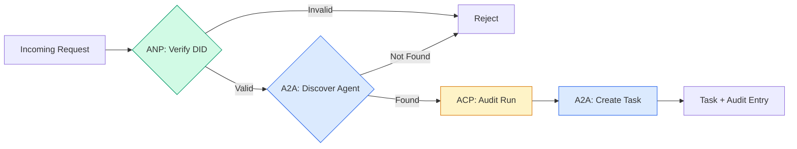

```typescript
class ProtocolGateway {
  private registry: AgentRegistry;
  private taskManager: TaskManager;
  private auditRunner: AuditableRunner;
  private identityRegistry: IdentityRegistry;

  constructor(
    registry: AgentRegistry,
    taskManager: TaskManager,
    auditRunner: AuditableRunner,
    identityRegistry: IdentityRegistry
  ) {
    this.registry = registry;
    this.taskManager = taskManager;
    this.auditRunner = auditRunner;
    this.identityRegistry = identityRegistry;
  }

  async delegateTask(
    fromDid: string,
    signature: string,
    targetAgent: string,
    message: AgentMessage,
    sessionId?: string
  ): Promise<{ task: Task; audit: AuditEntry } | { error: string }> {
    if (!this.identityRegistry.verify(fromDid, signature, message.id)) {
      return { error: "Identity verification failed" };
    }

    const card = this.registry.resolve(targetAgent);
    if (!card) {
      return { error: `Agent ${targetAgent} not found in registry` };
    }

    const audit = await this.auditRunner.run(
      targetAgent,
      [message],
      sessionId
    );
    const task = await this.taskManager.sendMessage(targetAgent, message);

    return { task, audit };
  }

  discoverAndDelegate(
    fromDid: string,
    signature: string,
    skillTag: string,
    message: AgentMessage
  ): Promise<{ task: Task; audit: AuditEntry } | { error: string }> {
    const candidates = this.registry.discoverBySkillTag(skillTag);
    if (candidates.length === 0) {
      return Promise.resolve({
        error: `No agents found with skill tag: ${skillTag}`,
      });
    }
    return this.delegateTask(
      fromDid,
      signature,
      candidates[0].name,
      message
    );
  }
}
```
該閘道器在單一呼叫中同時完成了四項核心任務：
1. **ANP**：透過 DID 數位簽章嚴格驗證呼叫者的真實身分
2. **A2A**：動態發現目標 agent 並深度檢驗其支援能力
3. **ACP**：將整個執行過程妥善封裝進附帶完整軌跡的稽核紀錄中
4. **A2A**：建立具備全生命週期追蹤能力的標準任務

### 步驟七：貫通整合
```typescript
async function protocolDemo() {
  const registry = new AgentRegistry();
  registry.register({
    name: "researcher",
    description: "Searches and summarizes findings",
    version: "1.0.0",
    supportedInterfaces: [
      {
        url: "https://researcher.local/a2a/v1",
        protocolBinding: "JSONRPC",
        protocolVersion: "1.0",
      },
    ],
    capabilities: { streaming: true, pushNotifications: false },
    defaultInputModes: ["text/plain"],
    defaultOutputModes: ["text/plain", "application/json"],
    skills: [
      {
        id: "web-research",
        name: "Web Research",
        description: "Searches the web",
        tags: ["research", "search", "summarization"],
        inputModes: ["text/plain"],
        outputModes: ["application/json"],
      },
    ],
  });
  registry.register({
    name: "coder",
    description: "Writes code from specs",
    version: "1.0.0",
    supportedInterfaces: [
      {
        url: "https://coder.local/a2a/v1",
        protocolBinding: "JSONRPC",
        protocolVersion: "1.0",
      },
    ],
    capabilities: { streaming: false, pushNotifications: false },
    defaultInputModes: ["text/plain", "application/json"],
    defaultOutputModes: ["text/plain"],
    skills: [
      {
        id: "code-gen",
        name: "Code Generation",
        description: "Generates code",
        tags: ["coding", "generation"],
        inputModes: ["text/plain", "application/json"],
        outputModes: ["text/plain"],
      },
    ],
  });

  const taskManager = new TaskManager();
  const auditRunner = new AuditableRunner();

  const researchTrajectory: TrajectoryEntry[] = [];

  taskManager.registerHandler(
    "researcher",
    async function* (task, message) {
      yield {
        statusUpdate: {
          taskId: task.id,
          status: {
            state: "TASK_STATE_WORKING" as const,
            timestamp: Date.now(),
          },
        },
      };

      researchTrajectory.push({
        reasoning: "Searching for React 19 documentation",
        toolName: "web_search",
        toolInput: { query: "React 19 compiler features" },
        toolOutput: {
          results: ["react.dev/blog/react-19", "github.com/react/react"],
        },
        timestamp: Date.now(),
      });

      researchTrajectory.push({
        reasoning: "Extracting key findings from search results",
        toolName: "doc_analysis",
        toolInput: { url: "react.dev/blog/react-19" },
        toolOutput: {
          summary:
            "React 19 compiler auto-memoizes, no manual useMemo needed",
        },
        timestamp: Date.now(),
      });

      yield {
        artifactUpdate: {
          taskId: task.id,
          artifact: {
            id: crypto.randomUUID(),
            name: "research-results",
            parts: [
              {
                data: {
                  findings: [
                    "React 19 compiler auto-memoizes components",
                    "No more manual useMemo/useCallback needed",
                    "Compiler runs at build time, not runtime",
                  ],
                  sources: ["react.dev/blog/react-19"],
                },
                mediaType: "application/json",
              },
            ],
          },
          append: false,
          lastChunk: true,
        },
      };

      yield {
        statusUpdate: {
          taskId: task.id,
          status: {
            state: "TASK_STATE_COMPLETED" as const,
            timestamp: Date.now(),
          },
        },
      };
    }
  );

  auditRunner.registerAgent("researcher", async () => ({
    output: [
      textMessage("ROLE_AGENT", "React 19 compiler auto-memoizes components"),
    ],
    trajectory: researchTrajectory,
  }));

  const identityRegistry = new IdentityRegistry();

  const coderIdentity = createIdentity("coder.local", "coder");
  const researcherIdentity = createIdentity("researcher.local", "researcher");

  identityRegistry.publish(coderIdentity.document);
  identityRegistry.publish(researcherIdentity.document);

  const gateway = new ProtocolGateway(
    registry,
    taskManager,
    auditRunner,
    identityRegistry
  );

  console.log("=== Protocol Demo ===\n");

  console.log("1. Agent Discovery (A2A)");
  const researchAgents = registry.discoverBySkillTag("research");
  console.log(
    `   Found ${researchAgents.length} agent(s):`,
    researchAgents.map((a) => a.name)
  );

  console.log("\n2. Identity Verification (ANP)");
  const message = textMessage("ROLE_USER", "Research React 19 compiler features");
  const signature = signPayload(coderIdentity, message.id);
  const verified = identityRegistry.verify(
    coderIdentity.did,
    signature,
    message.id
  );
  console.log(`   Coder DID: ${coderIdentity.did}`);
  console.log(`   Signature verified: ${verified}`);

  console.log("\n3. Task Delegation (A2A + ACP + ANP)");
  const result = await gateway.delegateTask(
    coderIdentity.did,
    signature,
    "researcher",
    message,
    "session-001"
  );

  if ("error" in result) {
    console.log(`   Error: ${result.error}`);
    return;
  }

  console.log(`   Task ID: ${result.task.id}`);
  console.log(`   Task state: ${result.task.status.state}`);
  console.log(`   Artifacts: ${result.task.artifacts.length}`);

  console.log("\n4. Audit Trail (ACP)");
  console.log(`   Run ID: ${result.audit.runId}`);
  console.log(`   Status: ${result.audit.status}`);
  console.log(`   Trajectory steps: ${result.audit.trajectory.length}`);
  for (const step of result.audit.trajectory) {
    console.log(`     - ${step.reasoning}`);
    if (step.toolName) {
      console.log(`       Tool: ${step.toolName}`);
    }
  }

  console.log("\n5. Full Audit Log");
  const fullLog = auditRunner.getFullAuditLog();
  console.log(`   Total runs: ${fullLog.length}`);
  for (const entry of fullLog) {
    const duration = entry.completedAt
      ? `${entry.completedAt - entry.startedAt}ms`
      : "in-progress";
    console.log(`   ${entry.agentName}: ${entry.status} (${duration})`);
  }
}

protocolDemo().catch((err) => {
  console.error("Protocol demo failed:", err);
  process.exitCode = 1;
});
```
## What Goes Wrong｜常見問題

通訊協定完美解決了正常路徑（happy path）。以下梳理在正式環境中必然面臨的真實挑戰：

**Schema 漂移（Schema drift）。** Agent A 發布了一份宣稱輸出為 `application/json` 的 Agent Card。然而不同版本之間的 JSON Schema 悄悄發生了變更。Agent B 依然按照舊格式進行解析，最終得到一堆垃圾資料。解法：為你的各項技能與輸出 Schema 嚴格標註版本號。這正是 A2A 規格在 Agent Card 上原生支援 `version` 欄位的核心初衷。

**狀態機違規（State machine violations）。** 某個 agent 處理常式產出了一個 `TASK_STATE_COMPLETED` 狀態更新，隨後卻又試圖產出更多工件。然而任務一旦終止即不可變更。你的程式碼要麼會無聲遺棄這些更新，要麼會直接拋出異常。解法：在產出任何事件前強制檢查是否已達終端狀態。上述 `TaskManager` 透過在終端狀態後執行 `break` 強制約束了這項邏輯。

**信任解析失敗（Trust resolution failures）。** Agent A 試圖驗證 Agent B 的 DID，然而 Agent B 的網域暫時故障中斷。DID 文件無法順利抓取。此時你該選擇容錯放行（fail open，接受未經驗證的 agent）還是嚴格阻擋（fail closed，堅決拒絕一切請求）？ANP 基於最小信任原則，強烈建議堅守嚴格阻擋策略。

**軌跡膨脹（Trajectory bloat）。** ACP 的軌跡記錄極具威力，但也代價昂貴。一個複雜的 agent 若在單次執行中呼叫了 200 次工具，將產生極為龐大的稽核紀錄。解法：支援可配置詳細等級的軌跡記錄。針對合規需求記錄工具名稱與 I/O，針對非監管業務則可略過細節推理步驟。

**服務發現驚群效應（Discovery thundering herd）。** 50 個 agent 在開機啟動時同時發起 `GET /agents` 查詢。解法：為 Agent Card 配置具備 TTL 的快取機制、錯開各 agent 的發現時間間隔，或採用基於事件推送的註冊機制替代主動輪詢。

## Use It｜實際應用

### 真實工業級實作

**A2A** 是當前最為成熟的方案。Google 的[官方規範](https://github.com/google/A2A)已在 Linux 基金會下完全開源。提供完善的 Python 與 TypeScript SDK。若你的 agent 需要動態發現與任務協同，請以此為首選起點。

**ACP** 正在全面融入 A2A 生態。IBM 的 [BeeAI 專案](https://github.com/i-am-bee/acp)最初將 ACP 打造為以 REST 為優先的通訊替代方案，如今其精髓所在——軌跡中繼資料（TrajectoryMetadata）概念——正被 A2A 生態系全面吸收。即便你採用 A2A 作為傳輸層，依然強烈建議導入 ACP 的設計模式（軌跡記錄、Run 生命週期）。

**ANP** 是最具實驗探索性的前沿協定。其[社群儲存庫](https://github.com/agent-network-protocol/AgentNetworkProtocol)提供了 Python SDK（AgentConnect）。其元協定動態協商理念極富開創性。在跨越組織邊界的 agent 部署場景中極具關注價值。

**MCP** 已在 Phase 13 中完整傳授。若你需要讓 agent 能夠呼叫各類工具，MCP 是當前毫無爭議的業界標準。

### 如何挑選合適的通訊協定
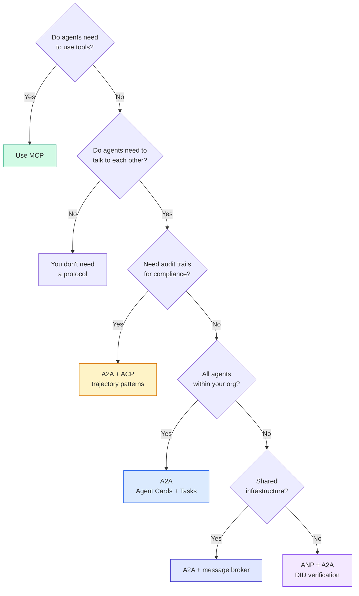
## Ship It｜交付成果

本課交付了以下實體成果：
- `code/main.ts` —— 完整實作了四大通訊協定模式的工業級展示程式碼
- `outputs/prompt-protocol-selector.md` —— 專門協助你為自身業務系統挑選最適通訊協定的決策 prompt

## Exercises｜練習

1. **多跳任務委派（Multi-hop task delegation）。** 擴充 `TaskManager`，使 agent 處理常機能夠將子任務進一步委派給其他 agent。研究員接收到任務後，將「搜尋」與「摘要」兩個子任務分別委派給兩個專家 agent，等待兩者皆順利完成後，再將雙方成果整合成自身的工件。

2. **串流稽核軌跡（Streaming audit trail）。** 改造 `AuditableRunner` 使其支援串流模式。與其等待完整結果出爐，不如在軌跡條目逐一生成時即時產出 `AuditEntry` 更新。利用能夠產出稽核快照的非同步生成器加以實現。

3. **DID 金鑰輪轉（DID rotation）。** 為 `IdentityRegistry` 增加金鑰輪轉機制。agent 應當能夠在發布包含新金鑰的新版 DID 文件的同時，保留 `previousDid` 歷史參照。驗證器在寬限期內應同時承認當前金鑰與前一版本金鑰的數位簽章。

4. **動態協定協商（Protocol negotiation）。** 實現 ANP 的元協定理念。讓兩個 agent 透過交換 `protocolNegotiation` 訊息提議各自支援的格式（例如「我能講 JSON-RPC」對決「我偏好 REST」）。在最多 3 輪交涉內，雙方達成格式共識或宣告逾時。達成共識的格式將直接決定後續調用哪一個 `TaskManager` 或 `AuditableRunner`。

5. **受限速的服務發現（Rate-limited discovery）。** 建構一個 `RateLimitedRegistry` 包裝層，以具備 TTL 的方式快取 Agent Card 查詢結果，並嚴格限制每個 agent 每秒能發起的發現請求上限。模擬 100 個 agent 在啟動時同時互相探索的驚群效應，並量化測量快取與限速所帶來的顯著改善成效。

## Key Terms｜關鍵術語

| Term | What people say | What it actually means |
|------|----------------|----------------------|
| MCP | "The protocol for AI tools" | A client-server protocol for agents to discover and use tools. Agent-to-tool, not agent-to-agent. |
| A2A | "Google's agent protocol" | A peer-to-peer protocol for agent collaboration under the Linux Foundation. Discovery via Agent Cards, 9-state task lifecycle, streaming via SSE. Supports JSON-RPC, REST, and gRPC bindings. |
| ACP | "Enterprise agent messaging" | IBM/BeeAI's REST API for agent runs with TrajectoryMetadata: every response carries the full chain of reasoning and tool calls. Merging into A2A. |
| ANP | "Decentralized agent identity" | A community protocol using `did:wba` (DID) for cryptographic identity, HPKE for E2EE, and AI-powered meta-protocol negotiation for agents that have never seen each other. |
| Agent Card | "An agent's business card" | A JSON document at `/.well-known/agent-card.json` describing skills, supported MIME types, security schemes, and protocol bindings. |
| DID | "Decentralized ID" | W3C standard for cryptographically verifiable identities hosted on the agent's own domain. ANP uses `did:wba` method. |
| TrajectoryMetadata | "The audit receipt" | ACP's mechanism for attaching reasoning steps, tool calls, and their inputs/outputs to every agent response. |
| Meta-protocol | "Agents negotiating how to talk" | ANP's approach where agents use natural language to dynamically agree on data formats, then generate code to handle them. |
| Task | "A unit of work" | A2A's stateful object tracking work from submission through completion. Immutable once terminal. |

## Further Reading｜延伸閱讀

- [Google A2A specification](https://github.com/google/A2A) -- 官方規格與 SDK（v1.0.1，Linux 基金會託管）
- [IBM/BeeAI ACP specification](https://github.com/i-am-bee/acp) -- 專門針對 agent 執行與軌跡中繼資料定義的 OpenAPI 3.1 規格
- [Agent Network Protocol](https://github.com/agent-network-protocol/AgentNetworkProtocol) -- 基於 DID 的去中心化身分、E2EE 與元協定動態協商
- [Model Context Protocol docs](https://modelcontextprotocol.io/) -- Anthropic 主導的 MCP 規格（詳見 Phase 13）
- [W3C Decentralized Identifiers](https://www.w3.org/TR/did-core/) -- 支撐 ANP 底層架構的身分認證標準
- [RFC 9180 (HPKE)](https://www.rfc-editor.org/rfc/rfc9180) -- ANP 用於實現端對端加密（E2EE）的核心加密演算法標準
- [FIPA Agent Communication Language](http://www.fipa.org/specs/fipa00061/SC00061G.html) -- 當代所有 agent 通訊協定的經典學術鼻祖
