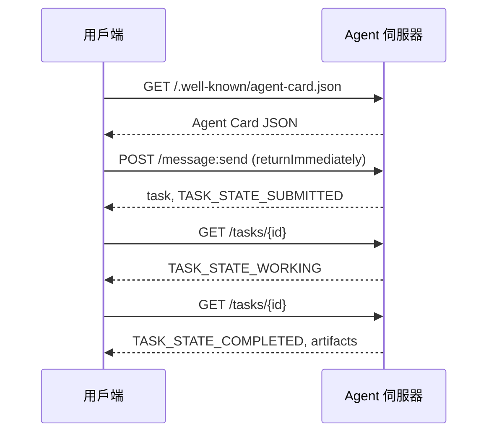

# A2A——Agent 間互聯通訊協定（A2A — The Agent-to-Agent Protocol）

> Google 於 2025 年 4 月正式發布 A2A 協定；截至 2026 年 4 月，其官方規範已推進至 https://a2a-protocol.org/latest/specification/ 並獲得 150 多個組織支持。A2A 是 MCP（第 13 課）在水平維度上的完美互補：若說 MCP 專注於垂直維度（Agent ↔ 各類工具），A2A 則專攻對等橫向協同（Agent ↔ Agent）。它標準化定義了 Agent Card（服務發現）、附帶多模態工件（文字、結構化資料、影片）的任務模型、黑箱式不透明任務生命週期，以及安全身分驗證。在正式環境系統中，MCP 與 A2A 的搭配愈來愈常見。Google Cloud 亦在 2025 至 2026 年間將 A2A 深度整合進 Vertex AI Agent Builder 之中。

**Type:** Learn + Build
**Languages:** Python (stdlib, `http.server`, `json`)
**Prerequisites:** Phase 16 · 04 (Primitive Model)
**Time:** ~75 minutes

## Problem｜問題

你的 Agent 需要呼叫運作在另一套系統上的另一個外部 Agent。該如何實作？你可以手動暴露一個標準 HTTP 端點，私自訂一套專屬的 JSON Schema，並暗自祈禱對端能夠正確理解它。然而如此一來，任何兩兩 Agent 之間的對接都會淪為極度痛苦的自訂點對點整合。

A2A 正是為消弭此痛點而生的通用線路通訊協定。它提供了標準化的服務發現機制、標準化的任務狀態模型、標準化的傳輸通道以及標準化的工件規格。其地位正如 HTTP+REST 之於現代網際網路，只不過它是專為將 Agent 視為一等公民而量身打造的。

## Concept｜核心概念

### 四大核心要素

**Agent Card。** 一份部署於 `/.well-known/agent-card.json` 的 JSON 格式中繼資料文件，詳盡描述該 Agent 的核心特質：名稱、所屬技能清單、`supportedInterfaces`（端點 URL、協定綁定途徑、協定版本）、預設支援的輸入與輸出媒體型別，以及安全驗證要求（`securitySchemes` 搭配 `securityRequirements`）。任何外部 Agent 皆能透過主動讀取該卡片完成服務發現。

```http
GET /.well-known/agent-card.json HTTP/1.1
Host: agent.example.com
```

```json
{
  "name": "code-review-agent",
  "description": "Reviews Python and TypeScript code.",
  "version": "1.0.0",
  "supportedInterfaces": [
    {
      "url": "https://agent.example.com",
      "protocolBinding": "HTTP+JSON",
      "protocolVersion": "1.0"
    }
  ],
  "capabilities": {"streaming": false, "pushNotifications": false},
  "securitySchemes": {
    "bearer": {"httpAuthSecurityScheme": {"scheme": "Bearer"}}
  },
  "securityRequirements": [{"schemes": {"bearer": {"list": []}}}],
  "defaultInputModes": ["text/plain", "application/json"],
  "defaultOutputModes": ["application/json"],
  "skills": [
    {
      "id": "review-python",
      "name": "Review Python",
      "description": "Reviews Python code.",
      "tags": ["code-review", "python"]
    },
    {
      "id": "review-typescript",
      "name": "Review TypeScript",
      "description": "Reviews TypeScript code.",
      "tags": ["code-review", "typescript"]
    }
  ]
}
```

**任務（Task）。** A2A 中的最小工作單元。一個非同步且具狀態的物件，遵循嚴格的生命週期：`TASK_STATE_SUBMITTED` → `TASK_STATE_WORKING` → `TASK_STATE_COMPLETED` / `TASK_STATE_FAILED` / `TASK_STATE_CANCELED`。用戶端發起訊息，伺服器據此建立任務，隨後用戶端可透過主動輪詢或串流訂閱即時掌握進度更新。

**工件（Artifact）。** 任務執行完畢後產出的實質結果。涵蓋純文字、結構化 JSON、圖片、影片與音訊。工件天然具備強型別特質：每個片段皆攜帶 `text`、`raw`、`url` 或 `data` 之一，並明確標註其 `mediaType`，讓各類多模態資料皆能享有真正的一等公民地位。

**不透明的黑箱生命週期（Opaque lifecycle）。** A2A 刻意不硬性規定遠端 Agent 內部究竟該*如何*具體攻克任務。用戶端僅能感知外部的狀態躍遷與交付的工件；伺服器端則享有絕對的自由，可任意選用任何底層框架或工具鏈。

### MCP 與 A2A 的職責劃分

- **MCP**（第 13 課）：專注於 Agent ↔ 工具。Agent 透過 JSON-RPC 與各工具伺服器展開讀寫互動。預設為完全無狀態。
- **A2A**：專注於 Agent ↔ Agent。對等互聯協定；通訊雙方都是具有自主推理能力的 agent。

現代正式環境多 Agent 系統通常雙劍合璧。一個處於對等地位的 A2A 節點，在自身端點內部呼叫各類 MCP 工具。這種職責劃分確保了兩個維度的關注點分離與架構純粹。

### 服務發現全流程



上述展示了標準的 HTTP+JSON 綁定路徑，且每一個請求標頭皆強制攜帶 `A2A-Version: 1.0`。在預設情況下，`SendMessage` 會持續阻塞直到任務達成終端狀態或被中斷，因此採用輪詢的用戶端會主動設定 `configuration.returnImmediately` 以便在第一時間立即取得建立的任務物件。

若採用串流機制：向 `POST /message:stream` 發起請求即可建立 Server-Sent Events（SSE）串流（首先送出 `task` 本體，隨後持續推播 `statusUpdate` 與 `artifactUpdate` 事件），並支援透過 `/tasks/{id}:subscribe` 重新掛載至正在運作中的長任務。一旦任務抵達終端狀態，串流便會自然關閉；協定本身並不存在額外的 `final` 標記。

### 身分驗證架構

A2A 支援三種常見模式：

- **Bearer Token**：基於 OAuth2 或自訂的不透明權杖（`httpAuthSecurityScheme` 或 `oauth2SecurityScheme`）。
- **雙向 mTLS**：雙向 TLS 握手；企業組織之間藉此向彼此提供不可偽造的身分證明（`mtlsSecurityScheme`）。
- **API Key**：保存在請求標頭、查詢參數或 Cookie 中的金鑰（`apiKeySecurityScheme`）。

安全策略在 Agent Card 中顯式宣告：`securitySchemes` 具體定義各項方案，而 `securityRequirements` 則指明用戶端必須滿足的強制條款。用戶端能自發探索並遵循對應的安全規範。

### 截至 2026 年 4 月，A2A 獲 150 多個組織支持

企業級的規模化採用推動了 A2A 的高速普及。最核心的戰略意義：A2A 已成為企業 Agent 系統跨越信任邊界的常用方式。Google Cloud 正式釋出了 Vertex AI Agent Builder 對 A2A 的原生支援；微軟 Agent Framework 亦原生相容；絕大多數主流開源框架（LangGraph、CrewAI、AutoGen）皆已標配相應的 A2A 適配器。

### A2A 的致勝優勢場景

- **跨組織企業互聯。** 公司 A 的 Agent 呼叫公司 B 的 Agent。若缺乏 A2A，任何兩家企業之間的對接皆必須從零編寫專屬介面契約。
- **異質多框架混編。** LangGraph 驅動的 Agent 呼叫 CrewAI 打造的 Agent，後者再進一步呼叫純 Python 編寫的自研 Agent。A2A 可將異質框架間的呼叫標準化。
- **天然支援富多模態工件。** 影片分析成果、結構化 JSON、音訊——全部皆為原生一等公民。
- **跨越數小時的長時程任務。** 黑箱生命週期搭配輪詢，讓長達數小時的跨系統非同步工作流變得容易處理。

### A2A 遭遇瓶頸的場景

- **對延遲極度敏感的亞毫秒級呼叫。** A2A 的任務生命週期本質上是非同步的。若需要亞毫秒級別的極速 Agent 內部通訊，直接呼叫本機 RPC 顯然更為合適。
- **同行程內部緊密耦合的 Agent。** 若兩個 Agent 本來就跑在同一個 Python 行程中，硬套 A2A 的 HTTP 網路來回往返無異於嚴重的過度設計。
- **資源有限的小型敏捷團隊。** 完整實作規格的開銷不可忽視；純內部封閉的簡單 Agent 或許無需如此嚴苛的形式主義。

### A2A 與 ACP、ANP、NLIP 的橫向定位

在 2024 至 2026 年間誕生了數個相近領域的互補規範：

- **ACP**（IBM / Linux 基金會）——A2A 的先驅探索者，作用範疇相對較窄。
- **ANP**（Agent 網路協定）——重度聚焦於對等點對點服務發現與去中心化身分驗證。
- **NLIP**（Ecma 自然語言互動協定，於 2025 年 12 月通過標準化）——專注於自然語言內容型別定義。

截至 2026 年 4 月，A2A 是工業界採用率最為廣泛的 Agent 對等互聯協定。參見 arXiv:2505.02279（Liu 等人，《A Survey of Agent Interoperability Protocols》）以取得權威的橫向深度比較。

```figure
sw-agent-card-discovery
```

## Build It｜動手實作

`code/main.py` 透過 Python 標準函式庫的 `http.server` 與 JSON 模組，完整實作了一套最小可行的 A2A 伺服器與用戶端，嚴格遵循 1.0 HTTP+JSON 規格。伺服器端：

- 暴露標準的 `/.well-known/agent-card.json` 服務發現端點，
- 接收 `POST /message:send` 任務分發請求，
- 嚴謹維護非同步任務狀態機，
- 在 `GET /tasks/{id}` 上正確回傳產出的工件資料。

用戶端：

- 主動抓取並解析 Agent Card，
- 發起帶有 `returnImmediately` 的非同步訊息請求，
- 透過輪詢即時追蹤任務進度直到終端狀態，
- 讀取並驗收工件。

執行指令：

```
python3 code/main.py
```

該腳本會在背景執行緒中啟動 A2A 伺服器，隨後由用戶端對其發起真實的網路呼叫。你將在終端機中清晰見證完整的協定握手軌跡：服務發現、任務送出、狀態輪詢、工件交付。

## Use It｜實際應用

`outputs/skill-a2a-integrator.md` 能為具體的跨系統 Agent 整合任務產出完備的 A2A 架構設計：涵蓋 Agent Card 欄位定義、任務資料結構描述、驗證方案選型，以及串流 vs 輪詢的傳輸策略。

## Ship It｜交付成果

將 A2A 服務推向正式環境前的必備檢查清單：

- **強制鎖定協定規格版本。** A2A 仍在高速演進中；在 `supportedInterfaces` 的每個條目中皆必須明確宣告其 `protocolVersion`，且用戶端發起請求時必須強制攜帶 `A2A-Version: 1.0` 標頭。
- **保證任務建立的嚴格冪等性。** 網路重試引發的重複送出必須精準收斂為同一個任務。依據用戶端傳入的 `messageId` 去重。
- **嚴格驗證工件結構描述。** 明確宣告 Agent 回傳的工件形狀；消費方應驗證接收到的資料結構。
- **配備速率限制與身分驗證。** A2A 本質上面向公開網路；必須嚴格套用現代 Web 級別的資安防禦。
- **為失敗任務建立死信佇列（Dead-letter）。** 長期觀察失敗任務的模式，找出重複出現的失敗類型。

## Exercises｜練習

1. 執行 `code/main.py`。確認用戶端能否順利發現伺服器端點，並驗收正確交付的工件。
2. 為伺服器追加第二項專長技能（例如「文本摘要 summarize」）。更新其 Agent Card。撰寫一個能依據任務類型自動挑選技能的用戶端。注意：1.0 請求中並無單獨的 skill 欄位，因此伺服器端必須依據訊息內容進行路由分發。
3. 實作 `POST /message:stream` 串流端點：以 Server-Sent Events（先送出 `task` 結構，隨後持續推播 `statusUpdate` 事件）進行回應，並在任務抵達終端狀態時優雅關閉串流。思考用戶端在處理串流時需要做出哪些架構調整？
4. 閱讀 A2A 官方完整規範 (https://a2a-protocol.org/latest/specification/)。指出三項官方規格強制要求、但本玩具展示程式刻意簡化省略的具體協定特性。
5. 橫向對比 A2A（透過 Agent Card 進行服務發現）與 MCP（透過 `listTools` 進行伺服器端能力探測）。在架構設計上，「自描述型 Agent」與「主動探測型能力發現」各自伴隨著何種深刻的取捨平衡？

## Key Terms｜關鍵術語

| 術語 | 常見說法 | 實際意義 |
|------|----------|----------|
| A2A | 「agent 對 agent」 | 讓不同系統的 agent 互相呼叫的對等協定，由 Google 於 2025 年推出。 |
| Agent Card | 「agent 的名片」 | 位於 `/.well-known/agent-card.json` 的 JSON 文件，描述技能、`supportedInterfaces` 與驗證方式。 |
| 任務（Task） | 「工作單位」 | 具有生命週期的非同步狀態物件；完成後會產生工件。 |
| 工件（Artifact） | 「結果」 | 具型別的輸出，包括文字、結構化 JSON、圖片、影片及音訊，是一等媒體。 |
| 不透明生命週期（Opaque lifecycle） | 「如何完成任務是 agent 的事」 | 用戶端能看到狀態轉換；伺服器可自行選擇框架與工具。 |
| 探索（Discovery） | 「尋找 agent」 | `GET /.well-known/agent-card.json` 會回傳 Agent Card。 |
| MCP 與 A2A | 「工具與同儕」 | MCP：垂直連接 agent 與工具；A2A：水平連接 agent 與 agent。 |
| ACP／ANP／NLIP | 「相關協定」 | 相鄰領域的規格；A2A 是 2026 年採用最廣的協定。 |

## Further Reading｜延伸閱讀

- [A2A specification](https://a2a-protocol.org/latest/specification/) — A2A 官方權威標準規範。
- [A2A v1.0.1 release](https://github.com/a2aproject/A2A/tree/v1.0.1): 本課嚴格遵循的具體 `docs/specification.md` 與 `specification/a2a.proto` 標籤版本。
- [Google Developers Blog — A2A announcement](https://developers.googleblog.com/en/a2a-a-new-era-of-agent-interoperability/) — 2025 年 4 月官方發布的奠基文章。
- [A2A GitHub repo](https://github.com/a2aproject/A2A) — 官方參考實作與各大語言 SDK。
- [Liu et al. — A Survey of Agent Interoperability Protocols](https://arxiv.org/html/2505.02279v1) — 涵蓋 MCP、ACP、A2A 與 ANP 的全面權威綜述。
