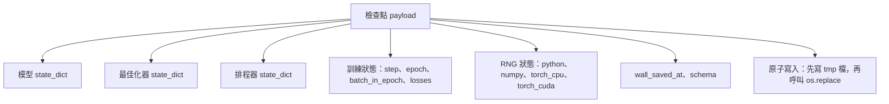
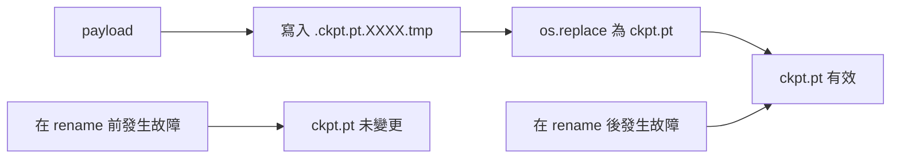
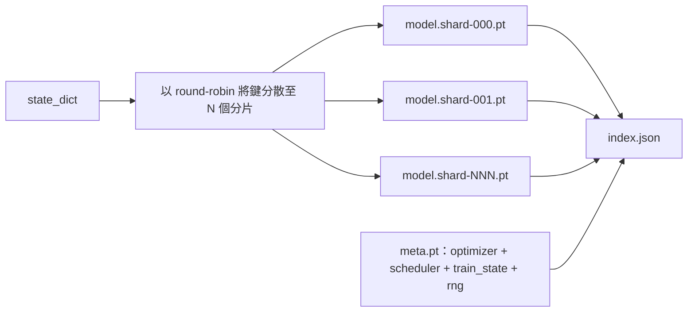

# 檢查點保存與中斷續訓（Checkpoint Save and Resume）

> 訓練過程中斷會毀滅任務；而健全的檢查點（Checkpoint）則能讓任務絕處逢生。以具備原子性（Atomically）的方式，完整保存模型權重、最佳化器狀態、學習率排程、歷史損失紀錄、步數計數器以及全隨機數生成器（RNG）狀態，確保在任何猝不及防的斷電崩潰瞬間，磁碟上始終保留著一份 100% 完好合法的存檔檔案。

**Type:** Build
**Languages:** Python
**Prerequisites:** Phase 19 lessons 42 to 45
**Time:** ~90 minutes

## Learning Objectives｜學習目標

- 將完整的訓練狀態打包捕獲進單一 Payload 資料結構中，使其隨時能被乾淨的新行程無損重新載入。
- 實作「先寫入臨時檔案再原子性重命名（Write-to-temp then rename）」的原子儲存機制，確保崩潰永遠不會留下半寫入的損壞檔案。
- 完美還原 Python、NumPy 與 PyTorch 的內部隨機數生成器（RNG）狀態，使中斷續訓後的損失收斂曲線與從未中斷的原始 baseline 100% 精準吻合。
- 為超大規模模型建構分片式檢查點（Sharded Checkpoint）架構，支援雜湊校驗與 JSON 索引清單。

## The Problem｜問題

你遞交了一場預計耗時 18 個小時的長期預訓練任務。叢集的單任務最大執行時間上限（Wallclock Cap）被機房管理員卡死在 4 小時。更糟糕的是，在第 11 個小時，叢集因核心升級重啟。若缺乏檢查點機制，你只能從第 0 步重新開始；若缺乏全狀態續傳機制，即便模型權重被幸運保留了下來，前 11 個小時歷經千錘百煉學出的 AdamW 動量矩陣也已蕩然無存，下一個步進的最佳化器更新將會朝著模型早已跨越的荒謬方向劇烈抽搐。

真正合格的檢查點資產，是一份包含了接續訓練所需之一切要素的自包含實體：模型參數、最佳化器狀態、排程器狀態、用於繪製儀表板的歷史損失、當前 Epoch、全局 Step 以及當前 Epoch 內的 Batch 計數器，還有支撐所有隨機行為的 RNG 狀態。若遺漏了 RNG 狀態，續訓後的損失曲線實質上將變成一條完全不同的全新曲線——模型相同、資料相同，但隨機洗牌不同、Dropout 遮罩不同，監控看板上的數值自然徹底脫軌。

原子性寫入（Atomic Save）是整個合約的另一半基石。直接向最終檔名寫入資料意味著一旦在寫入中途發生斷電或崩潰，磁碟上將殘留一個殘缺損壞的破檔案；下次啟動續訓時讀取到的將是一堆垃圾。而「先向同目錄下的臨時檔案寫入、寫入完畢後再透過重命名原子性覆蓋」的機制，能確保中途崩潰時上一個歷史良好檔案毫髮無損。在 POSIX 檔案系統上，同檔案系統內的 rename 操作具備作業系統級別的絕對原子性。

## The Concept｜核心概念



### 五大核心狀態儲存桶

| 狀態儲存桶 | 為何生死攸關 |
|---|---|
| 模型參數（Model） | 包含所有權重矩陣與 Buffer；定義了模型當前的物理本體。 |
| 最佳化器（Optimizer） | 一階動量與二階自適應變異數；缺乏它們，下一步更新等同於在解決完全不同的最佳化問題。 |
| 排程器（Scheduler） | 記錄當前學習率在衰減曲線上的精確位置；餘弦退火排程對此極其敏感。 |
| 訓練計數器（Train counters） | Step、Epoch、當前 Epoch 內的批次索引，以及支撐前端儀表板繪圖的歷史損失記錄。 |
| 隨機狀態（RNG state） | 嚴格鎖定 Dropout 遮罩、資料洗牌順序以及模型內部隨機取樣的確定性。 |

### 原子性儲存



兩條鐵律：第一，臨時檔案必須存放在與目標檔案**完全相同的同一個實體目錄下**，確保重命名操作嚴格發生在同一個檔案系統分區內；跨磁碟或跨裝置的重命名在作業系統層面不具備原子性。第二，臨時檔名每次必須具備全局唯一性，防止多個並行 Worker 發生檔案踩踏衝突。

### 分片式檢查點

當大模型的參數量達到數十億甚至千億級別時，單一龐大的檢查點檔案將變得無法快速載入、無法排查除錯，且在分散式網路儲存抖動時極易發生 I/O 逾時崩潰。標準解法是將參數狀態分派至多個分片，並編寫一份小巧的 JSON 索引清單將它們串聯在一起。



索引清單記錄分片總數、每個分片的獨立 SHA256 雜湊，以及中繼資料檔案的雜湊值。載入器在偵測到任何雜湊不符時立即主動報警。各個分片可分散儲存在不同的實體硬碟上；中繼資料檔案小巧無比，在啟動時優先被快速讀取。

### Epoch 中途精確接續

如果續訓機制只能粗暴地回退到「下一個 Epoch 的開頭」，這意味著中途崩潰會無端白白浪費數小時甚至整整一天的算力。唯一優雅的解法是精確記錄 `(epoch, batch_in_epoch)` 以及完整的 RNG 隨機狀態。在載入檢查點後，訓練迴圈直接命令隨機數產生器向前快轉（Fast-forward），快速跳過當前 Epoch 中已經被消耗掉的批次，直接自 `batch_in_epoch` 處無縫接軌。本課程式碼嚴密實作了該邏輯：續訓後的損失收斂軌跡與從未發生中斷的連續基準線相比，誤差嚴格低於 $10^{-4}$。

```figure
cc-atomic-checkpoint
```

## Build It｜動手實作

`code/main.py` 交付以下四大核心原語與演示程式：

### 第一步：RNG 隨機狀態的捕獲與還原

`capture_rng_state` 回傳一個包含 Python 官方 `random.getstate`、NumPy `np.random.get_state` 以及 PyTorch CPU 與 CUDA RNG 位元組的字典。所有資料結構皆被規範化為純粹的 Python 原生數值、元組與清單（NumPy 的陣列經過 `tolist()` 轉譯），確保第三步的載入器在讀取時無需反序列化任意危險物件。`restore_rng_state` 負責逆向無損還原。PyTorch CPU 張量在底層為 uint8 位元組緩衝區，PyTorch 核心能直接原生消費。

### 第二步：原子性安全寫入

`atomic_save` 首先將 Payload 寫入目標目錄下的臨時檔案，隨後調用 `os.replace` 在作業系統層面實施原子替換。`atomic_write_json` 對分片 JSON 索引檔案實施完全相同的原子保護。

### 第三步：全狀態檢查點雙向往返

`save_checkpoint` 將模型、最佳化器、排程器、訓練計數器與 RNG 狀態打包為單一字典。`load_checkpoint` 負責逆向解析並回傳標準的 `TrainState`。schema 版本欄位是系統未來的升級接縫：未來的格式升級只需遞增版本字串，載入器即可優雅分發處理。

`load_checkpoint` 強制調用 `torch.load(..., weights_only=True)`。一個 `.pt` 檔案本質上是一個 Python Pickle 串流；若在 `weights_only=False` 下反序列化一個未經授權的惡意檔案，檔案中所寫入的任何惡意程式碼皆會在當前機器上以最高權限被直接執行！開啟 `weights_only=True` 僅允許載入張量與基礎容器，堅決封殺所有可執行程式碼物件，這正是第一步中我們刻意將 RNG 狀態轉換為純清單儲存的關鍵原因。完整性檢查一律拋出顯式的 `ValueError` 而非使用 `assert`，因為 `python -O` 最佳化旗標會將 assert 語句直接剝離抹除。本課要求使用 PyTorch 2.6 或更高版本，以徹底封死早期版本中存在的未授權繞過漏洞。

### 第四步：分片式檢查點擴充

`save_sharded_checkpoint` 使用循環輪替排程（round-robin）將模型參數 Key 分散寫入 N 個獨立分片，每個分片透過獨立的原子寫入完成儲存；將最佳化器、排程器與訓練狀態寫入獨立的中繼資料檔案，並輸出包含各分片 SHA256 雜湊的 JSON 索引清單。`load_sharded_checkpoint` 在合併權重前嚴格校驗每個分片的雜湊值，並拒絕任何解析至檢查點目錄以外的非法分片路徑。

### 第五步：中斷續訓端到端實戰演示

`run_resume_demo` 首先在未受干擾的狀態下訓練一個微型模型 `total_steps` 步作為客觀黃金 baseline；在第二次運作中，在 `interrupt_at` 節點強制中斷並儲存檢查點；隨後模擬第二個行程載入該檢查點並接續跑完剩餘步數。函式精確比對中斷點之後兩條損失函數曲線的最大絕對誤差（Max Absolute Difference）。在 RNG 狀態被完美還原的前提下，兩者的差值嚴格收斂至零（或微小的浮點數雜訊）。

執行測試：

```bash
python3 code/main.py
```

單檔案檢查點與分片式檢查點演示皆嚴格驗證誤差低於 $10^{-4}$。詳細審計報告自動落盤至 `outputs/resume-demo.json`。

## Use It｜實際應用

正式環境的訓練框架皆將檢查點模組作為一等公民內建於訓練器中。標準架構完全同構：模型 + 最佳化器 + 排程器 + 計數器 + RNG，以原子性方式寫入磁碟，檔名嚴格以 Step 命名以便快速索引。分片式架構支撐著超大規模模型的平行極速載入，而 index.json 正是驅動這一切的核心神經。

四大正式環境實戰守則：

- **永遠強制使用 `weights_only=True` 載入權重**：自共享儲存儲存桶或網路下載的檢查點檔案一律視為不可信輸入。開啟該模式能堅決防止惡意攻擊者透過特製的權重檔案在你的訓練節點上執行任意後門程式碼。
- **Schema 版本號必須作為字串明確寫入 Payload**：架構遷移與升級依託於此。若缺乏版本號，未來對檢查點格式的任何微小更動皆會直接毀滅所有歷史運作資產。
- **為每一個分片強制計算 SHA256**：在網路傳輸中遭遇未報錯的截斷下載是最陰險的惡性 Bug；載入器必須具備在啟動第一秒快速失敗的能力。
- **儲存節奏必須嚴格恪守客觀紀律**：每隔 N 步或每隔固定物理分鐘（取兩者中較短者）強制觸發一次原子儲存。否則，一次耗時極長的大步運作一旦意外崩潰，將會白白浪費一整段巨大的算力窗口。

## Ship It｜交付成果

交付的 `outputs/skill-checkpoint-save-resume.md` 是適用於任何全新訓練專案的標準作戰手冊：Payload 規格、原子寫入機制、RNG 完整捕獲、分片 JSON 索引。只需將該技能引入程式碼庫，在定時儲存點掛載 `save_checkpoint`，在啟動入口掛載 `load_checkpoint`，你的長期訓練任務便能從容抗住任何不可預期的物理中斷。

## Exercises｜練習

1. 將循環輪替分片替換為按參數屬性分組分片（例如將結尾為 `.weight` 的層與結尾為 `.bias` 的層拆分至不同檔案）。深度探討兩種分片佈局各自適用的具體場景。
2. 擴充儲存迴圈：僅保留最近的 K 個有效檢查點，自動清理刪除更早的歷史過期檢查點。當磁碟儲存空間極度吃緊時，如何科學設定 K 的最佳取值？
3. 追加 `--ckpt-every-seconds` 命令列參數：使系統不僅支援按步數間隔儲存，同時支援按真實物理時鐘週期定時觸發存檔。
4. 實作啟動校驗模式：在訓練開始前，自動掃描目錄中的所有檢查點檔案，重新校驗其內部雜湊值，並明確呈報哪些檔案已經二進位損壞。
5. 實作 `migrate_v1_to_v2` 資料遷移函式：為 Payload 擴充一個全新的欄位並遞增 Schema 版本號。使載入器能夠同時向下相容處理 v1 與 v2 兩種不同版本的歷史檢查點。

## Key Terms｜關鍵術語

| 術語 | 常見說法 | 實際意義 |
|------|-----------------|------------------------|
| Atomic save | 「寫入後祈禱」 | 先寫入同一目錄中的暫存檔，再用 os.replace 改成目標檔名。 |
| State dict | 「權重」 | 依參數名稱索引的模型參數與 buffer。 |
| Sharded checkpoint | 「大型模型檔案」 | 由多個分片檔案、meta 檔案，以及含有 sha256 的 JSON 索引組成。 |
| RNG state | 「隨機種子」 | Python random、NumPy、PyTorch CPU 和 PyTorch CUDA 的已捕獲狀態，不只是種子。 |
| Mid-epoch resume | 「重新啟動」 | 將 RNG 向前推進，並從同一個 epoch 的下一個批次繼續訓練。 |
## Further Reading｜延伸閱讀

- POSIX `rename` 系統呼叫技術規格：深入理解支撐 `os.replace` 原子性承諾的底層檔案系統保證。
- PyTorch 官方技術文件之 `torch.save` 與 `torch.load`：包含跨裝置還原的 `map_location` 與不可信檔案安全載入的 `weights_only` 參數詳解。
- 第 19 階段第 46 課：深入了解本課檢查點機制所安全守護的梯度累加控制迴圈。
- 第 19 階段第 48 課：深入了解分散式並行封裝架構（DDP / FSDP）在檢查點儲存時的專屬格式適配。
- Linux 核心之 `fsync` 系統呼叫技術手冊：透視支撐原子重命名背後不可動搖的持久化磁碟刷盤機制。
