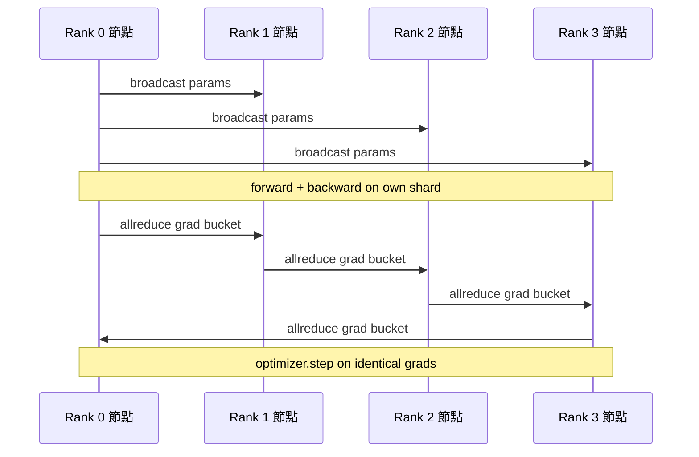

# 從零打造分散式資料平行 DDP（Data Parallel DDP From Scratch）

> 分散式資料平行（DistributedDataParallel，DDP）本質上只不過是掛載在 AllReduce 集合通訊上方的一個智慧回呼鉤子。封裝一個模型、自 Rank 0 節點廣播初始權重以確保所有節點處於完全同一的起跑線、在每個參數上掛載反向傳播鉤子自動觸發梯度的 AllReduce 歸約，其餘工程細節與常規梯度下降別無二致。整套模式共 200 行程式碼。

**Type:** Build
**Languages:** Python
**Prerequisites:** Phase 19 Track C lessons 42-49
**Time:** ~90 min

## Learning Objectives｜學習目標

- 實作具備 `DistributedDataParallel` 形態的標準外殼：在建構時廣播初始權重，在反向傳播後對梯度實施跨節點 AllReduce。
- 透過 `torch.multiprocessing.spawn` 派生 N 個 CPU 行程，基於 gloo 通訊後端與檔案約會點（File-based Rendezvous）協同運作。
- 在數學與位元組維度嚴密證明梯度同步的正確性：在完全相同的資料上依序執行單行程訓練，證明逐步參數更新與 DDP 多節點訓練 100% 精確等價。
- 深刻理解「梯度分桶（Bucketing）」與「計算與通訊重疊（Overlap）」的核心價值：正是這兩項關鍵演進將理論玩具蛻變為工業級生產 DDP。

## The Problem｜問題

一個擁有 10 億參數的大模型，其活化值（Activations）在訓練時帶有 12 GB 的活化值，單張消費級顯卡裝不下。即便勉強裝入，單卡訓練也要耗上數週。資料平行（Data Parallel）透過將訓練批次切分給 N 個獨立節點，每個節點各自在自己的資料分片上並行執行前向傳播與反向傳播，並在每一步更新前將所有 N 個節點計算出的梯度求和，確保所有 N 個模型複本隨時保持完全同一。這份求和後的梯度，正是最佳化器用來更新參數的依據。

若缺乏梯度同步，N 個模型複本到第 2 步就會彼此分歧。此時訓練的已不再是「在更多資料上訓練的單一模型」，而是 N 個僅共用初始權重的獨立模型。反之，若梯度同步的實作不佳（例如每個參數獨立發起一次 AllReduce、通訊與計算完全序列化無重疊、缺乏分桶打包機制），網路通訊將迅速成為效能瓶頸，GPU 也會因等待網路傳輸而閒置。DDP 的關鍵設計目標，就在於將梯度同步的網路耗時壓縮到相較於神經網路計算幾乎「免費」的境界。PyTorch 官方 DDP 透過梯度分桶、將 AllReduce 與下一層的反向傳播在時間線上高度重疊，並使用 NVLink 上的 NCCL 達成這個目標。我們在普通 CPU 上使用 gloo 同樣能完整重現這三項核心技術，理解相同的原理。

## The Concept｜核心概念



### DDP 所必需的三大核心操作

| 訓練階段 | 集合通訊原語 | 為何不可或缺 |
|---|---|---|
| 初始化（Init） | 自 Rank 0 發起 broadcast 廣播 | 確保所有分散式節點在第 0 步皆擁有二進位完全一致的初始權重 |
| 反向傳播後（After backward） | 對每個梯度分桶執行 allreduce | 最佳化器必須在全局所有節點梯度的平均值上推動參數更新 |
| 特定場景（偶爾觸發） | 對模型內部 Buffer 執行 broadcast | 確保 BatchNorm 等算子維護的全局運算統計指標在各節點間維持同步 |

### 為何求平均，而非簡單求和？

AllReduce-SUM（求和）除以全局節點數 world_size，得到的是真實的平均梯度（Mean Gradient）。平均梯度對 world_size 具備天然的尺度不變性：在單卡上調校得當的學習率，直接遷移至 4 卡叢集時無需做任何修改即可直接生效，因為單步梯度的物理幅值並未因節點增加而放大。反之，若使用純求和而不除以節點數，每次調整叢集卡數時皆被迫重新手動調整學習率。DDP 在底層包裝了求和並強制除以節點數；本課實作嚴格遵從該規範。

### 為何必須對梯度實施分桶？

一個 Transformer 大模型包含數千個獨立的權重張量。為每個張量單獨發起一次 AllReduce，意味著必須在網路上承擔數千次 gloo 底層通訊延遲的累計代價。DDP 將微小的梯度張量合併打包為約 25 MB 的大型緩衝區塊（Bucket），並針對整個桶發起單次聚合。在網路上傳輸的總位元組數雖然完全相同，但網路往返延遲被均攤稀釋了數千倍。在教學微型模型中，我們將所有梯度打包為單一分桶；其底層架構思想完全對齊。

### 隨機種子鎖定的精妙紀律

每個 Rank 在資料洗牌打散時，必須調用 `torch.manual_seed(seed + rank)`；但在模型權重初始化時，必須無條件調用 `torch.manual_seed(seed)`！若所有節點共享完全相同的資料種子，每個節點看到的資料順序將完全相同（徹底喪失了資料平行的本質意義）；而若在權重初始化時為各節點賦予不同的種子，初始參數將在浮點數層面產生偏差，後續的梯度同步再也無法拯救各節點分崩離析的命運。精準掌控種子紀律，否則參數等價性測試將在第 1 步當場崩潰。

```figure
ci-ddp-grad-sync
```

## Build It｜動手實作

`code/main.py` 實作了以下核心模組：

- `MiniMLP`：3 層微型多層感知器，小巧到可在數秒內極速收斂，同時足夠暴露全套分散式連線細節。
- `DistributedDataParallel(model, world_size)`：在建構時自動廣播參數，回傳一個標準外殼，其 `sync_grads` 方法將累加的 AllReduce 總和除以 world_size。
- `worker(rank, world_size, ...)`：完整的多行程訓練工作迴圈，包含基於 gloo 的 `torch.distributed` 初始化、前向傳播、反向傳播、梯度同步以及最佳化器單步更新。
- `_reference_single_process_loop(...)`：在單一 Rank 上循序執行完全相同的資料訓練，作為單元測試驗證逐步參數完全一致的黃金對照基準。

執行測試：

```bash
python3 code/main.py
```

輸出結果：展示一張逐步訓練對比表，橫向比對單行程損失值、參數校驗和與跨 4 個 Rank 的 DDP 運作指標。兩條路徑產出的損失函數曲線在浮點數精度範圍內 100% 完全重合，確鑿證明梯度同步邏輯具備嚴密的數學正確性。

## 工業級正式環境落地模式

三大實戰工程防線，能讓你的 DDP 架構足以承受正式環境超大規模任務的考驗：

**排查未使用的閒置參數（Find unused parameters）**：在某些神經網路前向路徑中，某些參數會被條件路徑動態跳過（例如早退機制 Early Exit、混合專家 MoE 路由門控）。被跳過的參數完全不會產生梯度，但 DDP 的 Bucket-Ready 鉤子會傻傻等待它們的梯度就緒，直接引發分散式死鎖！`find_unused_parameters=True` 指示 DDP 在歸約前主動遍歷計算圖排查哪些參數確實收到了梯度。其代價是每一步增加了一次計算圖遍歷開銷，因此除非前向傳播確實存在動態路徑，否則預設應當將其關閉。

**靜態計算圖最佳化（Static graph optimization）**：當神經網路的前向結構在各步進中高度恆定穩定時，`static_graph=True` 允許 DDP 提前預先計算並快取分桶排程計畫。該最佳化在大規模訓練中極具價值：預先計算在每一步能省下數毫秒的排程開銷，在 10,000 步的累積下將直接轉化為巨大的算力節約。

**梯度累加必須極其小心謹慎**：在跨 K 個微批次進行梯度累加時，跳過前續微批次的跨卡通訊同步能帶來高達 10 倍的吞吐暴增。DDP 提供了 `no_sync()` 上下文管理器，能暫時掛起反向傳播後的 AllReduce 操作。若遺漏該管理器，系統會在每個微批次中盲目發起 K 次無意義的全局通訊，訓練吞吐量會大幅下降。

## Use It｜實際應用

工業級生產框架在底層全體遵循完全相同的架構：

- **PyTorch DDP**：業界標準官方實作。`torch.nn.parallel.DistributedDataParallel(model)` 在底層無縫封裝了分桶、通訊計算重疊以及 no_sync 上下文。
- **Hugging Face Accelerate**：在此基礎上提供一個啟動器，負責處理 `torchrun` 環境變數注入與模型自動包裹，底層依然是完全同一套 DDP 引擎。
- **Megatron-LM 資料平行**：在超大模型訓練中將 DDP 與張量並行（Tensor Parallel）混合編織，其資料平行部分完全依託「反向傳播後執行 AllReduce」的完全相同模式。

## Ship It｜交付成果

第七十八課（ZeRO 分片）將把各參數獨立的 AllReduce 替換為 Reduce-Scatter，使每個節點僅需儲存屬於自身的那一份最佳化器狀態分片。第八十一課則將 DDP 與 ZeRO 深度融合，呈現在端到端分散式大演示中。

## Exercises｜練習

1. 為系統加入可設定大小的梯度分桶機制，在更深層的模型上實測其相較於「每個參數獨立發起 AllReduce」所帶來的端到端時間加速比。
2. 實作 `no_sync()` 上下文管理器，嚴格驗證跨 K 個微批次進行梯度累加後，其參數更新軌跡與單行程基準線依然維持 100% 精確吻合。
3. 構造一個前向傳播偶爾會跳過某個 MLP 層的動態條件路徑網路，驗證在未開啟 `find_unused_parameters` 時系統是否會如期觸發死鎖。
4. 嘗試將底層通訊替換為僅調用 `torch.distributed.barrier()` 的純同步模式，親身體會基於 AllReduce 的資料級同步與純障礙柵欄同步在語意上的本質鴻溝。
5. 在批次大小分別為 1、16、256 的情境下，實測度量梯度同步開銷在單步總耗時中的佔比，並從數學上解釋該比例隨批次大小擴展時的縮放規律。

## Key Terms｜關鍵術語

| 術語 | 常見說法 | 實際含義 |
|---|---|---|
| DDP（分散式資料平行） | 「資料平行」 | 在建構時廣播初始參數、在每一步反向傳播後對所有節點的梯度實施 AllReduce 聚合的標準並行架構 |
| Bucket（梯度分桶） | 「融合梯度」 | 將數萬個細碎的小梯度在記憶體中拼接打包為約 25 MB 的連續緩衝區，合併發起單次大通訊 |
| Overlap（計算通訊重疊） | 「隱藏通訊」 | 在當前層反向傳播梯度計算完畢的瞬間立即非同步發射通訊，與前續層的梯度計算在時間軸上並行推進 |
| no_sync | 「累加」 | 暫停反向傳播後的自動 AllReduce 同步，使梯度能在本地參數緩衝區中進行多步微批次累加的上下文管理器 |
| find_unused | 「有條件路徑的前向傳播」 | 在歸約前主動排查哪些參數未接收到梯度，防止因條件路徑跳過某些層而導致集合通訊死鎖的容錯開關 |

## Further Reading｜延伸閱讀

- [PyTorch 官方技術文件《DistributedDataParallel 深度指南》](https://pytorch.org/docs/stable/generated/torch.nn.parallel.DistributedDataParallel.html)
- [PyTorch 官方教學《DDP 內部機制與通訊原語拆解》](https://pytorch.org/tutorials/intermediate/ddp_tutorial.html)
- [Li et al., 2020，〈PyTorch Distributed: Experiences on Accelerating Data Parallel Training〉](https://arxiv.org/abs/2006.15704)：DDP 系統架構官方設計論文。
- 第 19 階段第 76 課：回顧支撐 DDP 運作的底層集合通訊原語基礎。
- 第 19 階段第 78 課：深入了解將 per-param allreduce 升級為 reduce_scatter 的 ZeRO 記憶體分片技術。
