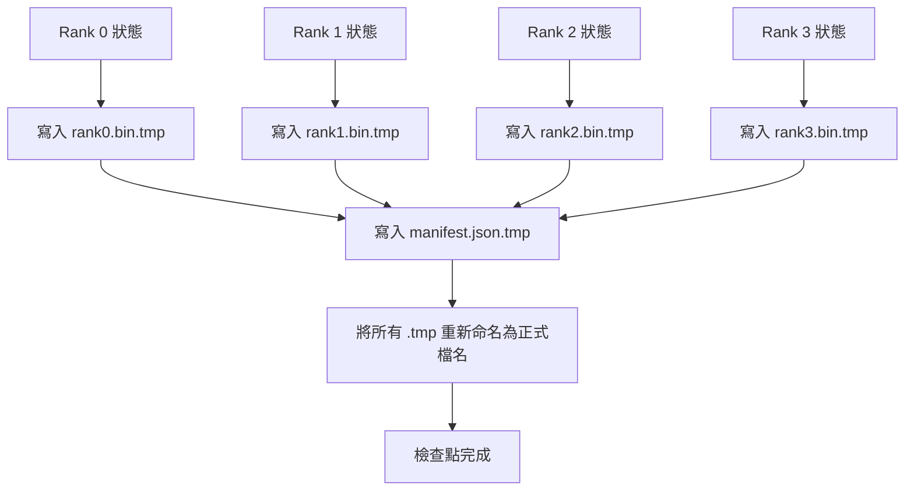

# 分片檢查點與原子性中斷續訓（Sharded Checkpoint and Atomic Resume）

> 一場 700 億參數（70B）的大模型預訓練任務，每隔數小時就可能因叢集硬體節點故障而被迫暫停。檢查點的格式設計，直接決定了你在故障重啟時究竟只損失 30 分鐘的算力，還是損失慘痛的 30 個小時。分片檢查點（Sharded Checkpoint）允許每個 Rank 節點並行向獨立檔案寫入自身的分片，並在全局清單（Manifest）中記錄權屬關係。中斷續訓時，各節點直接從自身專屬檔案精準載入狀態，在完全相同的 World Size 下無縫重構模型，最佳化器宛如從未中斷過一樣平穩推進。而原子性寫入機制，則徹底杜絕了殘缺半寫入檔案對後續續訓過程的致命毒化。

**Type:** Build
**Languages:** Python
**Prerequisites:** Phase 19 Track C lessons 42-49
**Time:** ~90 min

## Learning Objectives｜學習目標

- 將多節點分散式檢查點儲存為「逐 Rank 獨立分片檔案 + 全局 Manifest 清單」的標準架構，清單嚴格記錄各節點的權屬分工。
- 實作「先寫入臨時檔案隨後原子性重命名（Write-to-temp then rename）」的原子寫入機制，確保中途崩潰絕不留下殘缺的半成品檢查點。
- 依託清單安全重啟續訓，在所有節點上嚴密校驗 FP16 模型參數與 ZeRO 最佳化器狀態的二進位完全一致性。
- 為清單 Schema 築牢安全防線，精準防禦三大經典致命故障：World Size 拓撲變更、分片總數不匹配，以及局部截斷寫入。

## The Problem｜問題

原生粗暴的單檔案檢查點機制，要求將全域所有參數與最佳化器狀態集中匯集到 Rank 0 節點，在記憶體中執行 Gather 聚合後，由 Rank 0 透過單一網路介面寫入單一實體檔案。對於一個 70B 參數的大模型，這意味著將高達 1.1 TB 的龐大狀態強行擠過單一伺服器的網卡與硬碟！在此期間，所有其餘節點皆被迫陷入無效等待。整個叢集的 I/O 頻寬被最慢的一張網卡死死卡死。在真實實體叢集中，單次「聚合再寫入」耗費的時間甚至會超越上一個小時的純訓練時間，這意味著系統在一天之內連一個有效的檢查點都難以產出。

分片檢查點徹底顛覆了該模式：**每一個節點並行將自身的分片寫入專屬的獨立檔案中**。全局清單記錄哪個 Rank 擁有哪些具體分片，使續訓時各節點能各歸其位精準載入。叢集的聚合寫入頻寬隨節點總數呈現完美的線性擴展：原本透過單一節點需要耗時 4 小時的 1 TB 巨型存檔，在 64 卡並行寫入下僅需 4 分鐘即可落盤！更重要的是，清單機制為不相容的異常續訓提供了剛性防護：節點數變更能被即時阻斷、局部殘缺寫入能被秒級識破，載入器能夠在第一時間以刺耳的報警終止運作，而絕不允許系統在底層靜默加載陳舊損壞的錯誤資料。

## The Concept｜核心概念



### 清單 Schema 規範

```json
{
  "world_size": 4,
  "step": 1234,
  "wall_clock_seconds": 4521,
  "shards": [
    {"rank": 0, "path": "rank0.bin", "sha256": "...", "param_shard_offset": 0, "param_shard_numel": 65536},
    {"rank": 1, "path": "rank1.bin", "sha256": "...", "param_shard_offset": 65536, "param_shard_numel": 65536}
  ],
  "schema_version": 1
}
```

三大核心承重欄位：`world_size` 確保在節點規模變動時主動報錯，而非在錯誤拓撲下靜默腐化；各分片的 `sha256` 雜湊精準捕獲任何局部截斷或位元組損壞；`param_shard_offset` 與 `param_shard_numel` 則讓載入器在記憶體中將扁平參數張量無縫拼裝至精確的物理位置。

### 原子性寫入機制

標準工業防禦工程：首先將各個分片寫入 `<name>.tmp`，將清單寫入 `manifest.json.tmp`，對每個檔案執行 fsync 強制刷盤，隨後實施原子性重命名。在同一個檔案系統分區內，POSIX rename 具備作業系統級別的絕對原子性：新檔案要麼完整存在，要麼舊檔案毫髮無損。若在最後重命名之前發生系統崩潰，上一個歷史健康檢查點依然安然無恙。若缺乏該機制，中途崩潰會留下一個殘缺的半成品分片，而清單卻誤以為它完好無損，下次啟動時最佳化器狀態將在無形中被徹底摧毀。

### 清單必須嚴密防禦的三大經典故障

| 致命故障模式 | 具體異常表徵 | 清單剛性防禦機制 |
|---|---|---|
| 叢集節點規模變更 | 在 N=8 的叢集上載入 N=4 時產出的清單 | 偵測到清單中的 world_size 衝突，強制快速失敗 |
| 分片檔案數量缺失 | 磁碟上的 rank*.bin 檔案數量少於清單中的宣告數 | 遍歷所有分片條目，強制斷言每個檔案皆二進位存在 |
| 局部截斷不完整寫入 | 分片檔案在 I/O 刷盤中途遭遇崩潰斷電 | 載入時強制重新計算並校驗全分片的 SHA256 雜湊 |

每一道防線皆能將不合法的載入在第 0 秒堅決拒絕；而其替代後果則是極其可怕的隱性腐化——直到 100 步之後損失函數突然崩潰為 NaN 時才原形畢露。

### 為何堅持逐 Rank 獨立檔案，而非單一共享檔案

雖然透過 POSIX 的 `O_APPEND` 可以對單一檔案實施並發追加，但在真實實踐中，分片內的位移區段達 MB 級，頻繁的檔案鎖爭搶將直接摧毀吞吐量。而為每個 Rank 分配獨立的實體檔案完全零鎖爭搶，且在平行分散式檔案系統（如 Lustre、GPFS）上能天然享受極致的條帶化（Striping）並行加速。DeepSpeed、FSDP 與 NeMo 等工業級技術堆疊全體統一採用逐 Rank 獨立檔案架構。

```figure
ci-sharded-checkpoint
```

## Build It｜動手實作

`code/main.py` 實作了以下核心模組：

- `ShardManifest` 資料類別：封裝上述標準 Schema，內建 `to_json` 與 `from_json` 序列化方法。
- `save_sharded(state_dict_per_rank, dir, step)`：使用「寫入臨時檔案隨後原子替換」的原子機制，將每個 Rank 的二進位狀態獨立寫入對應分片，並輸出全局清單。
- `load_sharded(dir, expected_world_size)`：解析清單、嚴格校驗每個分片的 SHA256 雜湊，並回傳各 Rank 專屬的狀態字典。
- 雙向往返驗證：建置各 Rank 初始狀態、執行儲存、重新載入，嚴格斷言還原後的狀態與原始狀態在二進位層面完全一致。

執行測試：

```bash
python3 code/main.py
```

輸出結果：成功寫出 4 個分片檔案與 1 份清單，隨後重新載入並通過位元組級的嚴密校驗。

## 工業級正式環境落地模式

三大實戰工程技巧，能讓分片檢查點架構足以守護萬億參數模型的訓練安全：

**非同步背景落盤（Async write）**：在正式環境中，檢查點寫入通常交由獨立的背景執行緒或行程執行，使主計算核心無需停工等待，訓練照常全速推進。唯一的同步屏障設在下一次存檔節點：在發起新的儲存之前，必須確認上一次的背景寫入已 100% 成功落盤。DeepSpeed 的 `async_io` 旗標正是該機制的標準化落地。

**本地快碟先行，隨後非同步上雲**：兩級階層式儲存架構：首先寫入速度快的本機 NVMe 快取碟（供快速恢復使用）；隨後在背景非同步上傳至 S3 或 GCS 雲端物件儲存（用於災難復原與長期封存）。本機清單記錄本地路徑，上傳清單記錄雲端遠端路徑。

**滾動輪換淘汰（Rotation）至關重要**：正式環境長期任務強制維護最近的 K 個有效檢查點（通常為 3 至 5 個），並在落盤新存檔時自動安全刪除最古老的檢查點。缺乏輪換機制，磁碟空間會在數天內被巨型權重徹底撐爆，引發後續存檔集體崩潰。

## Use It｜實際應用

工業級生產框架在底層全體遵循完全相同的架構：

- **DeepSpeed Checkpointing**：`deepspeed.save_checkpoint(tag=step)` 實作逐 Rank 獨立分片寫入，並透過 `latest` 檔案指向目前使用的檢查點。
- **PyTorch FSDP Checkpointing**：`torch.distributed.checkpoint` 負責保存分片狀態，依託 `Planner` 排程器自適應規劃跨節點分佈。
- **NeMo**：在 DeepSpeed 與 FSDP 之上提供統一的 `save_to_checkpoint` API，並注入豐富的訓練環境中繼資料。

## Ship It｜交付成果

第八十一課將把該分片檢查點機制無縫接入端到端 DDP + ZeRO 預訓練大演示中，在相同的 World Size 下實測中斷續訓，確鑿證明狀態連續性合約完美兌現。

## Exercises｜練習

1. 實作非同步背景寫入機制：在獨立執行緒中啟動檔案落盤，允許主訓練迴圈接續前進；在下一次存檔點前夕強制等待前序任務完成。
2. 實作 `last_5_steps` 滾動淘汰機制：僅保留最近的 5 個檢查點，在寫入第 6 個檢查點之前自動安全清除最古老的存檔。
3. 為內迴圈重新載入新增僅使用 CRC 的快速驗證，並保留 rotation 將檢查點設為新啟用版本的情境。
4. 探索跨節點規模彈性加載：編寫資料重平衡函式，支援將在 N=4 環境下產出的分片清單，重新動態拆分適配至 N=8 的全新叢集上。
5. 模擬兩級儲存架構：在寫入本機目錄後，自動模擬將分片非同步複製至虛擬的 S3 備份目錄中，並輸出專屬的上傳清單。

## Key Terms｜關鍵術語

| 術語 | 常見說法 | 實際含義 |
|---|---|---|
| Sharded checkpoint（分片檢查點） | 「逐 Rank 儲存」 | 每個 Rank 節點並行向自身專屬的實體檔案寫入局部狀態的儲存架構 |
| Manifest（全局清單） | 「索引」 | 記錄所有分片檔案路徑、參數偏移量與密碼學 SHA256 雜湊的 JSON 索引合約檔案 |
| Atomic write（原子寫入） | 「暫存後重新命名」 | 先寫入臨時檔案、隨後透過作業系統級 rename 原子替換目標檔案的無損防禦模式 |
| Partial write（殘缺寫入） | 「遭截斷的分片」 | 檔案在 I/O 刷盤中途遭遇崩潰斷電引發的局部截斷損壞；由 SHA256 嚴密攔截 |
| Rotation（滾動淘汰） | 「保留最後 K 個」 | 在寫入新檢查點之前自動清除最古老的歷史存檔，防止磁碟空間被耗盡的空間管理機制 |

## Further Reading｜延伸閱讀

- [DeepSpeed Checkpointing 官方技術文件](https://deepspeed.readthedocs.io/en/latest/model-checkpointing.html)
- [PyTorch torch.distributed.checkpoint 官方分散式檢查點技術規格](https://pytorch.org/docs/stable/distributed.checkpoint.html)
- [POSIX rename 系統呼叫原子性語意手冊](https://pubs.opengroup.org/onlinepubs/9699919799/functions/rename.html)
- 第 19 階段第 78 課：深入了解本課分片檢查點所專門守護的 ZeRO 最佳化器狀態結構。
- 第 19 階段第 81 課：端到端分散式預訓練大演示，實戰檢驗檢查點與續訓合約。
