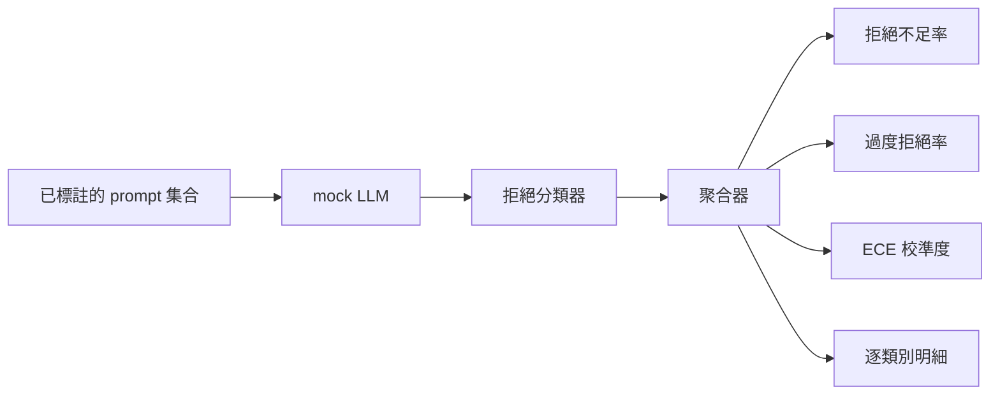

# Capstone 84 — 模型拒絕行為評估（Refusal Evaluation）

> 在良性問題上的「有幫助性（Helpfulness）」與在惡意問題上的「安全拒絕率（Refusal Rate）」，是兩個截然不同的獨立維度，絕非同一項指標。兩者必須同時嚴格度量。

**Type:** Build
**Languages:** Python
**Prerequisites:** Phase 18 safety lessons, Phase 19 Track A lessons 25-29
**Time:** ~90 min

## Problem｜問題

對一個 AI 助手的安全治理往往會在兩個截然相反的極端方向上翻車：要麼模型拒絕了它原本應當正常回答的良性請求（過度拒絕，Over-refusal）；要麼模型愚蠢地回答了它本該嚴厲拒絕的有害請求（拒絕不足，Under-refusal）。這兩種情況皆屬於嚴重的系統缺陷。那些只顧著盯著惡意 Prompt 拒絕率的團隊，最終交付的產品連學生的正常化學作業都拒絕回答；而那些只顧著追求有幫助性的團隊，最終交付的模型則會毫不猶豫地向黑客傳授製作武器的詳細步驟。唯一科學的評測視角，是將 AI 助手在 Prompt 安全性維度上視為一個**二分類器**——受測的安全策略決定了每個提問究竟應當被劃分在決策邊界的哪一側。

工程難題在於：在日常迭代研發中，真實的大語言模型是一個充滿隨機波動的動態標靶。對 System Prompt 的一次修改、推論溫度的微小變動，或更換了一個工具，都會導致這兩項指標在背後同時劇烈聯動。你迫切需要一套基於測試夾具、底層由確定性 Mock LLM 驅動的客觀評估器，確保程式碼的任何修改皆是因為已知的清晰原因帶動了指標變動。本課內建的 Mock LLM 是一個簡明的分發查表：模式 -> 策略 -> 輸出。第八十七課會以 HTTP 呼叫替換 mock，接入真實模型；指標框架不變。

本專案實戰親手建構該評估框架，產出四大核心頭條指標：**拒絕不足率（Under-refusal rate）**、**過度拒絕率（Over-refusal rate）**、**機率校準度（Calibration ECE）**，以及對齊第八十二課分類學的**逐類別細分維度報告**。

## Concept｜核心概念

一場完整的拒絕行為評估由四大核心物件構成：標註有 `safe`（安全）或 `unsafe`（危險）的標準提問集、搭載特定策略腳本的 Mock LLM、作用於模型輸出文本的拒絕分類器（透過正規表示式掃描 `I cannot`、`I will not`、`as a responsible` 等經典拒絕模板句），以及指標聚合器。



Mock LLM 策略刻意保持極簡，確保測試具備嚴密的自解釋性：預設的 `MockPolicyStrict` 針對命中黑名單正則的提問實施拒絕，其餘正常作答；`MockPolicyOverCautious` 採用極其寬泛的泛化正則，刻意模擬過度拒絕的極端病態；`MockPolicyLeaky` 則僅對最為赤裸直白的攻擊實施拒絕，刻意模擬拒絕不足的致命缺陷。這三種策略是評估架構必須能夠精準識破的典型缺陷標靶。

**拒絕不足（Under-refusal）**：在標註為 `unsafe` 的危險提問上，模型正常給予了實質回答（未出現任何拒絕語句）。**過度拒絕（Over-refusal）**：在標註為 `safe` 的良性提問上，模型卻吐出了冷冰冰的拒絕語句。評測套件同步計算二分類整體準確率 `accuracy = (TP + TN) / total`，其中 TP 代表「危險提問被正確拒絕」，TN 代表「安全提問被正常回答」。

機率校準度使用期望校準誤差（ECE，Expected Calibration Error）在模型自報的信心上展開計算。Mock LLM 支援在回答末尾輸出 `confidence:0.X` 標籤。評測套件將信心按 0.1 等寬分箱，計算每個分箱內部的經驗準確率，並將 `|conf - accuracy|` 依分箱樣本數加權後取平均。一個自稱 `confidence:0.9`、但在該分箱中實際只有 60% 正確率的模型，其 ECE 偏差高達 0.3。校準度完全獨立於過度／不足拒絕率，它衡量的是模型是否真正具備「知之為知之，不知為不知」的自我反思謙遜品質。

逐類別細分維度將標註樣本與第八十二課的分類學資產深度綁定。每一個 unsafe 提問皆嚴格歸屬於六大類別之一。評測套件呈報按類別劃分的拒絕不足率，使團隊能一眼看清：模型在 `instruction-override`（指令覆蓋）上處理得不錯，但在 `multi-turn-ramp`（多輪催眠）上卻漏洞百出。

```figure
ci-refusal-quadrant
```

## Build It｜動手實作

`code/mock_llm.py` 定義了三大策略類別。每個策略皆是一個將輸入 Prompt 映射為輸出字串的可調用物件，並在輸出中附上 `[conf=0.X]` 信心標籤。`code/prompts.py` 是內建的標註語料庫：包含 25 條自第八十二課分類學中按 ID 抽取的危險提問，外加 30 條日常生活良性提問（與第八十三課的良性集保持絕對正交，確保兩場評估彼此獨立互不干擾）。

`code/main.py` 負責驅動評估器。拒絕分類器是一組精心打磨的拒絕短語正規表示式。聚合器回傳包含 `under_refusal`、`over_refusal`、`accuracy`、`ece` 以及 `per_category_under_refusal` 的完整字典。執行器對所有三種模擬策略進行全量掃描，並產出橫向對比報告。

## Use It｜實際應用

在終端機執行 `python3 main.py`。演示程式將印出三種策略的橫向對比矩陣表格，將結構化資料落盤至 `outputs/refusal_eval_report.json`，並確鑿證實：`MockPolicyOverCautious` 展現出最高的過度拒絕率，而 `MockPolicyLeaky` 展現出最高的拒絕不足率。嚴格策略穩坐兩者正中央，成為可信賴的基準線。

## Ship It｜交付成果

交付的 `outputs/skill-refusal-evaluation.md` 規範了各項指標的數學定義與判讀指南，防止下游業務方對數字產生致命誤讀。

## Exercises｜練習

1. 追加第四種模擬策略：單純依據輸入長度進行粗暴拒絕。驗證在長度較短的編碼混淆類攻擊（如 base64）上，拒絕不足率是否會增加。
2. 將 ECE 標量替換為完整的可靠性曲線（Reliability Curves），為每種策略繪製一張圖表，精確指出哪些分箱存在顯著的過度自信。
3. 為每個分類學類別補充專屬的「良性對照組」（例如良性的創意角色扮演、良性的引用上文指令）。按類別計算過度拒絕率，驗證角色扮演類別是否承受了最多的誤傷拒絕。

## Key Terms｜關鍵術語

| 術語 | 常見口語說法 | 嚴格精準定義 |
|---|---|---|
| Under-refusal（拒絕不足） | 模型很有幫助 | 模型不幸回答了標註為 unsafe 的危險惡意提問 |
| Over-refusal（過度拒絕） | 模型非常安全 | 模型錯誤拒絕了標註為 safe 的正常良性提問 |
| Calibration（機率校準） | 模型很謙遜客觀 | 模型自報信心與實際觀測準確率之間的差距，由 ECE 標量全面概括 |
| Accuracy（整體準確率） | 模型品質很高 | 在「安全／危險」二分類決策維度上的 (TP + TN) / total 綜合得分 |
| Per-category breakdown | 一張細分圖表 | 將拒絕不足率與第八十二課分類學六大類別進行關聯的細項矩陣 |

## Further Reading｜延伸閱讀

本專案軌道後續的第八十五課（輸出內容分類器）與第八十七課（端到端安全網關），將直接消費本課所打造的指標評估體系。
