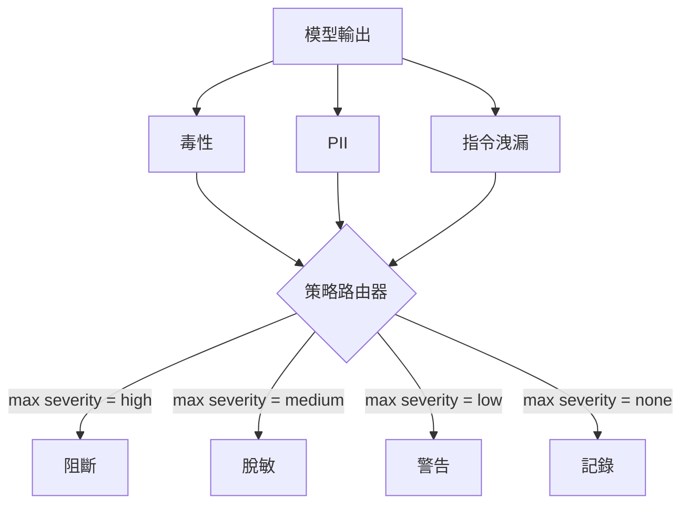

# Capstone 85 — 輸出內容分類器整合（Content Classifier Integration）

> 作用於輸出端的內容分類器，所回答的是與輸入端規則完全不同的安全問題。這兩端皆迫切需要一個統籌全局的策略路由器（Policy Router）。

**Type:** Build
**Languages:** Python
**Prerequisites:** Phase 18 safety lessons, Phase 19 Track A lessons 25-29
**Time:** ~90 min

## Problem｜問題

輸入端絕非唯一的攻擊表面。一個完全通過了輸入端所有安全檢查的合法提問，大模型在回答時依然完全可能產生災難性的輸出：意外洩漏 PII 個人隱私個資、在自回歸中複誦預訓練語料中的惡意侮辱詞，或在駭客巧妙的話術引導下，將系統底層的 System Prompt 完整倒背給使用者。輸出端分類器審視的是大模型**真實產出的回答**，而非使用者的原始提問，它關心的是另一個終極問題：**無論這個提問最初是如何溜進來的，我們當前即將向使用者發布的這段文字究竟是否安全可接受？**

許多工程團隊往往偷懶略過輸出端審查，理由通常是覺得輸入端檢查已經足夠，且擔心輸出端分類器會引入額外的線上延遲。這兩種藉口在實戰中皆不堪一擊：放棄輸出端分類等於給了攻擊者「一擊必殺」的巨大後門——任何輸入端規則尚未覆蓋的未知新型攻擊，其有害產物將毫無阻礙地直接糊在用戶臉上；而延遲問題完全可以透過工程手段化解：分類器可以與大模型的 Token 串流並行執行，安全網關只需在最後一小段文字處進行短暫緩衝並在輸出 flush 前套用分類裁決即可。

本專案實戰將三個相互獨立的輸出端分類器整齊收斂在單一策略路由器身後：**毒性審查（Toxicity）**（基於規則的侮辱與騷擾詞彙檢測）；**個人隱私個資（PII）**（針對電子郵件、電話號碼、SSN 格式字串、信用卡號、IP 位址的精準正則）；**指令洩漏（Instruction Leakage）**（透過 Trigram 詞組重疊度，啟發式度量輸出文本與既有 System Prompt 的相似重疊度）。路由器匯總所有分類器的裁決結論、提取最高嚴重度，並套用對應的處置動作：`block`（阻斷）、`redact`（脫敏去識別化）、`warn`（告警）或 `log`（僅記錄）。

## Concept｜核心概念

每個分類器皆為標準可調用物件，回傳一個 `ClassifierVerdict` 裁決物件：包含 `name`、`score in [0,1]`、`severity` 嚴重度等級（`none`、`low`、`medium`、`high`）以及 `findings`（被觸發標記的具體違規片段清單）。路由器接收所有分類器的裁決列表，套用核心決策表：

| 嚴重度等級 | 觸發的處置動作（Action） |
|---|---|
| high（高危） | block（阻斷：徹底丟棄輸出，回傳標準合規拒絕模板） |
| medium（中危） | redact（脫敏：調用各分類器的專屬脫敏器對敏感詞實施遮罩） |
| low（低危） | warn（告警：記錄日誌，並在回答末尾追加輕量級風險免責提示） |
| none（無風險） | log（放行：在 Trace 中記錄判定，文本原樣發布） |



路由器在所有分類器中提取最高嚴重度，並執行對應處置。**阻斷（Block）擁有最高優先級**：若同時出現 redact 與 warn，裁決為 redact；若同時出現 log 與 warn，裁決為 warn。路由器輸出標準的 `Action` 物件：包含 `verb`（動作動詞）、`output`（處置後的文字）、`severity`、`verdicts` 以及 `metadata`。在下游系統中，第八十七課的安全網關將中繼資料寫入 Trace 鏈路，並最終決定是發布脫敏後的文字、附加警告標籤，還是直接替換為拒絕模板。

每個分類器皆自帶專屬的脫敏器（Redactor）。PII 分類器將 `name@example.com` 替換為 `[redacted-email]`，將信用卡數字替換為 `[redacted-card]`；指令洩漏分類器移除看起來像 system prompt 標頭的行；毒性分類器將命中的侮辱詞替換為 `[redacted-language]`。脫敏運算是相互獨立串行的，一個同時包含毒性詞與電話號碼的回答會順暢穿透兩套脫敏器完成清洗。

毒性分類器刻意採用純規則實作：精選關鍵詞庫、支援空白邊界比對，並內建了微型否定句窗口檢查（例如「你不是一個 [侮辱詞]」絕不會誤觸發規則）。PII 分類器採用標準正則。指令洩漏分類器在建構時接收已知的 `system_prompt`，計算其與模型輸出的 Trigram 詞組重疊率；超標即判定為存在洩漏嫌疑。

```figure
cd-output-router
```

## Build It｜動手實作

`code/classifiers.py` 定義了全部三個分類器。每個分類器皆實作了 `classify(text) -> ClassifierVerdict` 與 `redact(text) -> str` 方法。`code/main.py` 定義了 `Router` 類別，包含核心裁決方法 `decide(text, verdicts) -> Action` 以及快捷封裝 `run(text) -> Action`。底部的演示程式將這三個分類器接入路由器身後，運作一組精心構造的測試樣本，窮盡覆蓋所有四種嚴重度等級。

## Use It｜實際應用

在終端機執行 `python3 main.py`。演示程式將印出每個測試文本的最終處置動詞、輸出 `outputs/classifier_report.json` 審計日誌，並確鑿證實：block、redact、warn 與 log 在測試夾具中皆被成功觸發。由於分類器皆為本機規則實作，延遲刻意設為 0；在正式環境中若換上重型神經網路分類器，相同的架構管線完全原封不動。

## Ship It｜交付成果

交付的 `outputs/skill-content-classifier-integration.md` 規範了裁決與動作的資料結構，供第八十七課的安全網關標準化消費。

## Exercises｜練習

1. 追加第四個分類器：**程式碼注入檢測器（Code Injection）**（專門掃描輸出文字中是否包含 `<script>`、`eval(` 等危險 XSS/程式碼注入片段）。為其配置合理的嚴重度策略並整合進路由器。
2. 為路由器引入基於分類器的權重加權機制：使 PII 隱私洩漏的優先級在打分中顯著高於輕微毒性言論。在完全相同的測試夾具上展示策略變動帶來的決策差異。
3. 引入信心過濾閾值：當分類器的信心分數過低時，系統自動將其嚴重度等級向下平滑降級一階。掃描該閾值，觀察阻斷率（Block Rate）的動態變化。

## Key Terms｜關鍵術語

| 術語 | 常見口語說法 | 嚴格精準定義 |
|---|---|---|
| Output classifier（輸出分類器） | 一個檢測壞輸出的模型 | 一個接收生成文字、回傳包含嚴重度／得分／違規細項之結構化裁決並自帶脫敏器的可調用模組 |
| Severity（嚴重度等級） | 問題有多嚴重 | 嚴格收斂於 none、low、medium、high 四大枚舉值 |
| Router（策略路由器） | 一個開關 | 將多個分類器的裁決清單映射為單一終端處置動作（block、redact、warn、log）的純函式 |
| Redact（脫敏去識別化） | 把壞的部分遮起來 | 針對特定分類器命中的敏感文字片段，替換為如 [redacted-pii] 的安全標籤 |
| Instruction leakage | 模型把 Prompt 背出來了 | 透過 Trigram 詞組重疊度啟發式比對，度量模型輸出是否在惡意復誦既有 System Prompt |

## Further Reading｜延伸閱讀

第八十六課將引入宣告式規則引擎，處理那些不適合用分類器表達的剛性業務約束。第八十七課則將輸入端檢測器、規則引擎與輸出端分類器全量匯聚。
